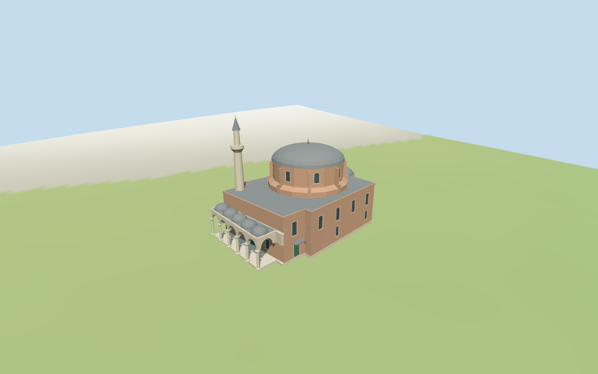

# Little Hagia Sophia

Individual medium-fi Little Hagia Sophia exterior: mixed brick/stone low body and projecting eastern apse, raised buttressed brick drum, shallow grey lead central dome, western five-bay round-arched open portico with five small roof domes, pale single-balcony minaret and green side door. Exact main outline retained; all internal partitions, heights, roof plans and tower position are estimates. Six existing shared 256² graphs, seven merged roles and four budgeted browser LODs. Separate tomb, cemetery, school, city, fine ornament and furnished interiors remain outside this asset.

## Evidence and reconstruction

Published dimensions and reconstructed details are separated in spec.json. Primary references:

- [Reference](https://commons.wikimedia.org/wiki/File:Istanbul_Little_Hagia_Sophia_exterior_in_2006_3295.jpg)
- [Reference](https://commons.wikimedia.org/wiki/File:Istanbul_Little_Hagia_Sophia_exterior_in_2009_5737.jpg)

Six existing shared 256² longformat brick, dry stone, continuous limestone, standing-seam metal, plain wood and cast bronze graphs serve seven merged roles including local opaque blue-grey fields. Metric UVs, linear tints and zero embedded images. No unique facade texture, copied photography, inscriptions, grille artwork or baked lighting.

## Model and axes

6,373 triangles; 19,119 vertices; 7 material groups; 769,016 bytes. Native bounds: -23.268, -0.957, -14.401 to 22.973, 32.290, 14.427. Source hash: `sha256:46ae8fea848388e5d8394131501d7bace65a4b8b3673d9e5d4179b22d048613d`.

{"x":"east-southeast apse","y":"up","z":"south-southwest side wall"}

Normal viewer DEM datum 10.356790680811036 m; working floor 0.2904746249239 m is the median of 53 outside-perimeter samples at 1 m offset plus 0.3 m. 121 raw footprint samples span -0.5223464068367267..0.3601771433511285 m. Adaptive footings follow the exact outline. Preview terrain seats the footprint and 1.5 m margin; model paving covers the raw ground cutout and supports the open portico. Exact porch steps, thresholds, court paving, wall/cemetery grades and present terrain joins remain unverified.

## Reproduce

Run `node packages/worldgen/scripts/generate-additional-landmarks.mjs --ids=little_hagia_sophia` (or add `--check`). The generator preserves manually edited masters by checking their baseline hashes. Import through the standard authored-model workflow with optimization disabled; then capture all QA cameras, including shared-surface views.

## Pending work

- Retained exact way 303179753 / Q1144576 is current viewer building 35184675268585. Its 16 current outer vertices, original anchor and heading remain fixed. Positive X points approximately east-southeast toward the apse; negative X toward the west-northwest entrance/portico. Positive Z is approximately south-southwest. A western five-bay portico is divided at estimated local X=-17; this is an architectural partition within the raw main footprint, not independent map data. The raised central drum/dome is centered near [3.5,0.1], with the single minaret near the northwest narthex corner [-13,-9.8]. Main roof divisions, portico bay positions, minaret plan and detailed side/rear openings are picture estimates. Current/retained heights and independent roof/tower controls are absent. Separate round building 35184902709509 north of the mosque, cemetery, court, schools and city remain host content.
- No retained or current map height values exist. Visualization estimates: main eaves 11.8 m; raised sixteen-sided brick drum/buttresses from 12–19.2 m; shallow lead-covered central dome 19.2–23.4 m and finial 24.8 m. Portico capitals 4.9 m, round arches to 6.8 m, roof/cornice 7.8 m and five small shallow domes to about 9.4 m. Single minaret: square base 7 m, tapering pale shaft to 23 m, projecting balcony around 23–24.2 m, smaller upper shaft to 28 m, conical lead cap to 31.4 m and finial 32 m. All these vertical dimensions, roof profiles, small finials, window rhythms and the exact tower origin are explicit picture-led approximations, not surveyed facts. Fine stone capitals, historic brick lattice, calligraphy and unseen interiors omitted.
- Normal viewer DEM datum 10.356790680811036 m; working floor 0.2904746249239 m is the median of 53 outside-perimeter samples at 1 m offset plus 0.3 m. 121 raw footprint samples span -0.5223464068367267..0.3601771433511285 m. Adaptive footings follow the exact outline. Preview terrain seats the footprint and 1.5 m margin; model paving covers the raw ground cutout and supports the open portico. Exact porch steps, thresholds, court paving, wall/cemetery grades and present terrain joins remain unverified.
- Individual mosque exterior; separate round tomb and cemetery remain host content. Exact main outline and original anchor/heading retained, with estimated western portico partition, central roof plan and tower position. All heights, detailed roof subdivisions, shallow apse cap, facade bay rhythm, minaret/balcony and finials are picture-led estimates. Round arcade openings lead to a shallow exterior porch with a closed church wall/door behind; no furnished-interior/free-walking claim. Fine historic capitals, brick lattice, calligraphy, window grilles, exact roof ribs, current finish, steps/paving and physical-device timings remain unverified.

This bundle follows the medium-fi standard. Medium-fi appearance and geographic fit are reviewed separately. Hash-bound visual acceptance is recorded separately after capture inspection.

## Additional geographic data

©OpenStreetMap contributors; Protomaps; Mapzen/USGS terrain tiles.
