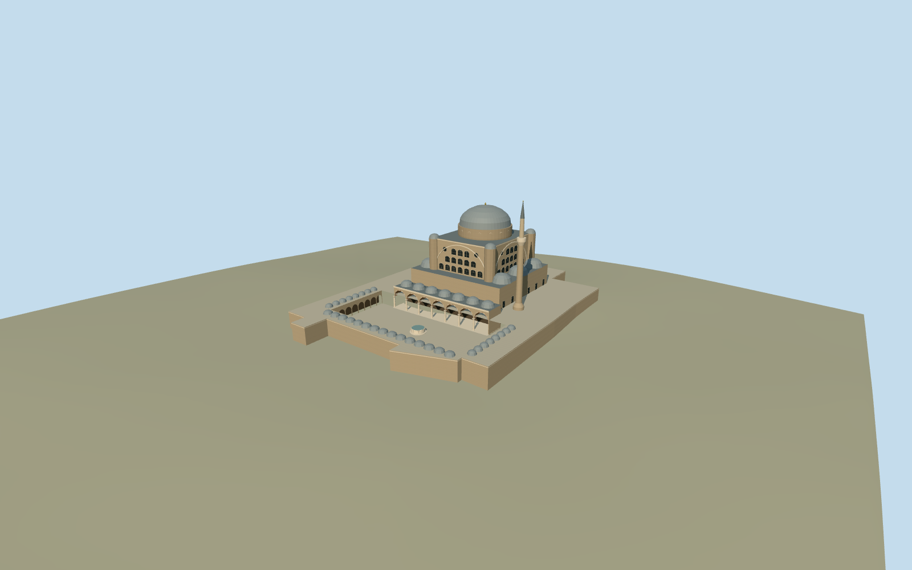

# Mihrimah Sultan Mosque, Edirnekapı

The Edirnekapı Mihrimah Sultan Mosque, with seven marble porch bays, a windowed dome, tall single minaret and enclosed madrasa court.

Authoring state: **review-in-qa.json**. Current completion evidence is in [qa.json](qa.json) and the [completion ledger](../../../../qualla-structures/batches/qualla-003.PROGRESS.md).

- [Mihrimah Sultan Mosque, Edirnekapi](https://qualla.com/mihrimah-sultan-mosque-edirnekap/)

The surviving restored silhouette uses the documented single slender minaret. Its height, rear roof lines, lead roofing tones, window lattices and courtyard paving are approximations derived from the published references.

The model follows the named mosque compound. The distinct hammam, historic city wall, interiors and surrounding independent buildings are outside its footprint.

Build: `node content/worldgen/source/places/sx/sxk/mihrimah_sultan_mosque_edirnekap/models/generate-mihrimah-sultan-mosque-edirnekap.mjs`. Add `--check` to verify exact regeneration. 20158 triangles; 7 materials; no embedded photographs.
