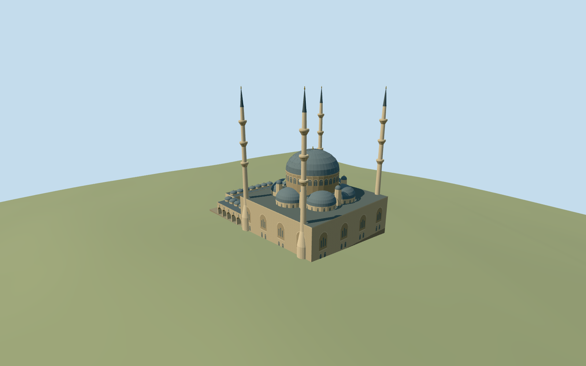

# Mimar Sinan Mosque

Ataşehir’s Mimar Sinan Mosque, with a large grey-blue dome, six surrounding half domes, an open arcade court and four three-balcony minarets.

Authoring state: **review-in-qa.json**. Current completion evidence is in [qa.json](qa.json) and the [completion ledger](../../../../qualla-structures/batches/qualla-003.PROGRESS.md).

- [Mimar Sinan Mosque](https://qualla.com/mimar-sinan-mosque/)

The 42 m central dome height, 27 m diameter, four 72 m minarets and their three balconies follow the documented 2012 proportions. The surrounding six half domes and upper mosque piers follow the architect’s description.

The outer mosque and open-court lines are mapped. Individual turret footings, dome seams, far-side façade motifs and courtyard trim are estimated. The unrelated Uphill Court apartments in the photograph belong to the normal Earth context.

The review uses the original terraced terrain for the exterior. The below-grade parking and service rooms and the interior are outside the model scope.

Build: `node content/worldgen/source/places/sx/sxk/mimar_sinan_mosque/models/generate-mimar-sinan-mosque.mjs`. Add `--check` to verify exact regeneration. 28704 triangles; 6 materials; no embedded photographs.
