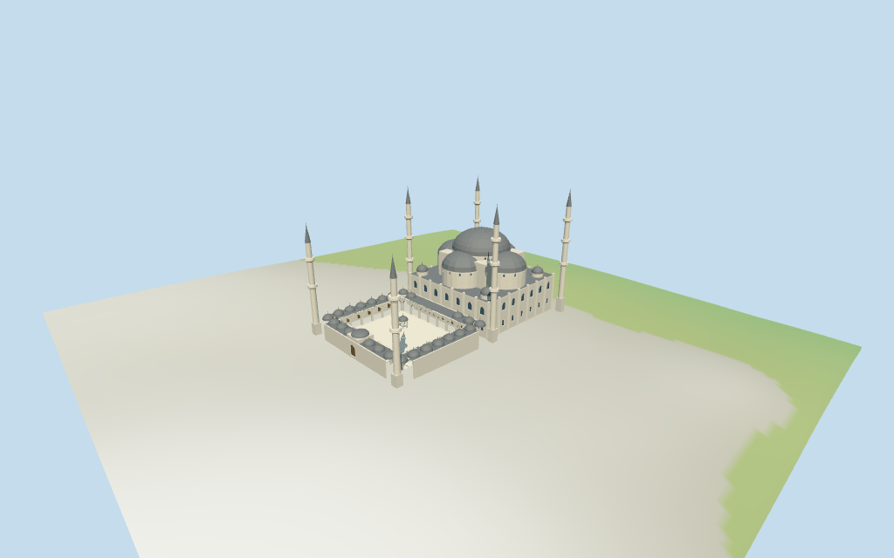

# Sultan Ahmed Mosque

Individual medium-fi Blue Mosque:central lead-grey dome,four semidomes/small corner domes,stepped stone mass and six separately mapped pencil minarets with three/two balconies,open northwest court and domed pointed arcades,raised portals and six-sided domed fountain. Five existing shared256² graphs and four browser LODs. Plan controls exact to retained PMTiles;roof heights and architectural detail picture estimates,exact terrain joins/current finish unverified.

## Evidence and reconstruction

Published dimensions and reconstructed details are separated in spec.json. Primary references:

- [Reference](https://commons.wikimedia.org/wiki/File:Blue_mosque_exterior_istanbul_(14269684836).jpg)
- [Reference](https://commons.wikimedia.org/wiki/File:Courtyard_of_Sultan_Ahmed_I_Mosque.jpg)
- [Reference](https://commons.wikimedia.org/wiki/File:Fatihistanbul.jpg)

Five existing shared256² limestone,raw limestone,standing-seam metal,plain wood and bronze graphs;six merged groups including local glazing. Standing seam abstracts lead roofs. Linear tints,metric UVs and faceted architecture;zero embedded images,bespoke facade bitmaps,baked lighting or invented inscriptions.

## Model and axes

29,971 triangles; 89,913 vertices; 6 material groups; 3,600,320 bytes. Native bounds: -58.593, -1.595, -34.069 to 57.588, 65.349, 33.528. Source hash: `sha256:5f95307bdc0f625f58d5f0ded32e1fcedefd74ef53bb9f3f4a2a170f003ac338`.

{"x":"southeast toward prayer hall and mihrab","y":"up","z":"southwest toward Hippodrome"}

Standard viewer DEM reused from the nearby Istanbul extractN0411;datum38.472520m. Whole perimeter-1.25 to1.00m relative to it. Floor1.349m is maximum whole-perimeter sample plus0.35m,an approximate raised attachment plane. Adaptive stone footings crossY=0 and extend below retained terrain. Exact thresholds,stairs,outer paving,street/court/base contact,altitude and walking remain unverified. No flattening,ground cutout or road replacement;raw DEM retained.

## Reproduce

Run `node packages/worldgen/scripts/generate-additional-landmarks.mjs --ids=N0414` (or add `--check`). The generator preserves manually edited masters by checking their baseline hashes. Import through the standard authored-model workflow with optimization disabled; then capture all QA cameras, including shared-surface views.

## Pending work

- Retained exact relation/18055570 /Q80541 and current PMTiles whole52776576188818 identify Sultan Ahmed Mosque (Blue Mosque),Istanbul. Whole,courtyard void,all selected roof/gallery/minaret parts and six fountain layers retain raw plan points/properties. Anchor[28.976654159,41.005406915] and heading−0.764606278692rad unchanged,no horizontal rescale. Native+X southeast prayer hall/mihrab,−X northwest open courtyard,+Z southwest Hippodrome side. Three inspected pictures resolve signed facing with approximate3° uncertainty. Separate Hagia Sophia,mausoleum,park/outer enclosure and nearby buildings remain host content.
- Four hall minarets64m and two court minarets54m use nominal current map tags. Main 66.5m estimate and unsourced Wikidata64m/65m/82m are consistency hints. Several layered roof parts tag30–62m with min_height30/40/52m,which conflict with the photographed dome-to-minaret proportions;retained verbatim but not treated as surveyed roof elevations. Picture-led above-floor estimates:hall walls17.5m,semidome drums24–26m/roofs34m,main drum30.5–32.5m/dome43m/finial45m,small corner roofs22m,court arcade7.6m/small domes10m/raised portals11m and fountain7m. Court dome tags5–6.5m likewise do not establish each gallery roof elevation. Profiles,openings,ornament,current finish and exact levels unverified.
- Standard viewer DEM reused from the nearby Istanbul extractN0411;datum38.472520m. Whole perimeter-1.25 to1.00m relative to it. Floor1.349m is maximum whole-perimeter sample plus0.35m,an approximate raised attachment plane. Adaptive stone footings crossY=0 and extend below retained terrain. Exact thresholds,stairs,outer paving,street/court/base contact,altitude and walking remain unverified. No flattening,ground cutout or road replacement;raw DEM retained.
- Medium-fi exterior reconstructed from three inspected pictures and standard PMTiles/DEM. Four-way dome cascade,six minarets/open court and gallery/fountain silhouette are individually authored. Roof elevations are picture estimates because layered map tags conflict with visible proportions;all tags retained. Open court arcades and fountain arches in district/street/close-up;skyline keeps open court with fewer square posts and coarser domes. Shallow facade recesses and simplified doors/lattice stand for exterior openings only;no prayer-hall interior or free traversal claim. Fine carved muqarnas,calligraphy,leaded art,tiled interior,engineering,current finish and exact site joins excluded or unverified. Separate mausoleum,outer enclosure/park,Hagia Sophia and other city buildings remain host content. Synthetic neighborhood context and physical-device timing unverified.

This bundle follows the medium-fi standard. Medium-fi appearance and geographic fit are reviewed separately. Hash-bound visual acceptance is recorded separately after capture inspection.

## Additional geographic data

©OpenStreetMap contributors;Protomaps;Mapzen/USGS terrain tiles.
