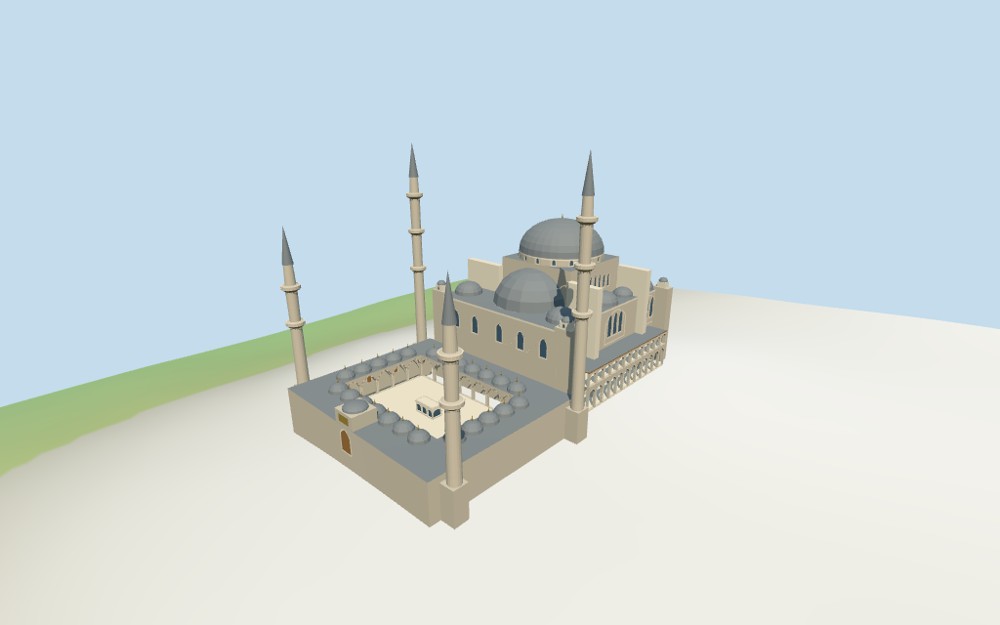

# Süleymaniye Mosque

Individual medium-fi Süleymaniye Mosque:dominant central dome and opposed longitudinal semi-domes,stepped buttressed prayer-hall silhouette,two tall three-balcony and two shorter two-balcony minarets,open rectangular court with low domed pointed arcades/raised northwest portal,rectangular grille-fronted marble fountain and two-tier external side galleries. Five existing shared256² materials,six merged groups,four browser levels. Exact retained whole/dome/minaret plans;nominal heights and picture-estimated exterior partitions/current finish/site joins remain explicit.

## Evidence and reconstruction

Published dimensions and reconstructed details are separated in spec.json. Primary references:

- [Reference](https://commons.wikimedia.org/wiki/File:Courtyard_of_the_Süleymaniye_Mosque_in_Istanbul,_Turkey_001.jpg)
- [Reference](https://commons.wikimedia.org/wiki/File:Exterior_of_the_Süleymaniye_Mosque-.jpg)
- [Reference](https://commons.wikimedia.org/wiki/File:Exterior_of_the_Süleymaniye_Mosque_in_Istanbul,_Turkey_002.jpg)

Five existing shared256² limestone,raw limestone,standing-seam metal,plain wood and bronze graphs;six groups including local glazing. Standing-seam abstracts lead roofing. Linear tints,metric UVs and faceted architecture;zero embedded images,unique facade bitmaps,baked lighting or invented inscriptions.

## Model and axes

40,950 triangles; 122,850 vertices; 6 material groups; 4,917,808 bytes. Native bounds: -57.135, -4.100, -37.335 to 57.300, 81.155, 37.545. Source hash: `sha256:e8f3b2a0d2efb3dc36c7ebeeea1b4aa47f364380d811616b14ad8705a09692b7`.

{"x":"southeast prayer hall/mihrab","y":"up","z":"southwest side gallery"}

Standard viewer DEM datum57.901142m;whole perimeter-3.80 to4.85m relative to datum. Floor5.155m is maximum retained perimeter/interior-grid sample plus0.30m. Adaptive stone footings crossY=0 and extend below retained ground. This is an approximate attachment plane;coarse terrain may expose tall footings. No cutout,flattening or road replacement. Exact door/step/court/garden/street/base contact,altitude and walking remain unverified.

## Reproduce

Run `node packages/worldgen/scripts/generate-additional-landmarks.mjs --ids=N0418` (or add `--check`). The generator preserves manually edited masters by checking their baseline hashes. Import through the standard authored-model workflow with optimization disabled; then capture all QA cameras, including shared-surface views.

## Pending work

- Retained exact relation/1564032 /Q178643 identifies Istanbul Süleymaniye Mosque. Current whole52776559697280 (3×2^44+1564032),dome and four separate minaret base/shaft pairs match its retained plan. Ten controls with current raw polygons/properties retained;the mapped courtyard hole remains open above modeled paving. Anchor[28.963824495,41.016240297] and heading−0.834335421047rad unchanged,no horizontal rescale. Native+X southeast prayer hall/mihrab,−X northwest courtyard entrance,+Z southwest,−Z northeast side gallery. Pictures resolve the signed axis with about3° working facing uncertainty. Surrounding madrasas,tombs,Sinan mausoleum,outer garden/walls,streets and city buildings remain separate host content.
- Retained Wikidata53m height has no linked reference URL;current central dome53m and all four minaret55m map tags are nominal. Pictures clearly show two taller three-balcony hall-side towers and two shorter two-balcony courtyard-side towers. Short towers use55m nominal;hall-side76m is a picture-led working estimate rather than silently repeating all four55m tags. Main dome/drum finishes at53m including finial,body26m,central support38.5m/drum41m,opposed semi-domes26–37m,side caps25–30m,court arcade7.8m/domes10.3m and raised portal13.5m are estimated exterior partitions. Side galleries,bays,roof joints,window/door/capital/balcony profiles and unseen faces are picture estimates,not a surveyed model.
- Standard viewer DEM datum57.901142m;whole perimeter-3.80 to4.85m relative to datum. Floor5.155m is maximum retained perimeter/interior-grid sample plus0.30m. Adaptive stone footings crossY=0 and extend below retained ground. This is an approximate attachment plane;coarse terrain may expose tall footings. No cutout,flattening or road replacement. Exact door/step/court/garden/street/base contact,altitude and walking remain unverified.
- Individual medium-fi exterior from three actually inspected2012/2023 courtyard/exterior photographs and standard viewer PMTiles/DEM. Dominant central dome,two opposed semi-domes,four minarets with different height/balcony counts,domed pointed court arcades/raised northwest gate,rectangular grille-fronted fountain and two-tier side galleries. Fine carved muqarnas,calligraphy,leaded/glazed lattice patterns,clock/tap fixtures,interior,engineering,current finish and exact site joins excluded or unverified. Simplified side arch/roof partitions and unseen faces estimated. Main hall fields close shallow recesses;court and side galleries have open exterior voids,no prayer-hall interior/free traversal claim. Separate tombs,madrasas,outer garden/walls,Sinan mausoleum,streets and other complex/city content excluded. Synthetic context and physical-device timing unverified.

This bundle follows the medium-fi standard. Medium-fi appearance and geographic fit are reviewed separately. Hash-bound visual acceptance is recorded separately after capture inspection.

## Additional geographic data

©OpenStreetMap contributors;Protomaps;Mapzen/USGS terrain tiles.
