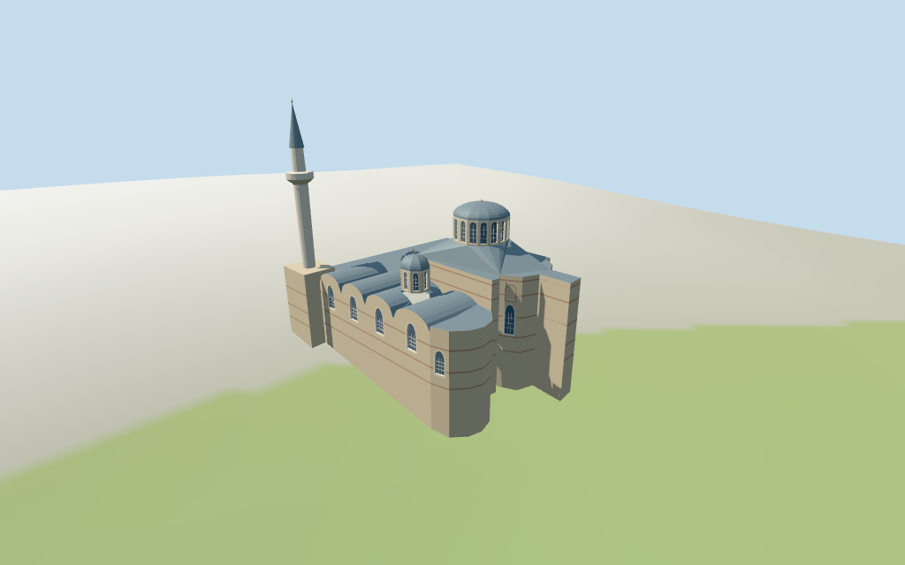

# Chora Church

Individual medium-fi Chora Church/Kariye Mosque exterior:asymmetric mapped shell,east polygonal apses/buttress,four mapped windowed domes with shallow grey lead-like caps,curved chapel gables,selected arched glazing/blind fields,pale coursed masonry/brick bands and southwest cylindrical minaret/balcony/cone. Six existing shared graphs,eight merged material roles,four authored browser levels. Circular map roof boundaries are capped by domes rather than drawn as courtyards. Heights and unseen western/northern/roof fabric remain estimates;no copied mosaics or navigable interiors.

## Evidence and reconstruction

Published dimensions and reconstructed details are separated in spec.json. Primary references:

- [Reference](https://commons.wikimedia.org/wiki/File:Chora_Church_exterior_16-06-2024_01.jpg)
- [Reference](https://commons.wikimedia.org/wiki/File:Chora_Church_exterior_16-06-2024_02.jpg)
- [Reference](https://commons.wikimedia.org/wiki/File:Chora_Church_exterior_16-06-2024_03.jpg)

Six existing shared256² limestone,brick,standing-seam metal,lime plaster,plain wood and bronze graphs. Eight merged material groups with metric UVs/linear tints;local blue-grey glazing. Pale masonry and original brick/arch bands abstract the pictured fabric. No embedded images,unique texture atlas,baked light,photographic art or copied mosaics.

## Model and axes

11,575 triangles; 34,725 vertices; 8 material groups; 1,393,696 bytes. Native bounds: -18.308, -2.741, -16.324 to 18.337, 34.649, 16.331. Source hash: `sha256:b92bfa71c8271c8bbe770eebfc4104eeb26dba2e84c87ca7921d11ca4a2ae907`.

{"x":"positive toward mapped eastern apses","y":"up","z":"positive toward chapel/south side;minaret at negativeX/positiveZ"}

Standard viewer DEM datum 61.491654 m;working floor 2.949098 m from maximum whole-footprint1 m bilinear sample plus0.25 m. Relative sample range -2.391..2.699 m. Terrain is unflattened;wall footings adapt below it and cross Y=0. Precise terraces,thresholds,ground joins and walking remain unverified.

## Reproduce

Run `node packages/worldgen/scripts/generate-additional-landmarks.mjs --ids=N0439` (or add `--check`). The generator preserves manually edited masters by checking their baseline hashes. Import through the standard authored-model workflow with optimization disabled; then capture all QA cameras, including shared-surface views.

## Pending work

- Retained exact relation/7614527 / Q849489 matches current whole52776565747775 (3*2^44+7614527) and named The Chora/Kariye Camii POI. Original anchor[28.939057828,41.031194722] and heading-0.254041634454 rad retained. Current26-point outer shell,four circular roof boundaries (8/8/8/16 points) and the separate four-point southwest minaret-base part are preserved. These circular boundaries are interpreted as mapped domed roofs,not open courtyards;source retains their original geometry. Apses project toward positiveX/east-northeast;the minaret occupies the mapped negativeX/positiveZ southwest corner. The asymmetric plan and southeast-side pictures support this assignment within about15 degrees of visual uncertainty,not a surveyed facade bearing. Exact doorway position and unseen western/northern fabric remain approximate.
- No retained height/width/length fact or current height/min_height tag. Visualization estimates:low fabric7.2 m,main raised shell11.4 m/main drum14..17.3 m/lead crown19 m/finial19.4 m;chapel roof up to9.2 m/drum9.4..12.2 m/crown13.8 m;two narthex drum crowns11/11.3 m;minaret base9 m/balcony22.4 m/cone31.1 m/tip31.7 m. Approximate uncertainty±3 m. Four mapped roof boundaries control the domes horizontally;relative masses,pale masonry/brick bands,grey caps and window rhythm follow three inspected2024 pictures. Unseen roofs,facade subdivisions and exact current finish remain approximate.
- Standard viewer DEM datum 61.491654 m;working floor 2.949098 m from maximum whole-footprint1 m bilinear sample plus0.25 m. Relative sample range -2.391..2.699 m. Terrain is unflattened;wall footings adapt below it and cross Y=0. Precise terraces,thresholds,ground joins and walking remain unverified.
- Individual medium-fi exterior. Four circular map roof boundaries are interpreted as domed roofs;no open courtyard or interior is invented. Main apse/buttress and chapel gables follow the asymmetric map and three southeast/east pictures. Western entrance/northern facade,roof subdivisions,exact stone/brick counts,window layouts,current finish and heights remain estimates. Windows/blind fields close on shallow backing. No navigable interiors,mosaics,terrace/doorway engineering or walking verification. Thin frame/brick bands disappear at distance;skyline retains four domes,eastern apse/buttress and southwest minaret. Physical-device timing remains unverified.

This bundle follows the medium-fi standard. Medium-fi appearance and geographic fit are reviewed separately. Hash-bound visual acceptance is recorded separately after capture inspection.

## Additional geographic data

©OpenStreetMap contributors;Protomaps;Mapzen/USGS terrain tiles.
