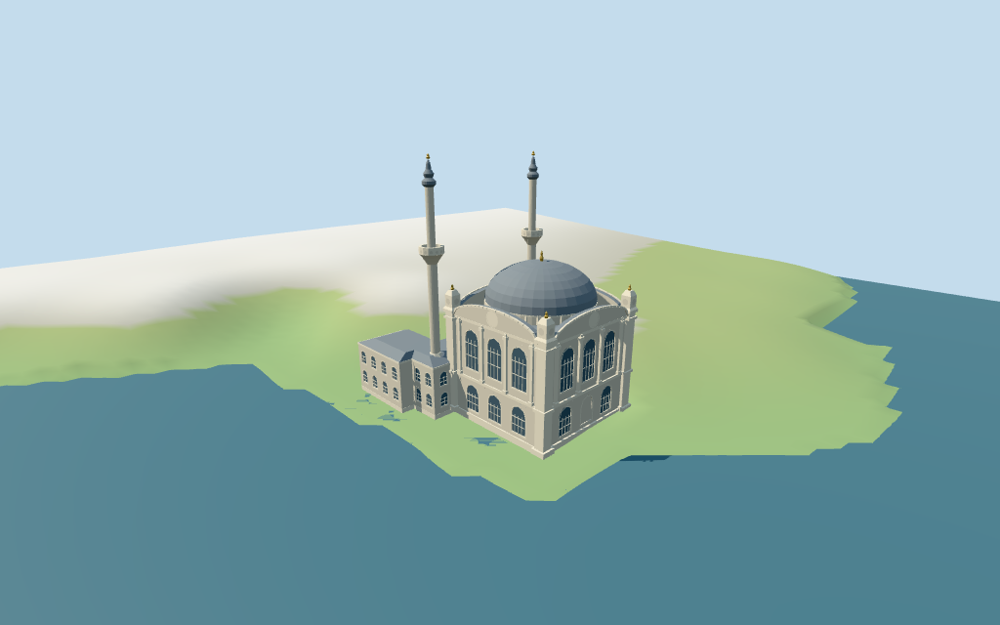

# N0452 — Ortaköy Mosque

Reviewed 2026-10-17 for the stated medium-fi exterior and approximate map fit. All vertical dimensions, subdivisions, ornament, current finish and precise ground/water joins remain limited.

## Exterior and shared materials

Inspected all 11 current portable frames, including the 1024×640 summary: square waterfront prayer hall, three upper arched windows on each exposed facade, lower windows and a blind central sea-facing niche, curved pediments, stepped corner pilasters with round medallion pinnacles, shallow grey dome and gold finials, twin single-balcony minarets and U-shaped lower entrance wings. The pink courtyard has three upper transoms and three lower door/screen bays. Fine stone carving, calligraphy, precise grilles, temporary banners and unseen interiors remain omitted.

Inspected all 11 shared/geographic-flat views. Six existing 256² graphs provide coursed and continuous limestone, lime plaster, standing-seam metal, cast bronze and plain wood; opaque blue-grey glazing is local palette. Seven merged roles use metric UVs and linear tints. No embedded images or unique facade atlas. Every graph is read once; eviction leaves zero live model geometries. The north-up overlay retains the mapped outline and heading. Flat shared captures omit water, while terrain captures use a separate review water fixture.

## Browser levels

| Level | Triangles | Bytes | Draws |
| --- | ---: | ---: | ---: |
| skyline | 787 | 81756 | 1 |
| district | 2597 | 238784 | 7 |
| street | 13054 | 1197148 | 7 |
| closeup | 17908 | 1671000 | 7 |

**320,540 bytes for initial skyline plus district**, plus shared textures. Six shared 256² graphs, seven roles, zero embedded images.

Inspected all 27 current medium-fi frames: Economy and High, noon and late light, street/block/skyline distances, untextured silhouette, six details, four matched LODs and four transitions. Also inspected the matched skyline at full size. Skyline 787 retains the twin single-balcony minarets, shallow grey dome, curved pediments and U-shaped lower wings; district 2597 adds arched window rhythm, street 13054 adds recesses, trim and medallions, closeup 17908 refines curves and selected relief. Initial skyline plus district is 320540 bytes plus shared textures, at one/seven draws. District panes were moved outward to correct two hidden northeast panes before final captures. LOD switches visibly add windows, gold details and finer curves. Synthetic Mediterranean neighbors and the coarse, pixelated shore are review fixtures. Physical laptop and phone measurements remain pending.

## Placement and scope

Retained exact way498861735 /Q176380 is current standard viewer building35184870950567. All16 current raw outline vertices/properties and original anchor/heading are retained;current tile tags omit the QID. PositiveX SE toward the Bosphorus-facing square prayer hall;negativeX NW toward the U-shaped entrance wings;positiveZ SW toward the public pier square. Picture interpretation resolves the previously undirected axis without a180-degree flip or horizontal rescale. The coastal water polygons remain separate standard-map controls,not new building/parcel evidence. Standard viewer DEM datum0.3745512807612056m;floor0.3428171866021358m is median of94 outside-perimeter samples every2m at1m offset plus0.25m. 239 raw footprint samples range-0.3745512807612056..3.5934048946384536m,including coarse hillside rise behind the entrance. Source foundation follows the retained perimeter;preview terrain seats the footprint and a1.5m perimeter margin. Sea preview uses the viewer zero-meter sea datum,relative-0.3745512807612056m;only the selected coast water is lowered. The water plane is a preview fixture absent from the runtime GLB. Exact quay,pier,courtyard,stairs,tide and terrain joins remain unverified. Independently reunited all 16 raw mosque outline vertices and properties, and matched the selected coast-water geometry and properties to the current viewer tile. Water feature ID1 is a tile identifier, not a claimed OSM way identity. All 2706 renderer footprint checks pass across six files: selected mosque replacement and 450 exterior host buildings retained. Reproduced 239 footprint samples, 94 outside-perimeter samples, median floor plus 0.25m, 148 seated preview points and 4669 lowered water points. Runtime geometry contains no terrain or water. Exact quay, courtyard paving, piers, steps, tide and ground/water joins remain unverified.

Individual medium-fi Ortaköy Mosque: mapped waterfront prayer-hall/entrance-wing outline,three-bay arched facade tiers,curved lead pediments,stepped pilasters and medallion corner pinnacles,shallow grey dome/gold finial,two single-balcony minarets,lower pale stone wings and pink entry courtyard with three transoms/doors. All vertical dimensions,partitions,window/trim details,ornament and exact shore/ground joins are estimates. Six existing shared256² graphs,seven merged roles,four browser LODs. Fine artwork,calligraphy and unseen interiors omitted. No retained height/width/length facts are linked for this candidate. All vertical dimensions and subdivisions are picture estimates:main hall17.8m,curved pediment crown20.8m,dome base20.3m/cap26.7m/finial28.5m,two single-balcony minaret tips43.5m,lower entrance wings9.0m with shallow grey roofs. Large upper/lower arched windows,blind seaward lower centre niche,pilasters,corner medallion pinnacles,crescent-like finials,pink rear courtyard walls,three entrance bays,step geometry and small ornament are simplified estimates. Fine carving,calligraphy,grille patterns,sculpture and unseen interiors are omitted. Four inspected exterior, courtyard, detail and recent overall pictures guide an original simplified exterior. The mapped outline, anchor and heading are retained without rescaling. All vertical heights, partitions, roof profiles, facade rhythms, relief forms and current finish are estimates. Surrounding boats, bridge, kiosks and city remain host content. No bespoke survey sources, redistributed photographs, copied sculptural patterns or furnished interior.

## Verification

49 current views inspected; 484 FrontSide rays; 2706 renderer footprint checks; six Khronos validations with zero errors, warnings or images. Source, runtime, input, LOD, frame, report, shared-graph and placement hashes agree. Targeted source reproduction, scene validate, sim30 and recipe/registration Biome pass. The N0432–N0449 full source checkpoint is retained; next routine batch checkpoint is N0450–N0469.

Source: sha256:24e91fa8636c9db8c42e3e8a9f0d4784fa61494aa67220641702d861ebf283cc

Runtime: sha256:851baed331b830c2785755bdd3373d8de659fdc77f237d93905b93046c08a502

Input: sha256:76b833a9ffca619862877915eee03ca787f0af17e3570dd8a03bdc5bf53a51f5

Commands: targeted generate/import/LOD --ids=N0452; generate --check; portable reflections/antialias/fitted shadows; shared reflections/adaptive clipping/bounded placement; medium-fi reflections; LOD layout checks; scene validate/sim30; recipe/registration Biome. Bulk captures remain local and ignored.

## Inspected picture references

[Yair Haklai — 2023-04-19](https://commons.wikimedia.org/wiki/File:View_of_Ortak%C3%B6y_Mosque_from_the_Bosphorus.jpg). CC-BY-SA-4.0;viewed only. Inspected complete960×939 seaward facade. Three tall upper round-headed windows,two lower screen windows and a central blind arched panel;heavy stone pilasters/continuous ledges,curved lead pediment roof,four decorated corner pinnacles,grey dome/gold finial and two slender single-balcony minarets. Quay/ticket booths are surroundings,not copied model parts.

[R Prazeres — 2016-06-03](https://commons.wikimedia.org/wiki/File:Ortakoy_Mosque_DSCF5556.jpg). CC-BY-SA-4.0;viewed only. Inspected complete960×720 entrance view. U-shaped two-storey rear wings enclose a pink/cream courtyard elevation with three round arch transoms;central timber entry and flanking screen gates under stone lintels/pilasters. The high curved pediment and medallion pinnacles rise behind. Fine gilt grille/calligraphy and temporary banners are omitted.

[R Prazeres — 2016-06-03](https://commons.wikimedia.org/wiki/File:Ortakoy_Mosque_DSCF5637.jpg). CC-BY-SA-4.0;viewed only. Inspected complete960×1127 SW facade detail. Shallow grey dome,curved sloping lead roof bands,high corner medallion panels on stepped pilasters and gold finials;round upper window heads and strong continuous cornices. Geometry approximates large relief masses and round medallions;no copied sculpted patterns.

[Joseolgon — 2026-08-22](https://commons.wikimedia.org/wiki/File:Ortak%C3%B6y_Mosque_in_2026.jpg). CC-BY-4.0;viewed only. Inspected960×640 overall daylight view. Small square prayer hall with grey dome,arched side facade and low rear wings;two very tall pale single-balcony minarets with slender segmented grey caps. The mosque sits immediately at the Bosphorus edge. Bridge,city buildings,boats and waterfront businesses remain host content.
