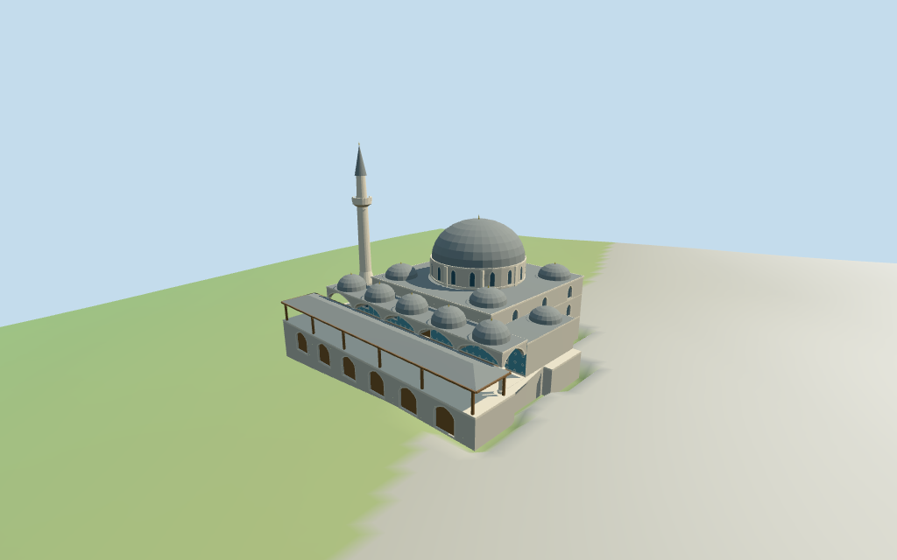

# Rüstem Pasha Mosque

Individual Rüstem Pasha Mosque exterior: irregular raised shop/terrace base,broad hipped outer canopy,five-domed columned pointed-arch porch,coarse blue tile fields,stone hall with low side galleries and corner domes,windowed polygonal central drum,large grey metal dome and one pale single-balcony minaret. Original geometric blue/cream tile rhythm suggests Iznik surfaces without reproducing historic artwork or inscriptions. Neighbor buildings,detached courtyards and furnished interiors are excluded.

## Evidence and reconstruction

Published dimensions and reconstructed details are separated in spec.json. Primary references:

- [Reference](https://commons.wikimedia.org/wiki/File:Istanbul_-_R%C3%BCstem-Pascha-Moschee_-_panoramio_(cropped_and_retouched).jpg)
- [Reference](https://commons.wikimedia.org/wiki/File:R%C3%BCstem_Pasha_Mosque_courtyard_and_porch_in_2003_1826.jpg)

Six shared256² coursed/raw limestone,standing-seam metal,plain wood,ceramic tile and cast bronze graphs;seven merged roles including local opaque glazing. Metric UVs and linear tints,no embedded images,unique atlas,copied historic tile art/calligraphy or baked light.

## Model and axes

12,926 triangles; 38,778 vertices; 7 material groups; 1,555,388 bytes. Native bounds: -23.270, -2.823, -19.794 to 23.270, 36.152, 19.855. Source hash: `sha256:2abddb2f4aa2414635428001f41bf3ff415868c96cfafbdbd0e16c272c941798`.

{"x":"retained long axis","y":"up","z":"estimated front atnegative Z"}

Standard Protomaps20261014 and Mapzen/USGS viewer extractN0473;datum 10.46533676004657 m. 358 footprint samples span -2.3500027495321802 to 2.0671052745382514 m. Foundation plane 0.3515711559351722 m equals the median of 95 outer samples plus0.25 m. Edge foundations sample at<=2 m. Replacement and preview terrain seating use only the retained mosque outline. Adjacent buildings,streets and courtyards remain host content;shop thresholds,stairs,terrace level and exact grade joins are unverified.

## Reproduce

Run `node packages/worldgen/scripts/generate-additional-landmarks.mjs --ids=N0473` (or add `--check`). The generator preserves manually edited masters by checking their baseline hashes. Import through the standard authored-model workflow with optimization disabled; then capture all QA cameras, including shared-surface views.

## Pending work

- Retained Q1137511 /way175518494 anchor,axis and15-vertex outline remain unchanged. Current named mosque point and14-vertex main polygon share id35184547607326. Negative Z is assigned to the broad porch/platform end and positive Z to the narrower rear hall. This facing and all internal partitions are picture/map-guided approximations. The raw denomination=anglican tag is retained as source data without endorsement. Adjacent shop blocks and their courtyards remain separate host buildings.
- Retained22.8 m height fact has no resolved component or vertical datum;it remains separate from estimates. No current PMTiles height tags are available. Estimated heights above the local foundation plane: terrace4.5 m,main wall12.3 m,drum16.1 m,dome shell22.8 m plus0.9 m finial,and minaret35.8 m including its tip. Platform,porch,canopy,side galleries,small domes and tower attachment are estimated from pictures and the mapped envelope,not surveyed.
- Standard Protomaps20261014 and Mapzen/USGS viewer extractN0473;datum 10.46533676004657 m. 358 footprint samples span -2.3500027495321802 to 2.0671052745382514 m. Foundation plane 0.3515711559351722 m equals the median of 95 outer samples plus0.25 m. Edge foundations sample at<=2 m. Replacement and preview terrain seating use only the retained mosque outline. Adjacent buildings,streets and courtyards remain host content;shop thresholds,stairs,terrace level and exact grade joins are unverified.
- Two inspected2003/2009 pictures guide the exterior vocabulary. Historic tile motifs,lattice,inscriptions and current restoration state are not reproduced. The front canopy,porch,hall,side galleries and tower are approximate partitions inside the mapped envelope. Closed panes/doors are opaque exterior fields;the model has no furnished or navigable interior. Exact threshold/grade joins,engineering and physical-device/full-city timing remain unverified.

This bundle follows the medium-fi standard. Medium-fi appearance and geographic fit are reviewed separately. Hash-bound visual acceptance is recorded separately after capture inspection.

## Additional geographic data

©OpenStreetMap contributors;Protomaps;Mapzen/USGS terrain.
