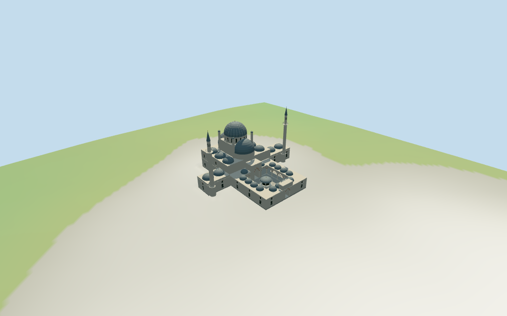

# N0482 — Bayezid II Mosque

Reviewed 2026-10-18 for its declared medium-fi exterior and approximate geographic fit. The mapped dome height is retained; its datum, other heights, internal layout and roof partitions remain approximate.

## Exterior and shared materials

Inspected 11 current portable views, including the retained 1024×640 summary. The retained stepped compound has an open courtyard with pointed arcades, pale stone columns, a covered polygonal fountain and real entrance passage; pale walls with rectangular ground glazing, pointed upper fields and coarse red/cream bands; domed gallery roofs, lower side wings/cupolas, a gray ribbed central dome with paired semi-domes and two widely separated minarets with open balconies and conical caps. Semi-dome support walls and upper root closures were added; concave-envelope cornice triangles were replaced by per-edge strips; separate minaret plinths reach sampled grade; corner piers reach the hall roof. Fine inscriptions, exact ornament, neighboring library/bazaar/tombs, landscape, fence, furniture and interiors are omitted. The seated terrain fixture and court paving are illustrative finished levels.

Inspected 11 current shared-material/geographic-flat views, including the placement overlay. Six existing 256² graphs serve raw/coursed/weathered limestone, brick, standing-seam metal and cast bronze; seven merged roles include local opaque glazing. Metric UVs and linear tints, no embedded images or unique atlas. Each graph is read once and eviction disposes the model geometry. The five occupied ground masks include both notched ring pieces, both minaret bases and the fountain; the court stays open elsewhere. An initially omitted first mask was corrected. Precise building subtraction uses the filled current compound envelope joined to its two tower bases; the associated dome and fountain are replaced with them. All 43 independent neighbors remain. The overlay establishes approximate pose/replacement, not surveyed terrain contact.

## Browser levels

| Level | Triangles | Bytes | Draws |
| --- | ---: | ---: | ---: |
| skyline | 997 | 94360 | 1 |
| district | 3735 | 349852 | 6 |
| street | 14378 | 1409736 | 7 |
| closeup | 18362 | 1842480 | 7 |

**444,212 bytes for initial skyline plus district**, plus six existing shared 256² graphs. Seven merged roles; no embedded images.

Inspected 27 current medium-fi views: Economy/High, noon/late light, street/block/skyline, silhouette, six details, four matched LODs and four transitions. The central/paired semi-domes, open court, separated minarets and low wings remain legible. Skyline simplifies the court to broad openings, keeps three coarse gallery cupolas, coarse domes, minaret balconies/cones, entrance passage and a small dark fountain canopy; its fountain columns are merged away at distance. District restores the four-bay arcade rhythm, stone columns, facade fields, more cupolas and simple open balcony posts. Street adds recessed glazing, coarse grids, red/cream bands, fuller capitals, dome ribs and more facets. Closeup further refines curves/ribs and finials. Whole cameras retain the compound and both towers; detail cameras crop other portions. Synthetic context apartments and coarse terrain are illustrative. Physical laptop/phone/tablet and full-city timing remains unmeasured.

## Placement and limits

Retained Q853064 relation/12342892 preserves anchor,undirected heading,23 exterior vertices,7 courtyard vertices,original tags and empty dimensional facts. Current ordinary PMTiles has the same named compound id52776570476140 plus two separate minaret bases,a dome part and a courtyard fountain. Their raw polygons control approximate roles and centers. The court lies to local−Z;the hall lies to+Z;the two minarets project toward±X. Signed facing and roof subdivisions remain reviewed approximations. Standard Protomaps20261014 and Mapzen/USGS viewer extractN0482;datum 60.82547566447552 m. 1008 ring samples span -0.7641521786992627 to 0.5921243355244883 m;floor 0.015593559872279172 m is the median of 186 compound/court/tower edge samples plus0.25 m. Footings sample grade;the synthetic fixture seats the five occupied masks and a3 m margin. The open court remains unmasked except the mapped fountain footprint. Flat court paving and exact thresholds,stairs,drains and finished levels remain approximations. Independently reproduced 23 retained exterior and 7 courtyard vertices, all 65 vertices across the five current building/part controls, the named mosque point, unchanged anchor/heading, original tags and dimensional facts. The current dome part retains height44 with no min_height or stated datum. All 288 placement/host-area checks and 992 FrontSide probes pass for opaque fields, open arcades/court, gallery ceilings/floors, semi-dome roofs/supports/root closures, supported corner piers, minaret balconies/floors, all finials and seated compound/tower foundations. Standard DEM reproduces 1,008 ring samples, 186 edge samples, 429 seated fixture points and the 16-bit heightmap. Five simple ground masks reproduce the occupied ring/tower/fountain union and keep the remaining courtyard unmasked.

Individual Bayezid II Mosque compound: retained stepped envelope and open court,pale limestone walls,red/cream arch bands,rectangular ground windows and pointed upper screens,real courtyard arcades with stone columns,domed gallery roofs,entrance portals,covered polygonal fountain,central gray lead dome and paired semi-domes,lower side cupolas and two widely separated slender minarets with open balconies and conical gray caps. Adjacent library,bazaar,tombs,garden,fence,vehicles,inscriptions,exact ornament,furnished interiors and engineering are excluded. Current dome part35184885256835 retains height44 m with no min_height or stated datum;the model applies it as the approximate main dome shell top above the local floor,with finial45.6 m. Other controls have no heights. Estimated gallery/side-wing/hall/core levels9/10.6/17.2/28 m;main drum34 m;two minaret finials54 m;outer gate13 m;inner portal15 m;fountain canopy/finial7/8 m. All partitions,semi-domes,window rhythm,small cupolas,tower stages,decoration and finished levels are visual estimates,not surveys. Retained exact relation identity/axis and the associated current compound, two minarets, dome and fountain support approximate visualization. Two inspected 2011/2024 courtyard/exterior pictures establish vocabulary; no bespoke surveyed sources or copied photo textures are used. Signed bearing, height datum, complete current condition, roof subdivisions, cupola/window counts, semi-dome drum shapes, portal proportions, minaret stages, exact ornament and finished ground levels remain estimates. The map dome shell height44 m is applied above the local floor with a 45.6 m finial; estimated tower finials are54 m. Fine historic artwork, inscriptions, interiors and engineering remain unverified or omitted.

## Verification

49 current views inspected; 992 FrontSide probes; 288 placement/host-area checks; six zero-error/zero-warning Khronos validations. Model/source/input/material/capture/placement hashes agree. Raw map compound controls and 16-bit terrain fixture reproduce. Source/placement checks, scene validate/sim30, selected LOD layout and Biome pass. Bulk captures stay ignored.

Source: sha256:14797f099adb17fc895f5c4539b45b69ad316b6737ab0ef1da50ff3f23c1d9f0

Runtime: sha256:e8dce551906a1ec5e8ef23405c2e0e052fa02fb604a35bc4f7e826d496170abd

Input: sha256:e6ebdc23e78308c678aa322166b309603a7349cb1df66f35c4f148c6cf8a302f

Commands: targeted generate-additional-landmarks/import-next-1000-models/generate-landmark-lods/register-landmark-previews --ids=N0482; source/placement --check; capture-next-1000-models --reflections --antialias --fit-shadows; capture-landmark-library --reflections --adaptive-clipping --bounded-placement; capture-medium-fi --ids=n0482_bayezid_ii_mosque --reflections; scene validate/sim30; selected LOD layout; Biome. Existing builds reused.

## Inspected picture references

[R Prazeres — 2011-07-23](https://commons.wikimedia.org/wiki/File:Bayezid_II_Mosque_courtyard_DSCF1149.jpg). CC-BY-SA-4.0. Inspected960×720 courtyard view:open pointed arcades on slender pale stone columns,alternating cream/gray arch blocks,gray gallery cupolas,a pale raised portal,central dome above a front semi-dome and small capped piers,and a covered polygonal fountain with pale columns,dark upper enclosure,shallow gray dome and gold spindle. Furniture,people and inscriptions are omitted.

[Dosseman / Dick Osseman — 2024-05-28](https://commons.wikimedia.org/wiki/File:Bayezid_II_Mosque_NE_exterior_side_and_entrance_in_2024_5519.jpg). CC-BY-SA-4.0. Inspected960×620 eastern courtyard exterior:pale stone with rectangular lower windows,pointed pale upper screens,red/cream arch bands,tall recessed central portal,projecting cornices,small gray lead cupolas,main dome/drum with pointed pale screen windows,and a slender minaret with conical gray cap behind. Trees obscure some hall portions;two tower footprints and central/fountain centers come from the ordinary map. No measured elevations or current complete condition are inferred.
