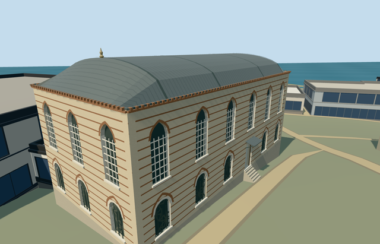

# N0742_AGAS — Mosque of the Agas, Topkapi Palace

Reviewed2026-10-21. **Complete as an individual medium-fi main-hall visualization; native terrain fit remains approximate. Topkapi is incomplete:10/18 required members ready.**

## Built and inspected

Inspected 48 final source/shared/medium-fi/native views in one continuous author/build/inspect/fix pass. Named striped stone/brick hall, six working courtyard bays, pale upper grilles, pointed upper heads, lower round pale surrounds and pointed brick relieving arches. True open entrance has wood reveals, a closed lead hood with visible underside/thin diagonal braces, and a short occupied stair. Shallow barrel roof with hipped ends, transverse bands, dentilled brick eaves and a small turned spindle finial. Corrected exterior-face classification that hid the brick courses, replaced the blocky finial, closed the initially one-sided entrance hood and changed district lower screens to opaque panes. Coarse brick courses/window rows retain the distant identity. All nine earlier palace members retain current input/source/runtime pins. Native fixture renders this member against native context, not a combined ten-model scene.

## Shared surfaces and browser levels

Seven existing256px graphs: stone_limestone_raw, brick, metal_standing_seam, stone_marble, metal_painted, metal_rosette_screen and wood_plain. Eleven roles merge to eight near material draws, seven district draws and one skyline draw; only six graphs are requested by district. Exterior masonry faces use stone and brick bands; hidden interior wall faces stay plain stone. Metric wall/brick/roof UVs apply to both quads and clipped triangles. Existing rosette graph substitutes for bespoke lower ironwork. Every requested graph read once; no new graph/private atlas/embedded image. Separate POSITION/NORMAL streams and equal CPU/GPU accounting.

| Level | Triangles | Bytes | Draws |
| --- | ---: | ---: | ---: |
| skyline | 481 | 48,136 | 1 |
| district | 2,086 | 200,004 | 7 |
| street | 12,865 | 1,121,844 | 8 |
| closeup | 20,355 | 1,700,772 | 8 |

Initial geometry: **248,140bytes**. Four authored levels481/2086/12865/20355 triangles; initial skyline plus district248140bytes. Skyline retains mapped hall, shallow barrel/hip profile, representative window rows/brick courses, door and approach. District restores upper grids/coarser stone-brick courses and roof bands while using opaque dark lower panes. Street/closeup restore actual recessed windows/opaque backs, shared lower screens, curved arch surrounds, more brick courses/dentils, closed entrance hood/braces and finer barrel/spindle profiles. All four satisfy triangle/download/draw/layout budgets. Physical ordinary-laptop/phone/tablet and dense-city timings remain pending.

## Native fit

Independent Ağalar Mosque Q133475725 within Topkapi Q170495; Commons category directly records OSM way32396236/native35184404485068. Original five-corner parent with two detailed PMTiles fragments retained. Internal+X follows the courtyard elevation northeast; internal+Z faces southeast into Third Courtyard toward the Library. World heading0/+X east/+Z south. Low attached ranges visible in photos remain independent native buildings. Existing standard PMTiles/Mapzen grid retained. Provider control internal[0,10] is outside every original native building footprint, verified before authoring; it supplies nativeY0. Level occupied floor is .18m above the highest original boundary sample, with bounded protective foundations and a short front entry stair. Only the actual body/stair footprint cuts terrain. Coarse ground falls below rear/east parts and may expose foundation; this does not verify historical basement/retaining-wall heights. No precinct flattening or custom terrain; historical thresholds/accessibility unverified. Only Mosque main hall way32396236/native35184404485068 replaced. The original five-corner body and entry stair alone open terrain. All 258 independent resident records of 259 and 572 wider records of 573 remain unchanged, including the low attached range. Ten overlapping PMTiles cases at levels13/14/15 pass, including both detailed parent fragments. Original161x161/6m terrain/roads/3400906.0006393427 square metres water unchanged. Provider control is outside all573 native building records and original terrain remains there in every LOD. Failure keeps259 originals; every unload restores ground/water/zero live geometry. Native approximate exterior fit/facing accepted. The uncovered court control internal[0,10] was checked before building; source datum50.51033051660131m is not an asserted survey height. FloorY0.6489649213325495 is .18m above the highest original boundary sample. Existing grade exposes foundation on lower sides; its depth and the entry stairs accommodate coarse terrain and do not verify historic basement/threshold heights. Independent ranges remain native context. No precinct slab/flattening or bespoke terrain.

## Limits and checks

Two ordinary Amaury Laporte exterior photos from2014 were actually viewed: close corner and whole courtyard elevation. Commons category records independent Q133475725 and the exact OSM way32396236. Existing PMTiles supplies the named five-corner parent and courtyard-facing axis. No qualified native height. Picture-led main eaves10.9m in the authored source frame, shallow barrel rise2.4m and floor just above the highest original boundary sample. Six front window bays, representative lower entrance position, rear/end openings, roof bands and small finial are visualization controls, not a surveyed inventory. Hidden interior arrangements, exact profiles and architectural heights remain approximate. Generic shared rosette ironwork, a representative spindle finial and simplified masonry/arched surrounds replace fine detail. No invented minaret/dome, copied calligraphy or inscriptions, trees/visitors, manuscripts or furnished prayer/library room. The low attached range is an independent retained map building. This completes one main-hall member; the palace remains incomplete.

Six GLBs: zero Khronos errors/warnings;305 actual mesh/contact probes. Ten overlapping PMTiles cases13/14/15 pass. All48 final views inspected, including pixel-identical previously inspected images and newly inspected changed frames; exact comparison in qa.json. Selected source/import/placement/strict medium-fi/scene/simulation/lint checks pass. Sim30: `b445ac9a6a9ca3e929b2c4931c6fef80806648d6b53b1e78da4952d56e34357e`.

Exact current hashes: [qa.json](qa.json). Editable footprint, grade, stair and roof controls: [map-frame.json](map-frame.json). Rebuild with generate-additional-landmarks.mjs --ids=N0742_AGAS, import-next-1000-models.mjs --ids=N0742_AGAS and generate-landmark-lods.mjs --ids=n0742_agas --force in their existing script directories.

## Viewed photographs

- https://commons.wikimedia.org/wiki/File:Agalar_Mosque_in_Topkapi_Palace_1_(19021417699).jpg — Amaury Laporte; 2014-01-06; CC-BY-2.0. Viewed only; no copied pixels.

- https://commons.wikimedia.org/wiki/File:Agalar_Mosque_in_Topkapi_Palace_3_(19211225731).jpg — Amaury Laporte; 2014-01-06; CC-BY-2.0. Viewed only; no copied pixels.
