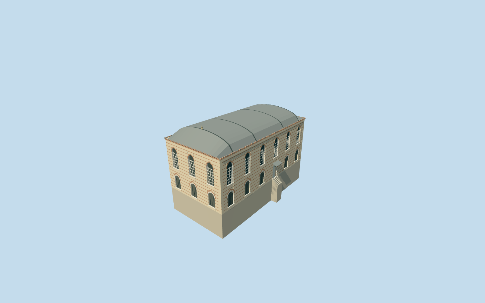

# Mosque of the Agas, Topkapi Palace

Specific Mosque of the Agas/Ağalar Camii main hall on way32396236: striped pale stone and narrow red-brick courses, tall pointed upper windows/pale grilles, round lower screened windows with pale surrounds/pointed brick relieving arches, an open front entrance with small lead hood/steps, and a shallow lead barrel roof with hipped ends/transverse bands and a representative finial. Preserve the independent low attached range and other palace members. No invented minaret/dome, copied inscriptions, historic manuscripts, plants or furnished prayer/library interior.

## Evidence and reconstruction

Published dimensions and reconstructed details are separated in spec.json. Primary references:

- [Reference](https://commons.wikimedia.org/wiki/File:Agalar_Mosque_in_Topkapi_Palace_1_(19021417699).jpg)
- [Reference](https://commons.wikimedia.org/wiki/File:Agalar_Mosque_in_Topkapi_Palace_3_(19211225731).jpg)

Specific Mosque of the Agas/Ağalar Camii main hall on way32396236: striped pale stone and narrow red-brick courses, tall pointed upper windows/pale grilles, round lower screened windows with pale surrounds/pointed brick relieving arches, an open front entrance with small lead hood/steps, and a shallow lead barrel roof with hipped ends/transverse bands and a representative finial. Preserve the independent low attached range and other palace members. No invented minaret/dome, copied inscriptions, historic manuscripts, plants or furnished prayer/library interior.

## Model and axes

20,355 triangles; 50,007 vertices; 8 material groups; 2,049,360 bytes. Native bounds: -15.147, -4.495, -14.209 to 15.058, 14.020, 14.101. Source hash: `sha256:8236de3f0f301528fc61003fd827059a37bb5bd7467cf61f4e23c51db35d323c`.

{"x":"east","y":"up","z":"south"}

The geographic proposal uses exact-QID OpenStreetMap evidence. Map-derived orientation and estimated architectural details require real-site visual review; preview eligibility is distinct from geographic/fidelity approval. Map attribution: © OpenStreetMap contributors, ODbL-1.0.

## Reproduce

Run `node packages/worldgen/scripts/generate-additional-landmarks.mjs --ids=N0742_AGAS` (or add `--check`). The generator preserves manually edited masters by checking their baseline hashes. Import through the standard authored-model workflow with optimization disabled; then capture all QA cameras, including shared-surface views.

## Pending work

- Specific Mosque of the Agas/Ağalar Camii main hall on way32396236: striped pale stone and narrow red-brick courses, tall pointed upper windows/pale grilles, round lower screened windows with pale surrounds/pointed brick relieving arches, an open front entrance with small lead hood/steps, and a shallow lead barrel roof with hipped ends/transverse bands and a representative finial. Preserve the independent low attached range and other palace members. No invented minaret/dome, copied inscriptions, historic manuscripts, plants or furnished prayer/library interior.
- Independent Ağalar Mosque Q133475725 within Topkapi Q170495; Commons category directly records OSM way32396236/native35184404485068. Original five-corner parent with two detailed PMTiles fragments retained. Internal+X follows the courtyard elevation northeast; internal+Z faces southeast into Third Courtyard toward the Library. World heading0/+X east/+Z south. Low attached ranges visible in photos remain independent native buildings.
- No qualified native height. Picture-led main eaves10.9m in the authored source frame, shallow barrel rise2.4m and floor just above the highest original boundary sample. Six front window bays, representative lower entrance position, rear/end openings, roof bands and small finial are visualization controls, not a surveyed inventory. Hidden interior arrangements, exact profiles and architectural heights remain approximate.
- Existing standard PMTiles/Mapzen grid retained. Provider control internal[0,10] is outside every original native building footprint, verified before authoring; it supplies nativeY0. Level occupied floor is .18m above the highest original boundary sample, with bounded protective foundations and a short front entry stair. Only the actual body/stair footprint cuts terrain. Coarse ground falls below rear/east parts and may expose foundation; this does not verify historical basement/retaining-wall heights. No precinct flattening or custom terrain; historical thresholds/accessibility unverified.

This bundle follows the medium-fi standard. Medium-fi appearance and geographic fit are reviewed separately. Hash-bound visual acceptance is recorded separately after capture inspection.
