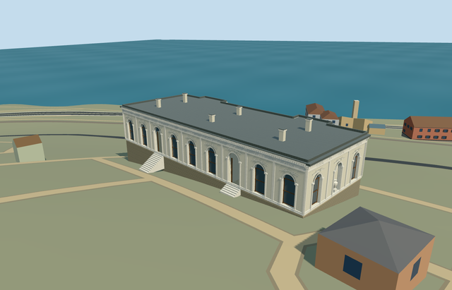

# N0742_GRAND - Grand Kiosk, Topkapi Palace

Reviewed 2026-10-21. **Complete as a medium-fi upper exterior with approximate native terrain fit. Topkapi remains incomplete:15/18 ready. Historic sea-side lower storeys/terraces and exact garden thresholds remain unapproved; Hasoda terrain fit remains pending.**

## Built and inspected

Long low pale plaster hall following its twelve mapped corners and small sea-side projections. Two genuine round-headed garden entrances, tall opaque round-headed brown-framed windows, full-height pilasters, end-wall recessed shell/urn niche, simplified geometric scroll reliefs, frieze, dentil/deep cornice, lead roof/parapet and six capped chimneys. Plain floor, closed ceiling/roof and simple internal room divisions. Three ordinary exterior pictures plus existing PMTiles informed one continuous author/build/inspect/fix pass. Fixed floating four-tread entries with sampled-grade flights, district stair-top faces, window bars crossing entrances, and a blocky urn profile.

## Shared textures and browser LODs

Seven existing256px shared graphs: lime plaster, marble trim, limestone floor, ashlar protective basement, standing-seam lead substitute, plain brown wood and painted-metal opaque glazing substitute. No new graph/private atlas/embedded images. Linear tints and metric wall/roof/floor quad UVs; separate POSITION/NORMAL streams and equal CPU/GPU accounting. Seven close-up draws/six district draws/one skyline draw. Native fixture requests each required graph once and releases all model geometry on unload.

| Level | Triangles | Bytes | Draws |
| --- | ---: | ---: | ---: |
| skyline | 1,000 | 88,360 | 1 |
| district | 2,536 | 223,664 | 6 |
| street | 15,776 | 1,485,940 | 7 |
| closeup | 31,872 | 3,230,288 | 7 |

Initial geometry: **312,024 bytes**. Four authored LODs1000/2536/15776/31872triangles. Initial skyline and district geometry312024bytes; close-up3230288bytes. District uses flat trim and opaque arch shapes; street reduces relief and dentil density; close-up retains the sculpted urn and scrolls. Paired entry positions/long frieze/parapet/chimneys retained. Synthetic flat fixtures do not approve native terrain. Physical ordinary-laptop, phone/tablet and dense-city measurements remain pending.

## Native placement

Independent Q20471823/way32396254/native35184404485086, exact twelve-corner canopy and signed garden-facing entrances/end niche. Two actual overlapping standard PMTiles14/15 cases pass; no overlapping13 feature present. Replace only its parent building; all258 independent resident records of259/all572 wider records of573 preserved. Original161x161/6m terrain, roads and3400906.0006393427square metres water retained. Ground cutout is only the inset occupied hall floor and is sealed by model flooring. Garden stair ground and uncovered provider internal[-11,0] remain; provider verified outside all573 records. Source floor1.097296103142327m above provider; source datum36.71385939758244m. Twelve- and five-tread entries descend to actual sampled grade and native modelWorldY is approximately0. Approximate main upper exterior fit accepted. Failure retains259 originals; each unload restores ground/water and zero live geometries. All fifteen prior palace assets retain input/source/runtime pins, including inactive Hasoda.

## Fidelity and limitations

Pictured upper hall/round openings/pilasters/frieze/parapet and independent map plan guide the model.6.25m wall,6.8m parapet,1.1-1.7m chimneys, hidden sea elevation, opening/chimney inventory, plain internal partitions and geometric floral reliefs are picture-led approximations. Original coarse slope exposes the protective basement;12/5tread flights accommodate ground and do not claim photographed four-tread historical thresholds. Historic sea-side lower storeys/terraces, exact garden elevation and accessibility remain unapproved. No bespoke terrain, precinct flattening, copied inscriptions/art, furnishings or independent Wardrobe Chamber/terrace/mosque. Hasoda remains inactive and the palace candidate is incomplete.

## Targeted checks

Six GLBs: zero Khronos errors/warnings;225mesh/contact probes;48current inspected views;two overlapping map cases14/15. Selected source/import/placement/strict medium-fi/scene/sim30/lint pass. Sim30 sha256:3f2e38e753a13b53c89eeb947b7bf899335238afb2a0670bcbd39c35a96f4875. Current pins: [qa.json](qa.json). Editable controls: [map-frame.json](map-frame.json).

## Viewed references

- https://commons.wikimedia.org/wiki/File:Grand_Kiosk_of_Topkap%C4%B1_Palace_in_Istanbul,_Turkey_001.jpg - Moonik; 2012-07-01; CC-BY-SA-3.0. Viewed only; no copied pixels.

- https://commons.wikimedia.org/wiki/File:Grand_Kiosk_of_Topkap%C4%B1_Palace_in_Istanbul,_Turkey_002.jpg - Moonik; 2012-07-01; CC-BY-SA-3.0. Viewed only; no copied pixels.

- https://commons.wikimedia.org/wiki/File:Mecidiye_Kosku_Topkapi_Istanbul_2007_Pano.jpg - Gryffindor; 2007; public-domain (PD-self). Viewed only; no copied pixels.

- https://www.openstreetmap.org/way/32396254 - independently named Mecidiye Kiosk, v21; OpenStreetMap contributors, ODbL1.0.

- https://www.wikidata.org/wiki/Q20471823 - independent Grand Kiosk identity and Commons category.
