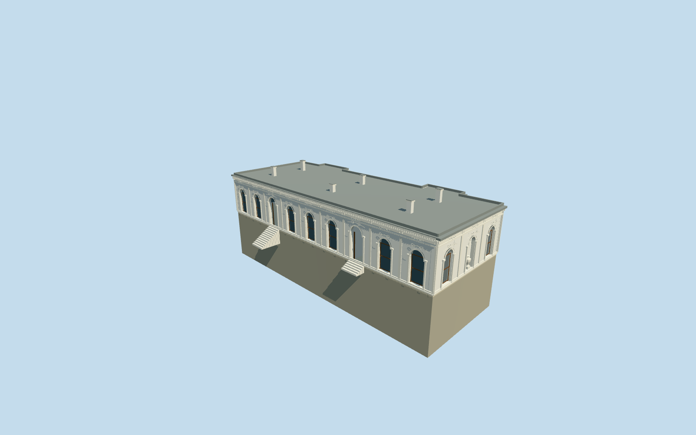

# Grand Kiosk, Topkapi Palace

Grand/Mecidiye Kiosk: long low pale plaster hall, round-headed brown-framed windows, two real garden entrances and steps, end-wall recessed urn niche, tall flat pilasters, simplified pale carved scroll/rosette reliefs, deep dentil cornice, lead roof behind a low parapet and six capped chimneys. Preserve the independently mapped Wardrobe Chamber and neighbouring terrace/mosque. No copied inscriptions/art, furnished interior or invented dome.

## Evidence and reconstruction

Published dimensions and reconstructed details are separated in spec.json. Primary references:

- [Reference](https://commons.wikimedia.org/wiki/File:Grand_Kiosk_of_Topkap%C4%B1_Palace_in_Istanbul,_Turkey_001.jpg)
- [Reference](https://commons.wikimedia.org/wiki/File:Grand_Kiosk_of_Topkap%C4%B1_Palace_in_Istanbul,_Turkey_002.jpg)
- [Reference](https://commons.wikimedia.org/wiki/File:Mecidiye_Kosku_Topkapi_Istanbul_2007_Pano.jpg)

Grand/Mecidiye Kiosk: long low pale plaster hall, round-headed brown-framed windows, two real garden entrances and steps, end-wall recessed urn niche, tall flat pilasters, simplified pale carved scroll/rosette reliefs, deep dentil cornice, lead roof behind a low parapet and six capped chimneys. Preserve the independently mapped Wardrobe Chamber and neighbouring terrace/mosque. No copied inscriptions/art, furnished interior or invented dome.

## Model and axes

31,872 triangles; 93,460 vertices; 7 material groups; 3,751,376 bytes. Native bounds: -15.658, -6.524, -21.065 to 15.718, 9.347, 21.065. Source hash: `sha256:270b2654b3f2fe41049100547e20398e78cfea7862ce6bfaf573a286560d22e8`.

{"x":"east","y":"up","z":"south"}

The geographic proposal uses exact-QID OpenStreetMap evidence. Map-derived orientation and estimated architectural details require real-site visual review; preview eligibility is distinct from geographic/fidelity approval. Map attribution: © OpenStreetMap contributors, ODbL-1.0.

## Reproduce

Run `node packages/worldgen/scripts/generate-additional-landmarks.mjs --ids=N0742_GRAND` (or add `--check`). The generator preserves manually edited masters by checking their baseline hashes. Import through the standard authored-model workflow with optimization disabled; then capture all QA cameras, including shared-surface views.

## Pending work

- Grand/Mecidiye Kiosk: long low pale plaster hall, round-headed brown-framed windows, two real garden entrances and steps, end-wall recessed urn niche, tall flat pilasters, simplified pale carved scroll/rosette reliefs, deep dentil cornice, lead roof behind a low parapet and six capped chimneys. Preserve the independently mapped Wardrobe Chamber and neighbouring terrace/mosque. No copied inscriptions/art, furnished interior or invented dome.
- Independent Grand Kiosk Q20471823 confirmed by Wikidata and its Commons category; exact named OSM way32396254 v21/native35184404485086 and twelve-corner parent. Internal+X east-southeast points from garden toward sea; internal+Z southwest follows the long court facade. Garden entrances face internal-X, and the end niche faces internal+Z.
- Picture-led single upper story with floor1.097296103142327m relative to uncovered provider,6.25m walls,6.45m cornice,6.8m parapet and1.1-1.7m chimney heights. Opening/relief/chimney inventories, hidden sea elevation, roof shape and plain internal room arrangement are reconstructed rather than surveyed. Entry stairs are terrain accommodations: 12 treads from sampled garden -1.0511341371871306m; 5 treads from sampled garden 0.33553824669332843m. Historic photographed four-tread thresholds are not reproduced as a survey claim.
- Original standard Protomaps20261020/Mapzen extract and161x161/6m terrain retained. Provider internal[-11,0] is uncovered and outside all573 building records. Upper floor sits0.18m above highest boundary grade; protective basement descends to the lowest boundary. Original terrain is removed only under the occupied floor; entry steps follow original garden grade. No custom terrain or precinct flattening; historic sea-side lower floors/terraces and threshold/accessibility fit remain unverified.

This bundle follows the medium-fi standard. Medium-fi appearance and geographic fit are reviewed separately. Hash-bound visual acceptance is recorded separately after capture inspection.
