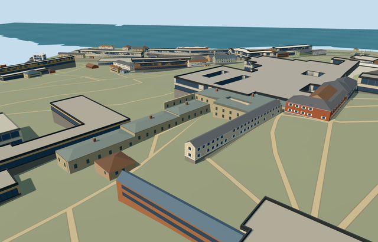

# N0742_HALBERDIERS — Halberdiers Quarters, Topkapi Palace

Reviewed2026-10-21. **Complete as a medium-fi quarters/service-range visualization with approximate native terrain fit. Topkapi remains incomplete:11/18required members ready. Hasoda is still a terrain-fit draft.**

## Built and inspected

Inspected52 current source/shared/medium-fi/native views during one continuous author/build/inspect/fix pass. Specific notched L-shaped service range and court head: pale stone, stepped shallow lead hips, two-storey head, rectangular recessed barred windows, real room entry/descending stair, narrow court, projecting upper story with timber braces, brick chimneys/pale pierced cowls/sloped lead hoods, and a small arched tiled fountain surround with a physically recessed bowl. Changed the initial square chimney lids to shallow faceted hoods and moved the exterior camera clear of the independent map colonnade. The close fountain view caught an overlapping brace/window bay: removed those intersections, lowered the arch below the upper projection and corrected/deepened the bowl inner profile so its recess reads clearly. The model retains the external court and opens the reconstructed head court through every roof. Lowered the fountain foot0.08m to meet retained court ground. Inspected nine changed final frames;43 frames retain prior actual inspection with byte-identical PNGs. All eleven prior palace assets retain exact input/source/runtime hashes; Hasoda remains an inactive terrain-fit draft.

## Shared surfaces and browser levels

Eight existing256px shared graphs: stone_limestone, plaster_lime, metal_standing_seam, brick, stone_limestone_raw, wood_plain, metal_painted and tile_glazed. Eight roles/eight textured material draws/one skyline draw. Converted sRGB palettes to linear vertex tints, used metric roof/wall quad UVs and metric internal-axis roof triangle UVs. Opaque window backs work from both sides and use trim, not tint-disabling window slot. Generic shared blue glazed tile substitutes for historical floral/calligraphic panels; no copied art/inscriptions. Each requested graph loaded once; no new graph/private atlas/embedded images. Separate POSITION/NORMAL streams and equal CPU/GPU accounting.

| Level | Triangles | Bytes | Draws |
| --- | ---: | ---: | ---: |
| skyline | 985 | 86,620 | 1 |
| district | 2,218 | 198,744 | 8 |
| street | 9,872 | 837,172 | 8 |
| closeup | 28,320 | 2,390,832 | 8 |

Initial geometry: **285,364bytes**. Four authored levels985/2218/9872/28320triangles; initial skyline+district285364bytes. Skyline preserves the notched L, the open head court, stepped lead roofs and four representative chimney cowls with sparse window rhythm. District restores all six chimneys, upper projections/braces and fountain. Street supplies real recessed windows, opaque backs, vent openings, stairs and more roof/brick detail. Closeup restores selected frames/bars, finer corbels, fountain arch/bowl and hood profiles. Every level meets triangle/draw/download/layout budgets. Synthetic flat context exposes or buries some terrain-specific foundations and cannot approve native fit; the original terrain scene supplies the fit review. Physical ordinary-laptop/phone/tablet and dense-city timings remain pending.

## Native fit

Topkapi Q170495 member way32396154/native35184404484986; current OSM page explicitly names Zülüflü Baltacılar Koğuşu and lead roof colour#cbd1cd. Exact original notched L parent retained. Internal+X northeast along the long service range; internal+Z southeast toward the external court. Independent Council Hall, Tower of Justice and colonnade remain outside this model. Existing standard Protomaps/Mapzen extract and original161x161/6m grid retained. Reference anchor lies outside all573 native records. Each service component uses a local floor datum; head court retains original host ground, with one bounded occupied entry stair. Cutouts follow only actual modeled rooms/stair. Coarse grade can expose foundations or bury low thresholds; inspect native views before activating. No bespoke terrain or precinct flattening. Approximate native exterior fit/facing inspected: service range grounded with separate component levels; source head court and the external L court retain original terrain. Local basement exposure, uphill partly buried lower openings and descending stair thresholds remain coarse-provider approximations, not historic survey heights. Approximate native exterior/court fit accepted. Only way32396154/native35184404484986 is replaced. All258 independent resident records of259 and572 wider records of573 stay unchanged, including the independent Tower/Council/colonnade. Original161x161/6m terrain, roads and3400906.0006393427square metres water remain unchanged. Two occupied concave ground outlines preserve the head courtyard and original exterior court; the actual stair is bounded. Replaced fragile triangle masks after the strict context render caught remaining ground at an opening probe; all current coverage probes are clear. Twelve overlapping PMTiles cases13/14/15 pass, including both detailed parent fragments. Provider/placement anchor is uncovered and outside all573 source records. Failed loading keeps259 originals; each LOD unload restores ground/water/zero live geometry. Native fixture renders this member against map context, not a combined twelve-model palace scene.

## Fidelity and limits

Three ordinary pictures actually viewed: Dosseman2012 exterior, Ray Swi-hymn2018 narrow court/corbels and entry fountain. OSM explicitly names the declared parent and its lead roof colour. Picture-led single-storey service range eaves5.6m and two-storey court head eaves7.6m above each declared floor, with shallow lead hips. Three service floor levels follow existing grade and are reconstruction controls, not surveyed historic steps. Narrow court5.5x16m, timber corbel positions and chimney inventory are representative; hidden roofs/rooms and architectural heights remain approximate. The5.5x16m head court is a picture-led local reconstruction, not a map-supplied hole or survey. Component floor steps, roof/window/door inventory, six chimney placements and hidden rear/room arrangement remain approximations. Lower openings can be partly buried on the uphill face, with some downhill base exposure on the original coarse grade. These are visualization compromises, not verified historical thresholds/accessibility. No custom terrain/precinct flattening, copied inscriptions/art, furnishings, visitors or the independent Tower of Justice. This completes one medium-fi quarters/service-range member, not the whole palace.

## Targeted checks

Six current GLBs: zero Khronos errors/warnings;454actual mesh/contact probes;12PMTiles cases13/14/15.52current views actually inspected. Selected source/import/placement/strict medium-fi/scene/sim30/lint checks pass. Sim30:413f3a34671558b3dbc924c9b6adfc10be5aaca46e5fb2203481cd15efb39c53.

Exact current hashes: [qa.json](qa.json). Editable component floors, hips, court/stair, fountain and chimney controls: [map-frame.json](map-frame.json). Rebuild with generate-additional-landmarks.mjs --ids=N0742_HALBERDIERS, import-next-1000-models.mjs --ids=N0742_HALBERDIERS and generate-landmark-lods.mjs --ids=n0742_halberdiers --force in their existing script directories.

## Viewed references

- https://commons.wikimedia.org/wiki/File:Topkap%C4%B1_Exterior_view_of_Quarters_of_the_Halberdiers_with_Tresses2012_01_6351.jpg — Dosseman; 2012-12-12; CC-BY-SA-4.0. Viewed only; no copied pixels.

- https://commons.wikimedia.org/wiki/File:20180115_Topkapi_8062_(25290665087).jpg — Ray Swi-hymn; 2018-01-15; CC-BY-SA-2.0. Viewed only; no copied pixels.

- https://commons.wikimedia.org/wiki/File:20180115_Topkapi_8059_(25290669627).jpg — Ray Swi-hymn; 2018-01-15; CC-BY-SA-2.0. Viewed only; no copied pixels.

- https://www.openstreetmap.org/way/32396154 — named primary, lead roof colour; OpenStreetMap contributors, ODbL1.0.
