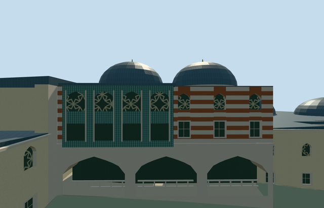

# N0742_HAREM — Imperial Harem, Topkapi Palace

Reviewed2026-10-21. **Complete as an individual medium-fi visualization. Topkapi remains incomplete:7/18 required members ready.**

## Built and inspected

Exact notched parent with three open mapped courts, stepped cream/stone ranges, closed lead roofs, seven representative principal domes, a compact bath-dome group and chimneys. The Twin Kiosk faces the mapped Favourites court with open lower arches/low balustrade, striped upper masonry, a projecting blue-green tiled bay and two window levels. Queen Mother court galleries have real circular shafts, tiled backs and upper windows. Three ordinary exterior/court photos and the existing standard PMTiles informed one continuous author/build/inspect/fix pass.

Inspected48 final source/shared/medium-fi/native frames. Removed a floating tile strip across an open gallery, grounded the circular columns and refined the skyline domes within budget. All six earlier palace members retain their approved input/source/runtime pins.

## Shared surfaces and browser levels

Eight existing256px graphs: plaster_lime, stone_limestone_raw, brick, metal_standing_seam, tile_ceramic, stone_marble, metal_rosette_screen and wood_plain. Ten roles merge into eight near/seven district/one skyline draws. Metric quad UVs retain pattern scale. No new graph, private atlas or embedded images; each requested graph read once. Separate position/normal streams and equal CPU/GPU memory accounting.

| Level | Triangles | Bytes | Draws |
| --- | ---: | ---: | ---: |
| skyline | 936 | 78,904 | 1 |
| district | 2,975 | 252,800 | 7 |
| street | 14,323 | 1,271,296 | 8 |
| closeup | 27,055 | 2,429,188 | 8 |

Initial geometry: **331,704bytes**. Skyline error estimate5m keeps that approximation farther away. Physical laptop/phone/tablet and dense-city measurements remain pending.

## Native fit

Q133817551/OSM relation4743322/native52776562876570. Internal+X follows the range southwest; +Z faces northwest; the Twin front faces internal-X toward Favourites court. Original open Queen Mother court internal[-14.2,-22.4] supplies nativeY0. Sampled occupied floors and their foundations retain the three uncovered host-ground courts.

All258 independent resident records of259/all572 wider records of573, original161x161/6m samples, roads and water retained. Sixteen overlapping map cases13/14/15 pass, including both detailed parent fragments. Failed loading keeps259 originals; every LOD unload restores ground/water and zero model geometry. The native fixture proves this member against native context, rather than a combined seven-model scene.

## Limits and checks

No qualified architectural height or surveyed roof/room subdivision. Roof zones, dome/chimney inventory, facade proportions and fine profiles are picture-led approximations. Shared geometric tile/screens substitute for copied artwork. No furnished rooms, inscriptions, external pool restoration or complete historic inventory. Flat fixtures expose/bury terrain-specific foundations; native exterior fit is approximate, and historical thresholds/accessibility remain unverified.

Six GLBs: zero Khronos errors/warnings;889 mesh/contact probes. Selected source/import/placement/strict medium-fi/scene/simulation/lint checks pass. Sim30: `e2bc16fba98418e3f98834b2ad7f1378a1981add7e9a85a1e7b6b3893f31cad3`.

Exact current hashes: [qa.json](qa.json). Editable footprint, grade, roof-zone and facade controls: [map-frame.json](map-frame.json). Rebuild with generate-additional-landmarks.mjs --ids=N0742_HAREM, import-next-1000-models.mjs --ids=N0742_HAREM and generate-landmark-lods.mjs --ids=n0742_harem --force in their existing script directories.

## Viewed photographs

- https://commons.wikimedia.org/wiki/File:Exterior_of_the_Harem_(Topkap%C4%B1_Palace).jpg — Yair Haklai; 2023-04-16; CC-BY-SA-4.0. Viewed only; no copied pixels.

- https://commons.wikimedia.org/wiki/File:4395_Istanbul_-_Topkapi_-_Harem_-_Cortile_delle_favorite_-_Foto_G._Dall'Orto_27-5-2006.jpg — Giovanni Dall'Orto; 2006-05-27; Attribution-only permission on file page; viewed only. Viewed only; no copied pixels.

- https://commons.wikimedia.org/wiki/File:Topkapi_harem_Istanbul_2013_12.jpg — Karelj; 2013; Public domain. Viewed only; no copied pixels.
