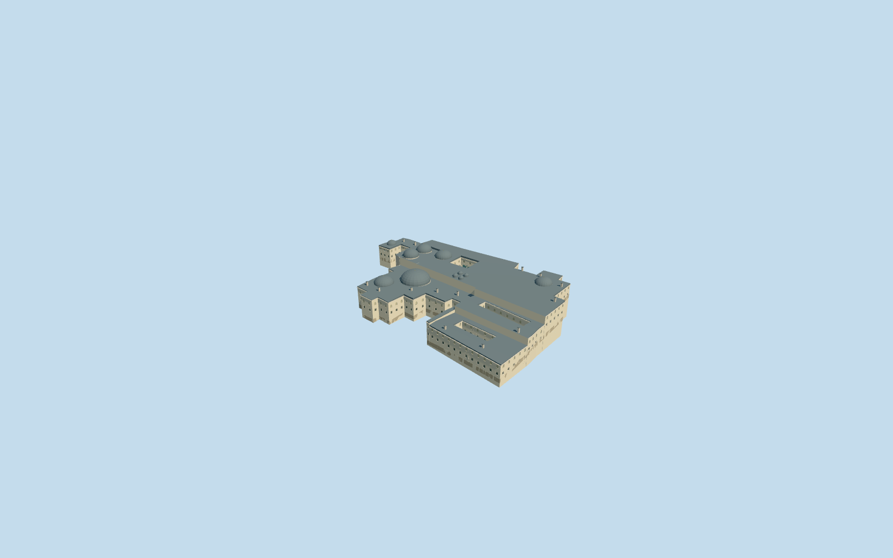

# Imperial Harem, Topkapi Palace

Specific Imperial Harem relation4743322: exact notched multi-court footprint, stepped cream/stone service and apartment ranges, lead hip roofs, principal domed halls, smaller bath domes and chimney groups. Distinct Twin Kiosk frontage faces the mapped Courtyard of the Favourites with open lower pointed arches, striped brick/stone upper work, pale window screens and projecting muted blue-green tiled bay. Keep all three mapped courtyards open and retain independent Tower of Justice, Council Hall and every other palace member. No furnished apartments, copied wall/ceiling art or inscriptions, visitors, pool restoration or invented complete historic room inventory.

## Evidence and reconstruction

Published dimensions and reconstructed details are separated in spec.json. Primary references:

- [Reference](https://commons.wikimedia.org/wiki/File:Exterior_of_the_Harem_(Topkap%C4%B1_Palace).jpg)
- [Reference](https://commons.wikimedia.org/wiki/File:4395_Istanbul_-_Topkapi_-_Harem_-_Cortile_delle_favorite_-_Foto_G._Dall'Orto_27-5-2006.jpg)
- [Reference](https://commons.wikimedia.org/wiki/File:Topkapi_harem_Istanbul_2013_12.jpg)

Specific Imperial Harem relation4743322: exact notched multi-court footprint, stepped cream/stone service and apartment ranges, lead hip roofs, principal domed halls, smaller bath domes and chimney groups. Distinct Twin Kiosk frontage faces the mapped Courtyard of the Favourites with open lower pointed arches, striped brick/stone upper work, pale window screens and projecting muted blue-green tiled bay. Keep all three mapped courtyards open and retain independent Tower of Justice, Council Hall and every other palace member. No furnished apartments, copied wall/ceiling art or inscriptions, visitors, pool restoration or invented complete historic room inventory.

## Model and axes

27,055 triangles; 73,053 vertices; 8 material groups; 2,959,396 bytes. Native bounds: -78.496, -11.900, -70.744 to 78.529, 17.293, 70.747. Source hash: `sha256:7e22c6fd6761ff86e4e35320732d357294434a10ba565c39012ce12babe2d622`.

{"x":"east","y":"up","z":"south"}

The geographic proposal uses exact-QID OpenStreetMap evidence. Map-derived orientation and estimated architectural details require real-site visual review; preview eligibility is distinct from geographic/fidelity approval. Map attribution: © OpenStreetMap contributors, ODbL-1.0.

## Reproduce

Run `node packages/worldgen/scripts/generate-additional-landmarks.mjs --ids=N0742_HAREM` (or add `--check`). The generator preserves manually edited masters by checking their baseline hashes. Import through the standard authored-model workflow with optimization disabled; then capture all QA cameras, including shared-surface views.

## Pending work

- Specific Imperial Harem relation4743322: exact notched multi-court footprint, stepped cream/stone service and apartment ranges, lead hip roofs, principal domed halls, smaller bath domes and chimney groups. Distinct Twin Kiosk frontage faces the mapped Courtyard of the Favourites with open lower pointed arches, striped brick/stone upper work, pale window screens and projecting muted blue-green tiled bay. Keep all three mapped courtyards open and retain independent Tower of Justice, Council Hall and every other palace member. No furnished apartments, copied wall/ceiling art or inscriptions, visitors, pool restoration or invented complete historic room inventory.
- Independent Imperial Harem Q133817551 and OSM relation4743322/native52776562876570; parent includes three mapped holes and the apartment/service ranges, but excludes Council Hall/Tower and adjacent independent halls/mosques. Existing PMTiles labels locate Queen Mother court and the external Favourites court. Internal+X follows the range southwest, internal+Z faces northwest toward the outer gardens. World heading0/native+X east,+Z south. Three ordinary exterior/court pictures actually inspected; roof-room assignments not supplied by PMTiles remain an explicitly approximate visual interpretation.
- No qualified native architectural height or roof/room subdivision. Picture-led working service eaves8.1-9.5m, Queen Mother/central apartment eaves9.2-9.7m and Twin Kiosk upper cornice12.8m above its local control; dominant hall domes rise4-7m above low drums. Seven principal/representative domes, a compact bath-dome group and chimney placement are footprint-led visual controls, not a surveyed inventory. Twin Kiosk undercroft and upper tile/window/brick proportions are guided by the actual exterior photo. Hidden interiors, exact roof-room assignments, fine ornament and historical thresholds remain unverified.
- Retain original standard PMTiles/Mapzen samples, roads and water. Existing Queen Mother court internal[-14.2,-22.4] supplies nativeY0 as an open-ground provider reference. Occupied floors follow a compact sampled grade grid and share boundary splits with their foundations; separate roof zones stay level locally. All three courts remain native ground and open sky. No palace precinct slab or terrain flattening. Native exterior placement remains draft until the actual map scene is inspected; supplied elevation does not certify historical floor levels or accessibility.

This bundle follows the medium-fi standard. Medium-fi appearance and geographic fit are reviewed separately. Hash-bound visual acceptance is recorded separately after capture inspection.
