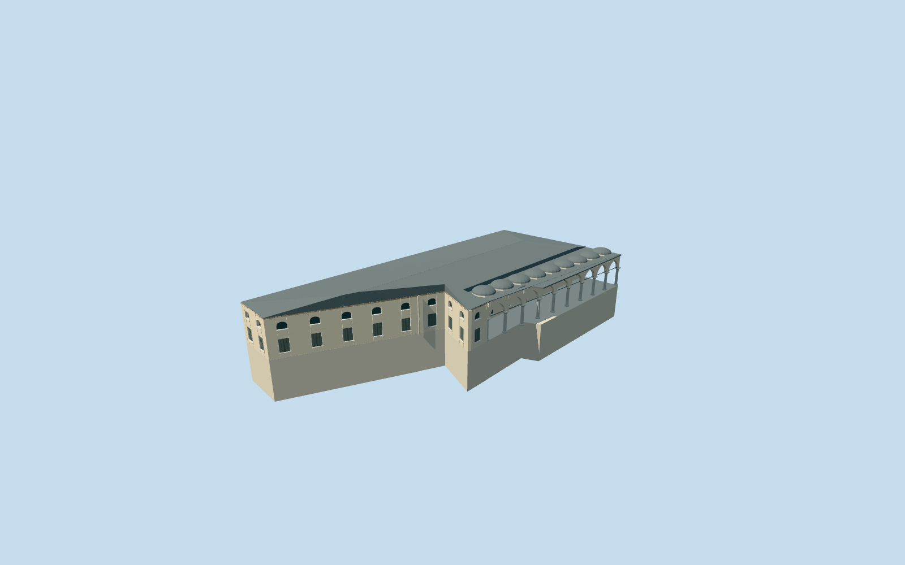

# Has Oda Kogusu, Topkapi Palace

Specific Has Oda Kogusu/Dormitory of the Privy Chamber on OSM way103907804: irregular elongated footprint, pale stone rear range and short angled southern connector, open courtyard colonnade with slender grey shafts/pale capitals/pointed arches, two window rows, low lead main roof and repeated shallow polygonal portico crowns. Preserve the independent Agas Mosque and large domed Sacred Relics chambers. No copied inscriptions, visitors, garden props or furnished museum interior.

## Evidence and reconstruction

Published dimensions and reconstructed details are separated in spec.json. Primary references:

- [Reference](https://commons.wikimedia.org/wiki/File:20131204_Istanbul_057.jpg)
- [Reference](https://commons.wikimedia.org/wiki/File:2013-01-02_Topkap%C4%B1_Palace_68.jpg)

Specific Has Oda Kogusu/Dormitory of the Privy Chamber on OSM way103907804: irregular elongated footprint, pale stone rear range and short angled southern connector, open courtyard colonnade with slender grey shafts/pale capitals/pointed arches, two window rows, low lead main roof and repeated shallow polygonal portico crowns. Preserve the independent Agas Mosque and large domed Sacred Relics chambers. No copied inscriptions, visitors, garden props or furnished museum interior.

## Model and axes

16,273 triangles; 42,973 vertices; 8 material groups; 1,747,156 bytes. Native bounds: -24.896, -2.326, -27.261 to 25.055, 11.271, 27.261. Source hash: `sha256:9e0b02d7fe7179385b9eac3285f20183dfe8510261c5e304831a5da3c354e6a8`.

{"x":"east","y":"up","z":"south"}

The geographic proposal uses exact-QID OpenStreetMap evidence. Map-derived orientation and estimated architectural details require real-site visual review; preview eligibility is distinct from geographic/fidelity approval. Map attribution: © OpenStreetMap contributors, ODbL-1.0.

## Reproduce

Run `node packages/worldgen/scripts/generate-additional-landmarks.mjs --ids=N0742_HASODA` (or add `--check`). The generator preserves manually edited masters by checking their baseline hashes. Import through the standard authored-model workflow with optimization disabled; then capture all QA cameras, including shared-surface views.

## Pending work

- Specific Has Oda Kogusu/Dormitory of the Privy Chamber on OSM way103907804: irregular elongated footprint, pale stone rear range and short angled southern connector, open courtyard colonnade with slender grey shafts/pale capitals/pointed arches, two window rows, low lead main roof and repeated shallow polygonal portico crowns. Preserve the independent Agas Mosque and large domed Sacred Relics chambers. No copied inscriptions, visitors, garden props or furnished museum interior.
- Declared Topkapi Q170495 OSM member way103907804/native35184475996636. Existing standard PMTiles fixes the full irregular parent and angled southern connector. Internal+X follows the range northeast; internal+Z faces southeast into Third Courtyard. Ordinary courtyard photographs guide the arcade. Has Oda Kogusu is the dormitory, not the adjacent Sacred Relics chamber or the Harem private rooms.
- Picture-led eaves5.8m, spring3.25m and shallow portico crowns above the authored occupied floor; nine representative open bays along the mapped straight courtyard leg. Hidden rear windows, the main hipped roof, window/door inventory and exact crown profiles are approximations. No measured architectural heights; native height5 is a coarse map hint.
- Existing standard Protomaps/Mapzen extract and original161x161/6m grid retained. Uncovered court attachment internal[8,19] is outside all573 original building records, verified before authoring. Level floor .18m above highest original boundary sample; bounded protective base follows only the actual mapped parent, leaving the exterior court open. Falling coarse ground may expose foundations; threshold/basement heights remain unverified. No precinct flattening or bespoke terrain.

This bundle follows the medium-fi standard. Medium-fi appearance and geographic fit are reviewed separately. Hash-bound visual acceptance is recorded separately after capture inspection.
