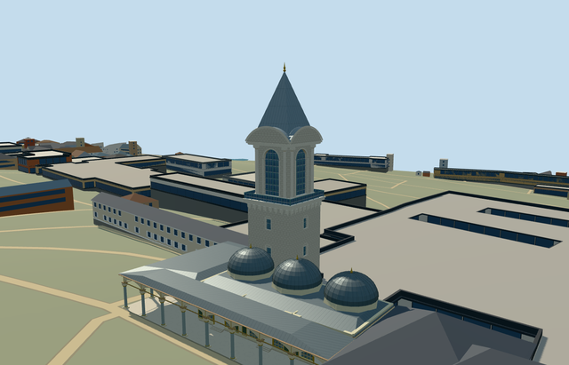

# N0742_JUSTICE — Tower of Justice, Topkapı Palace

Reviewed 2026-10-21. **Individual member complete to Molen’s medium-fi standard. Topkapı Palace remains incomplete: 5 of 18 required members.**



## Built and inspected

The named square stone tower: recessed barred shaft windows, corbelled projecting balcony with muted glazing/rails, four tall arched lookout windows and eight paired corner shafts, simplified capitals, curved segmental pediments, closed roof shoulders, steep square lead pyramid and gold finial. The 2026 photo guides the current balcony glazing. Fine carving, lower-window inventory and hidden access remain approximate; the model represents the exterior.

Two ordinary photographs and the existing standard PMTiles informed one continuous author/build/inspect/fix pass. A geometry probe caught a gap at the coarse spire skirt; its hidden base now intersects the shoulder at every LOD. Stone/lead were lightened and the visible spire shortened to improve the photographed proportions. All 48 final source, shared-material, medium-fi and native views were inspected.

## Shared surfaces and budgets

Six existing 256² graphs serve seven roles: ashlar, marble, standing-seam metal, window grid, painted metal and bronze. No new graph, private atlas or embedded images. The Tower/Council native scene uses ten distinct shared graphs in total, each requested once. Glazing uses the engine’s opaque reflection approximation. POSITION and NORMAL have separate buffers, with equal CPU/GPU geometry accounting.

| Level | Triangles | Bytes | Draws |
| --- | ---: | ---: | ---: |
| skyline | 994 | 94,084 | 1 |
| district | 2,522 | 239,588 | 6 |
| street | 6,830 | 661,488 | 6 |
| closeup | 8,202 | 809,016 | 6 |

Initial skyline plus district: **333,672 bytes**. Physical laptop, phone/tablet and dense-city timing measurements remain pending.

## Geographic placement and combined scene

Individual Q20470393, OSM way335402653/native35184707491485. Its approximately 8.7 × 8.6 m quadrilateral fixes the shaft location and scale. Native +X is east, +Z south, heading 0. The internal long wall runs north-northeast; the courtyard face points east-southeast. Approximate picture-led bearing uncertainty is 10°.

The tower uses exactly the Council Hall’s already inspected courtyard terrain reference, with modelHeight0 for both. Native exterior contact/facing is accepted. Only the occupied tower parent opens the ground; its candidate-only mask retains all 572 other wider building records of 573, including the Council records.

The native fixture loads the completed Council Hall/portico separately through the normal structure renderer at all four LODs. The approved Council input hash and all six Council GLBs remain unchanged; [qa.json](qa.json) binds all twelve source/runtime/LOD files in this two-model scene. Three owned native records are replaced, preserving 256 independent resident records of 259 and 570 wider independent records of 573. Original 161 × 161 / 6 m terrain samples, roads and 3,400,906.0006393427 m² of water are unchanged.

A tower-only load failure leaves the Council visible and retains the original map tower, with 257 native records remaining. Disposing both models restores all ground/water and releases all model geometry.

## Proportions and limits

No qualified height is present in the standard-map record. Working proportions are picture-led: 16 m shaft, balcony to16.55 m, belvedere17.35–25.4 m, curved pediments around28 m, pyramid25.9–36.5 m and finial37.9 m. These are approximate visualization dimensions. Exact historical levels, pane/window inventories, fine sculpture, concealed lower access and host terrain accuracy are not certified. The Tower GLB contains no Council geometry; its companion stays independently authored and loaded.

## Verification

- Six GLBs: zero Khronos errors/warnings; 294 actual geometry/contact probes.
- Eight actual overlapping PMTiles cases at levels 13, 14 and 15.
- Targeted source rebuild, import/hash, placement, strict medium-fi, scene validation, 30-tick simulation and lint pass.
- Sim30: `sha256:3f2b0dd556e6d2e10049e970c0797c63ceadba7c6892af702aa5758d17030ff7`.

Current input/file hashes, companion pins and inspected-frame bindings are in [qa.json](qa.json).

## Rebuild

```sh
node packages/worldgen/scripts/generate-additional-landmarks.mjs --ids=N0742_JUSTICE
node packages/worldgen/scripts/import-next-1000-models.mjs --ids=N0742_JUSTICE
node packages/tooling/scripts/generate-landmark-lods.mjs --ids=n0742_justice --force
```

## Ordinary picture references

- [2026-08-21 exterior](https://commons.wikimedia.org/wiki/File:Tower_of_Justice_Topkap%C4%B1.jpg): Joseolgon, CC-BY-4.0.
- [2007-07 exterior](https://commons.wikimedia.org/wiki/File:Tower_of_Justice_Topkapi_2007.jpg): Gryffindor, Public domain.

Pictures were viewed only; no image pixels or exact decorative artwork were copied.
