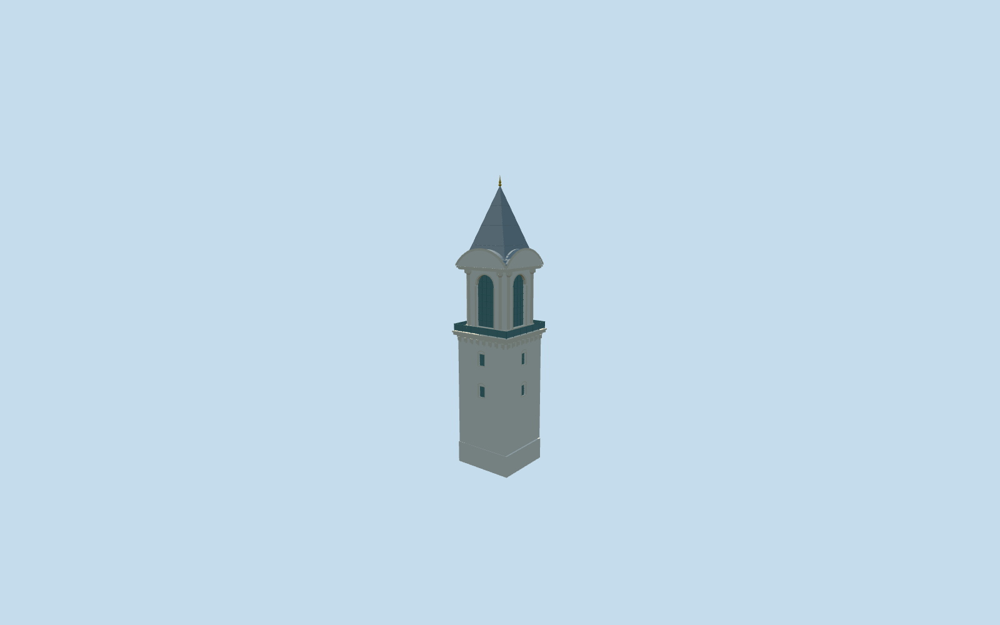

# Tower of Justice, Topkapi Palace

Tower of Justice (Adalet Kulesi) only, fifth authored member of18 required Topkapi Palace structures. Square pale masonry shaft with real recessed barred windows, corbelled projecting balcony and muted glazed railing, taller four-sided belvedere with arched recessed glazing and eight paired corner shafts, segmental curved pediments, closed curved roof shoulders, steep square lead pyramid and small gold finial. Council Hall/attached portico, Harem and Outer Treasury remain independent. No invented clock, furnished stair/interior, exact sculptural carving, copied inscriptions, visitors or transient CCTV/maintenance equipment.

## Evidence and reconstruction

Published dimensions and reconstructed details are separated in spec.json. Primary references:

- [Reference](https://commons.wikimedia.org/wiki/File:Tower_of_Justice_Topkap%C4%B1.jpg)
- [Reference](https://commons.wikimedia.org/wiki/File:Tower_of_Justice_Topkapi_2007.jpg)

Tower of Justice (Adalet Kulesi) only, fifth authored member of18 required Topkapi Palace structures. Square pale masonry shaft with real recessed barred windows, corbelled projecting balcony and muted glazed railing, taller four-sided belvedere with arched recessed glazing and eight paired corner shafts, segmental curved pediments, closed curved roof shoulders, steep square lead pyramid and small gold finial. Council Hall/attached portico, Harem and Outer Treasury remain independent. No invented clock, furnished stair/interior, exact sculptural carving, copied inscriptions, visitors or transient CCTV/maintenance equipment.

## Model and axes

8,202 triangles; 24,606 vertices; 6 material groups; 988,132 bytes. Native bounds: -6.432, -3.044, -6.432 to 6.432, 37.900, 6.432. Source hash: `sha256:dfdc0d06990acc65f05893e24e4a6f5b292661ad97b0b9f404e2300791e418f4`.

{"x":"east","y":"up","z":"south"}

The geographic proposal uses exact-QID OpenStreetMap evidence. Map-derived orientation and estimated architectural details require real-site visual review; preview eligibility is distinct from geographic/fidelity approval. Map attribution: © OpenStreetMap contributors, ODbL-1.0.

## Reproduce

Run `node packages/worldgen/scripts/generate-additional-landmarks.mjs --ids=N0742_JUSTICE` (or add `--check`). The generator preserves manually edited masters by checking their baseline hashes. Import through the standard authored-model workflow with optimization disabled; then capture all QA cameras, including shared-surface views.

## Pending work

- Tower of Justice (Adalet Kulesi) only, fifth authored member of18 required Topkapi Palace structures. Square pale masonry shaft with real recessed barred windows, corbelled projecting balcony and muted glazed railing, taller four-sided belvedere with arched recessed glazing and eight paired corner shafts, segmental curved pediments, closed curved roof shoulders, steep square lead pyramid and small gold finial. Council Hall/attached portico, Harem and Outer Treasury remain independent. No invented clock, furnished stair/interior, exact sculptural carving, copied inscriptions, visitors or transient CCTV/maintenance equipment.
- Individual Q20470393 and OSM way335402653/native35184707491485. The particular approximately8.7x8.6m quadrilateral shaft footprint fixes the anchor/scale and is distinct from the adjacent Council Hall, attached portico and Harem. Native+X east/+Z south at heading0. Internal+X follows the palace wall north-northeast; internal+Z faces the Second Courtyard east-southeast. Both ordinary photographs show the same stone shaft, high arched lookout, segmental pediments and narrow lead pyramid; the2026 image informs the current balcony glazing.
- No qualified height is supplied by this standard-map parent. Picture-led working shaft16m, projecting balcony16.0-16.55m, glazed belvedere17.35-25.4m, pediment crowns about28m, square lead spire25.9-36.5m and finial37.9m. Upper window clear width3.1m; paired slender shafts rise17-24.7m. These heights, exact lower-window inventory, pane grids, corbel/capital profiles and roof seams are approximate visualization proportions, not surveyed dimensions, structural/current-condition or accessibility certification. Roof silhouette and the distinctive upper window/column/pediment arrangement guide recognition. No clock is introduced.
- Existing standard Protomaps20261020/Mapzen PMTiles retained. Reuse the already inspected Council Hall front-courtyard terrain reference at[28.98360076577049,41.01245133743805], with modelHeight0 for both buildings. This keeps adjoining structures on the same actual host-provider datum rather than sampling the tower roof. Foundation reaches the original tower-footprint minimum; only its occupied parent ground opens. Council Hall and its portico, all other independent buildings, original terrain samples, roads and water are retained. Native approximate exterior contact and signed facing were inspected2026-10-21 beside the completed Council Hall and accepted. Both use exactly the same host-provider reference; the completed Council geometry/source was retained unchanged. Exact hidden lower access, historical floor levels and terrain accuracy remain outside scope.

This bundle follows the medium-fi standard. Medium-fi appearance and geographic fit are reviewed separately. Hash-bound visual acceptance is recorded separately after capture inspection.
