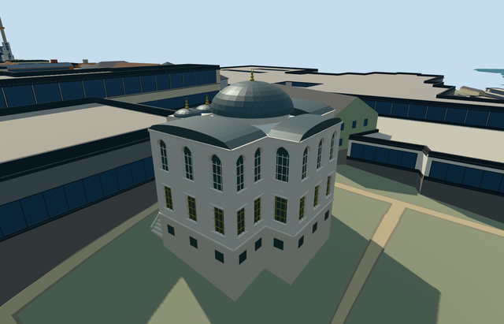

# N0742_LIBRARY — Library of Ahmed III, Topkapi Palace

Reviewed 2026-10-21. **Complete as an individual medium-fi visualization; native terrain fit is approximate. Topkapi remains incomplete: 9/18 required members ready.**

## Built and inspected

Inspected all 48 final source/shared/medium-fi/native views in one continuous author/build/inspect/fix pass. Specific cross-shaped pale marble library with raised basement, paired side stairs, three open pointed portico arches/four pale shafts/dark collars and ties, a real central entrance and two recessed window rows with opaque backs and simple metal grilles. Main lead dome sits on an octagonal drum; three small portico domes and shallow lead vaults over three arms retain the roof identity. Front fountain has a geometric gold recess/crest, tap and actual recessed basin floor/lips. Closed exposed window-header ends, aligned those headers with the wall thickness, made the basin hollow and tightened its ground opening. Restored simple window rows in the skyline to avoid blank far walls. Corrected the provider control from beneath the Audience Chamber canopy into an uncovered gap without changing the model world position or any GLB; 31 pixel-identical inspected views were retained and 17 changed final views inspected. All eight earlier palace members retain their approved input/source/runtime pins. The native fixture renders this member against native context, not a combined nine-model scene.

## Shared surfaces and browser levels

Seven existing 256px graphs: stone_marble, stone_limestone_raw, stone_granite, metal_standing_seam, metal_painted, metal_bronze_cast and wood_plain. Eight material roles/draws in textured levels; wall and trim use the same marble graph with distinct slots. Skyline merges to one draw and uses each graph mean. Explicit metric wall/roof quad UVs, opaque dark trim bindings and linear vertex tints. Each requested graph read once. No new graph, private atlas or embedded image. Separate POSITION/NORMAL streams and equal CPU/GPU accounting.

| Level | Triangles | Bytes | Draws |
| --- | ---: | ---: | ---: |
| skyline | 936 | 90,500 | 1 |
| district | 3,206 | 300,284 | 8 |
| street | 9,826 | 911,472 | 8 |
| closeup | 13,788 | 1,272,972 | 8 |

Initial geometry: **390,784 bytes**. Four authored levels: 936 / 3206 / 9826 / 13788 triangles. Skyline plus district initial geometry is 390784 bytes. All levels retain the cross plan, raised approach, open portico, real entrance, main dome/three small domes and arm roofs. Skyline now retains representative rectangular/pointed window rows; district restores the window pattern, small dome profiles and shaft detail. Street/closeup restore recessed window backs/reveals/grilles, finer pointed arches, dome/crescent profiles, stair rails and fountain detail. All levels meet triangle/download/draw/layout budgets. Physical laptop/phone/tablet and dense-city timings remain pending.

## Native fit

Independent Library Q104549762, within Topkapi Q170495, OSM way32396231/native35184404485063. Existing parent has twelve cross-plan corners and two detailed tile fragments. Internal+X follows front elevation southeast; internal+Z faces southwest toward separate Audience Chamber. World heading0/+X east/+Z south. Ordinary photos show the same front portico, raised basement, window rows and lead roofs. Only Library way32396231/native35184404485063 replaced. Ground opening follows actual occupied cross plan, paired stairs and the fountain body/basin. All 258 independent resident records of 259 and 572 wider records of 573 retained. Six overlapping PMTiles cases at levels 13/14/15 pass, including both detailed parent fragments. Original 161x161/6m terrain, roads and 3400906.0006393427 square metres water unchanged. Failure keeps 259 originals; all four LOD unloads restore ground/water and zero live geometry. The uncovered front gap internal[0,9.6] supplies the provider attachment with its explicit negative modelHeight; the unchanged source datum preserves the original model position. All 573 native footprints exclude that control. Walking planeY2.2 is level above the falling original samples. Native exterior fit and facing accepted as approximate visualization. Rear/east terrain exposes a deep protective basement: it accommodates coarse terrain and does not verify historical basement or retaining-wall height. Historical thresholds/accessibility remain unverified. No precinct slab/flattening or removal of the Audience Chamber. Standalone views show the full front arcade; the native doorway is inspected from inside its own portico because the retained Audience Chamber crowds the distant front camera.

## Limits and checks

Three ordinary photos viewed: Dosseman 2008 whole corner, Giovanni DallOrto 2006 roof close-up and Serhinho 2007 front elevation. Commons Library category attributes independent Q104549762; the collection now records that identifier with its identitySource. Existing PMTiles supplies twelve cross-plan corners and the separate named building parent. No qualified native height. Picture-led floor2.2m above open front court, main eaves10.9m, portico arch spring8.3m/crown10.45m, central octagonal drum12.0m and lead dome14.9m plus finial. Three portico domes and shallow arm vaults follow photos; heights/profiles, exact hidden roof joins, room layout and fine decoration remain approximate. Column/roof/window controls and fine profiles remain picture-led approximations. Fountain crest/shell and plaque are neutral geometry; no copied calligraphy, floral carving or textured artwork. No visitors, planted garden, furnishings or asserted surveyed interior plan. This is one member; the whole palace remains incomplete.

Six GLBs: zero Khronos errors/warnings; 572 actual mesh/contact probes. Six overlapping PMTiles cases at levels 13/14/15 pass. All 48 final views inspected. Selected source/import/placement/strict medium-fi/scene/simulation/lint checks pass. Sim30: `cf6cc5b22f0e1eed69c8615ab30c2400240ad70e57e1f3fc4f596cdb62403187`.

Exact current hashes: [qa.json](qa.json). Editable footprint, floor, portico, dome/vault and stair controls: [map-frame.json](map-frame.json). Rebuild with generate-additional-landmarks.mjs --ids=N0742_LIBRARY, import-next-1000-models.mjs --ids=N0742_LIBRARY and generate-landmark-lods.mjs --ids=n0742_library --force in their existing script directories.

## Viewed photographs

- https://commons.wikimedia.org/wiki/File:Topkap%C4%B1_Library_of_Ahmed_III_Exterior_in_2008_01_53.jpg — Dosseman; 2008-02-07; CC-BY-SA-4.0. Viewed only; no copied pixels.

- https://commons.wikimedia.org/wiki/File:4120_-_Istanbul_-_Topkapi_-_Tetto_della_Biblioteca_di_Ahmed_III_(1718)_-_Foto_G._Dall'Orto_27-5-2006.jpg — Giovanni Dall'Orto; 2006-05-27; Attribution-only. Viewed only; no copied pixels.

- https://commons.wikimedia.org/wiki/File:Front_Side_Library_Sultan_Ahmet_III.JPG — Serhinho; 2007-10-03; CC-BY-SA-3.0. Viewed only; no copied pixels.
