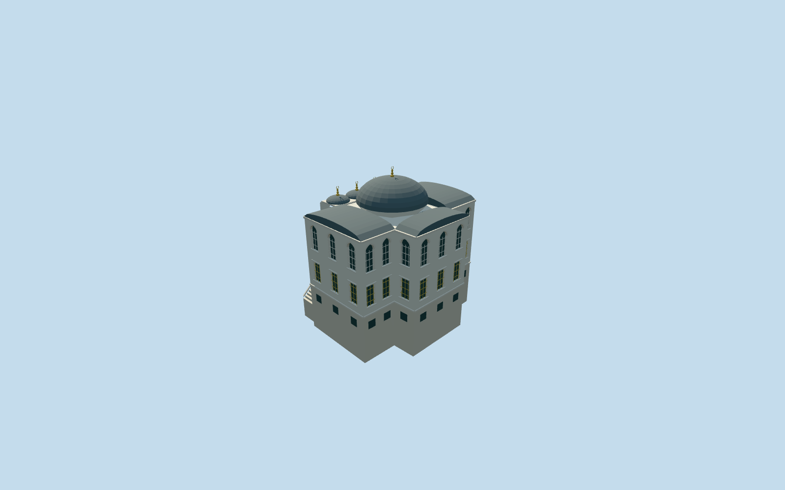

# Library of Ahmed III, Topkapi Palace

Library of Ahmed III/Enderun Library: mapped cross-shaped marble building, raised basement and paired side stairs, open three-bay pointed-arch portico/four pale shafts, real central doorway, two recessed window rows with metal grilles, main lead dome on octagonal drum, three small portico domes, low barrel roofs over three arms and front fountain. No copied inscriptions, floral carving, visitors, planting or furnished library.

## Evidence and reconstruction

Published dimensions and reconstructed details are separated in spec.json. Primary references:

- [Reference](https://commons.wikimedia.org/wiki/File:Topkap%C4%B1_Library_of_Ahmed_III_Exterior_in_2008_01_53.jpg)
- [Reference](https://commons.wikimedia.org/wiki/File:4120_-_Istanbul_-_Topkapi_-_Tetto_della_Biblioteca_di_Ahmed_III_(1718)_-_Foto_G._Dall'Orto_27-5-2006.jpg)
- [Reference](https://commons.wikimedia.org/wiki/File:Front_Side_Library_Sultan_Ahmet_III.JPG)

Library of Ahmed III/Enderun Library: mapped cross-shaped marble building, raised basement and paired side stairs, open three-bay pointed-arch portico/four pale shafts, real central doorway, two recessed window rows with metal grilles, main lead dome on octagonal drum, three small portico domes, low barrel roofs over three arms and front fountain. No copied inscriptions, floral carving, visitors, planting or furnished library.

## Model and axes

13,788 triangles; 37,640 vertices; 8 material groups; 1,525,336 bytes. Native bounds: -11.551, -4.058, -9.361 to 10.936, 16.118, 11.110. Source hash: `sha256:210616d3e0c9c2cc40bd5168adaf2dffe4107eece9b41a20e979d01c4e046989`.

{"x":"east","y":"up","z":"south"}

The geographic proposal uses exact-QID OpenStreetMap evidence. Map-derived orientation and estimated architectural details require real-site visual review; preview eligibility is distinct from geographic/fidelity approval. Map attribution: © OpenStreetMap contributors, ODbL-1.0.

## Reproduce

Run `node packages/worldgen/scripts/generate-additional-landmarks.mjs --ids=N0742_LIBRARY` (or add `--check`). The generator preserves manually edited masters by checking their baseline hashes. Import through the standard authored-model workflow with optimization disabled; then capture all QA cameras, including shared-surface views.

## Pending work

- Library of Ahmed III/Enderun Library: mapped cross-shaped marble building, raised basement and paired side stairs, open three-bay pointed-arch portico/four pale shafts, real central doorway, two recessed window rows with metal grilles, main lead dome on octagonal drum, three small portico domes, low barrel roofs over three arms and front fountain. No copied inscriptions, floral carving, visitors, planting or furnished library.
- Independent Library Q104549762, within Topkapi Q170495, OSM way32396231/native35184404485063. Existing parent has twelve cross-plan corners and two detailed tile fragments. Internal+X follows front elevation southeast; internal+Z faces southwest toward separate Audience Chamber. World heading0/+X east/+Z south. Ordinary photos show the same front portico, raised basement, window rows and lead roofs.
- No qualified native height. Picture-led floor2.2m above open front court, main eaves10.9m, portico arch spring8.3m/crown10.45m, central octagonal drum12.0m and lead dome14.9m plus finial. Three portico domes and shallow arm vaults follow photos; heights/profiles, exact hidden roof joins, room layout and fine decoration remain approximate.
- Source vertical datum remains 51.31288038632903m, preserving authored geometry and its native position. Actual provider attachment uses the uncovered front gap internal[0,9.6], outside every one of the 573 retained native building records, with modelHeight=-0.29670710644687404m. This negative local attachment height compensates for the original grid slope. Original terrain/roads/water remain unchanged; occupied floorY2.2 and deep rear/east foundations are approximate accommodations, not verified historical basement heights. No precinct flattening/custom terrain; thresholds/accessibility remain unverified.

This bundle follows the medium-fi standard. Medium-fi appearance and geographic fit are reviewed separately. Hash-bound visual acceptance is recorded separately after capture inspection.
