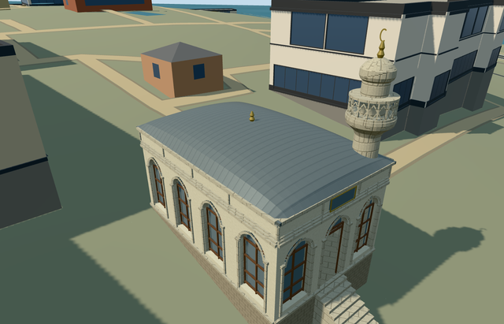

# N0742_SOFAMOSQUE - Sofa Mosque, Topkapi Palace

Reviewed 2026-10-21. **Source/shared-material/browser LOD review complete; native terrain fit pending. Public placement stays an inactive draft and this member is unfinished. Topkapi remains15/18 ready.**

## Source built and inspected

Specific small rectangular prayer hall with four pointed windows along the garden wall, three entrance bays/real central opening below a glazed transom, tall thin brown mullions and two reconstructed rear windows. Shallow lead cushion roof, paneled upper frieze/cornice, blank plaque retaining only its border/location, roof finial and short attached round minaret with moulded support, actual pierced diamond guard, blunt rounded cap and small finial/crescent. Plain floor/interior only. Two ordinary exterior images and one interior/window image informed this continuous pass. The stitched panorama can distort proportions. Source, shared, medium-fi and native frames inspected; native grade fit explicitly rejected.

## Shared textures and browser LODs

Seven existing256px graphs across eight roles: lime plaster, limestone trim/floor, ashlar protective basement, standing-seam metal, plain brown wood, painted-metal opaque glazing substitute and bronze. No new graph/private atlas/embedded images. Linear tints and metric wall/roof/floor quad UVs; POSITION/NORMAL have separate streams and CPU/GPU accounting agrees. Seven near draws/one skyline draw. Each graph requested once in native fixture; unloading disposes all model geometry.

| Level | Triangles | Bytes | Draws |
| --- | ---: | ---: | ---: |
| skyline | 564 | 55,108 | 1 |
| district | 3,548 | 338,928 | 7 |
| street | 8,536 | 812,308 | 7 |
| closeup | 11,872 | 1,115,376 | 7 |

Initial geometry: **394,036 bytes**. Four authored LODs564/3548/8536/11872triangles. Initial skyline+district geometry394036bytes, below phone/laptop initial budgets. Skyline keeps paired hall/minaret silhouettes and entry; district retains pointed windows and simplified rail; street/close-up have true guard openings and finer cushion curvature/frames. Synthetic context uses the occupied floor as its ground reference and does not establish native terrain fit. Physical ordinary-laptop, phone/tablet and dense-city measurements remain pending.

## Native placement remains unfinished

Independent Q127418589/way261824325/native35184633913157, exact four-corner parent and signed southeast entrance/southwest garden window facing. One actual overlapping detailed PMTiles15case passes; no overlapping13/14feature was present. Ownership/disposal checks pass: replace only the named parent in the preview fixture; all258 independent resident records of259/all572wider records of573 retained with original161x161/6m terrain, roads and3400906.0006393427square metres water. Ground opening is only occupied floor and is sealed by model geometry; original stair/garden/provider ground remains. Uncovered provider internal[0,7] is outside all573 records. Native modelWorldY approximately0; failure retains259 originals; each unload restores ground/water and zero live geometry. All sixteen previous palace assets retain source/runtime/input pins. HOWEVER the native slope exposes up to about2m of protective foundation and produces a14tread entry flight, unlike the photographed near-ground hall entrance. Native visual fit is rejected. Keep public placement inactive draft and member unfinished. No bespoke terrain or precinct flattening.

## Fidelity and limitations

Pictured pointed hall, shallow cushion roof and short blunt-capped minaret distinguish this asset.5.1m cornice,1.1m roof rise,10.4m minaret/finial, hidden elevations, opening inventory, minaret position/profile and geometric lozenge guard are reconstruction controls. Two-sided opaque shared glazing approximates the light windows. Plain interior excludes furnishings/chandelier/calligraphy/painted artwork. Blank plaque records no copied inscription. Original coarse terrain fails the photographed entrance/foundation fit; exact historic grade, thresholds and accessibility remain unapproved. Source/shared/LOD approval is not geographic approval. No independent adjacent palace ranges or invented large dome.

## Targeted checks

Six GLBs: zero Khronos errors/warnings;284mesh/contact probes;47current inspected views;one overlapping detailed PMTiles15case. No overlapping13/14feature present. Selected source/import/draft placement/strict medium-fi/scene/sim30/lint pass. Sim30 sha256:eda2657c380a6a8fb2051bbb3395f1312fb6552e0dbfb4d96d117959f4327fee. These checks preserve the failed native terrain-fit result. Current pins: [qa.json](qa.json). Editable controls: [map-frame.json](map-frame.json).

## Viewed references

- https://commons.wikimedia.org/wiki/File:Sofa_Camii_Topkapi_Istanbul_2007_015.jpg - Gryffindor; 2007-08; public-domain (PD-self). Viewed only; no copied pixels.

- https://commons.wikimedia.org/wiki/File:Istanbul_Topkapi_Mus_dec_2016_0966.jpg - Dosseman; 2016-12-09; CC-BY-SA-4.0. Viewed only; no copied pixels.

- https://commons.wikimedia.org/wiki/File:Sofa_Camii_Topkapi_Istanbul_2007.jpg - Marku1988, based on Gryffindor photographs; 2007-08; public-domain (PD-self). Viewed only; no copied pixels.

- https://www.openstreetmap.org/way/261824325 - v24, named Sofa Mosque/Q127418589; OpenStreetMap contributors, ODbL1.0.

- https://commons.wikimedia.org/wiki/Category:Sofa_Mosque - independent Q127418589 and same OSM way.
