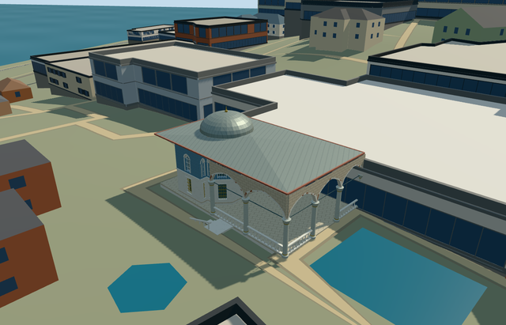

# N0742_YEREVAN — Yerevan Kiosk, Topkapi Palace

Reviewed2026-10-21. **Complete as a medium-fi exterior with approximate native terrain fit. Topkapi remains incomplete13/18ready. Hasoda terrain fit remains pending.**

## Built and inspected

Inspected48 final source/shared/medium-fi/native frames during one continuous author/build/inspect/fix pass. Exact mapped canopy contains a faceted blue upper chamber with three projecting window bays, pale marble lower wall and gold grilles, pointed upper windows, genuine northwest room entrance, long open three-sided pointed portico, round pale-grey shafts/faceted capitals/gold collars, low spindle railing, broad lead hip/warm soffit/red edge, slim curved pale canopy braces, short octagonal dome drum/lead dome/finial and a full thirteen-tread garden flight/solid rail/landing. Fixed the one-sided garden handrail before final captures. Two first native cameras were inside neighbouring procedural buildings; moved them to verified uncovered positions without changing neighbours. This is one Yerevan Kiosk, not an aggregate finished-palace model.

## Shared textures and browser LODs

Eight existing256px shared graphs: stone_limestone, stone_marble, metal_standing_seam, wood_plain, tile_glazed, metal_bronze_cast, metal_painted and brick. Eleven authored roles merge to eight near draws/seven district draws/one skyline draw. Floor shares the limestone wall graph; column/trim share marble; warm soffit/red edge share wood with linear vertex tints. Metric wall/floor/roof UVs. Generic blue glazed tiles and simplified pale/gold geometric grids substitute for bespoke historic floral/stained-glass/ironwork patterns. Each requested graph read once. No new graph/private atlas/embedded images; separate POSITION/NORMAL streams and equal CPU/GPU buffer accounting.

| Level | Triangles | Bytes | Draws |
| --- | ---: | ---: | ---: |
| skyline | 983 | 93,448 | 1 |
| district | 3,035 | 282,792 | 7 |
| street | 12,023 | 1,117,080 | 8 |
| closeup | 16,331 | 1,532,280 | 8 |

Initial geometry: **376,240bytes**. Four authored levels983/3035/12023/16331triangles; initial skyline+district376240bytes. Skyline preserves the faceted chamber, projecting bays, open porch, broad canopy, dome and stair silhouette. District restores pointed arcade and window rhythm, shaft/capital profiles and simple rails. Street restores actual window recesses, pointed upper reveals, alternating pale/brick arch bands, detailed balusters, curved braces and solid handrail; closeup refines shafts, curves and grids. Flat synthetic fixtures expose terrain-dependent basement/flight geometry and do not approve native historical grade. Physical ordinary-laptop/phone/tablet and dense-city timing measurements remain pending.

## Native placement

Independent Yerevan Kiosk Q6040439 / OSM way969327995 v14 / native35185341416827. The source page names Revan Köşkü/Yerevan Kiosk and Q6040439. Exact original four-corner canopy retained; internal+X southeast places the faceted room toward the garden end and internal+Z southwest faces the pool court. Existing standard Protomaps20261020/Mapzen extract and original161x161/6m grid retained. Uncovered provider internal[-14,0] is outside every native building. Original grid is nearly flat at this small pavilion and does not resolve the photographed garden terrace drop. No custom terrain/precinct flattening; do not approve historical thresholds or accessibility. Only the occupied canopy floor opens the ground; lower garden stair stays behind retained native terrain where its drop is unresolved. Main pavilion footprint, floor seating and signed garden/pool facing inspected in clear native views. Native fit accepted as an approximate exterior. The unresolved garden drop leaves much of the lower modeled stair/basement buried; historical garden-level fit is not approved. Only way969327995/native35185341416827 is replaced. All258 independent resident records of259 and572 wider records of573 retain original geometry, including the Sacred Relics chamber, Sofa Kiosk and Mosque. Original161x161/6m terrain/roads/3400906.0006393427square metres water remain unchanged. Four actual overlapping PMTiles cases13/14/15 pass, including the detailed parent. Provider internal[-14,0] remains uncovered and outside all573 original buildings; modelWorldY approximately0. Outside pool court remains covered. Failure retains259 originals; each LOD unload restores ground/water and zero live geometry. Each requested graph read once. Native fixture renders this member against original map context, not all fourteen authored palace members together.

## Fidelity and limitations

Yerevan Kiosk within its distinct four-corner canopy: faceted blue upper room with three projecting window bays, pale lower marble panels/gold grilles, long open pointed portico and pale shafts/capitals, broad lead hip/colored soffit, shallow domed chamber and a descending garden stair/balcony. Independent Sacred Relics chamber, Sofa Kiosk, Mosque, pool, freestanding fountain and general terrace remain native context. Picture-led chamber/portico eaves6.3m above a shared floor, three projecting window bays, two window levels and a low lead dome on a short octagonal drum. Heights, hidden roof/dome profile, interior arrangement, column/window counts and garden stair dimensions are reconstruction controls, not a survey. Floor is .55m above the highest native boundary sample. The lower garden flight follows the pictured2.65m descent; the coarse native grid buries much of that descent. Two ordinary Moonik2012 exterior pictures actually viewed; map name/Q6040439 corroborated by OSM v14 and Wikidata. Cross-room proportions, upper/lower opening inventory, column count, curved braces, dome/hidden roof profile and garden flight remain picture-led reconstructions. Main pavilion fit accepted as approximate; historical lower garden-level fit is explicitly not approved because the coarse grid lacks the terrace drop and buries much of the basement/stair. No custom terrain, copied inscriptions/artwork, museum furnishings or independent pool/fountain/Sacred Relics/Sofa structures. This completes one medium-fi kiosk exterior with the stated terrain limitation. Topkapi remains incomplete13/18ready; Hasoda remains an inactive terrain-fit draft.

## Targeted checks

Six GLBs: zero Khronos errors/warnings;242actual mesh/contact probes;48current inspected views;four overlapping map cases13/14/15. Selected source/import/placement/strict medium-fi/scene/sim30/lint checks pass. Sim30 sha256:f87015d41695437b67dcc7eea450bdb526d4c7854726ca211e73f942694282e8. Current pins and capture continuity: [qa.json](qa.json). Editable model controls: [map-frame.json](map-frame.json).

## Viewed references

- https://commons.wikimedia.org/wiki/File:Yerevan_Kiosk_in_the_Topkap%C4%B1_Palace,_Istanbul,_Turkey_001.jpg — Moonik; 2012-12-11; CC-BY-SA-3.0. Viewed only; no copied pixels.

- https://commons.wikimedia.org/wiki/File:Yerevan_Kiosk_in_the_Topkap%C4%B1_Palace,_Istanbul,_Turkey_005.jpg — Moonik; 2012-07-01; CC-BY-SA-3.0. Viewed only; no copied pixels.

- https://www.openstreetmap.org/way/969327995 — v14, independently named Yerevan Kiosk/Q6040439; ©OpenStreetMap contributors, ODbL1.0.
