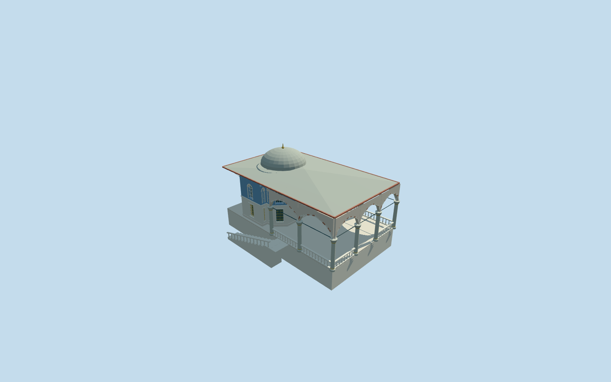

# Yerevan Kiosk, Topkapi Palace

Yerevan Kiosk within its distinct four-corner canopy: faceted blue upper room with three projecting window bays, pale lower marble panels/gold grilles, long open pointed portico and pale shafts/capitals, broad lead hip/colored soffit, shallow domed chamber and a descending garden stair/balcony. Independent Sacred Relics chamber, Sofa Kiosk, Mosque, pool, freestanding fountain and general terrace remain native context.

## Evidence and reconstruction

Published dimensions and reconstructed details are separated in spec.json. Primary references:

- [Reference](https://commons.wikimedia.org/wiki/File:Yerevan_Kiosk_in_the_Topkap%C4%B1_Palace,_Istanbul,_Turkey_001.jpg)
- [Reference](https://commons.wikimedia.org/wiki/File:Yerevan_Kiosk_in_the_Topkap%C4%B1_Palace,_Istanbul,_Turkey_005.jpg)

Yerevan Kiosk within its distinct four-corner canopy: faceted blue upper room with three projecting window bays, pale lower marble panels/gold grilles, long open pointed portico and pale shafts/capitals, broad lead hip/colored soffit, shallow domed chamber and a descending garden stair/balcony. Independent Sacred Relics chamber, Sofa Kiosk, Mosque, pool, freestanding fountain and general terrace remain native context.

## Model and axes

16,331 triangles; 46,421 vertices; 8 material groups; 1,871,936 bytes. Native bounds: -11.880, -2.071, -10.297 to 11.551, 10.229, 9.974. Source hash: `sha256:bc5d867e6a441e72fc6845e7860bd4ee2b6be922cd281f8e74f29a4db0a90b78`.

{"x":"east","y":"up","z":"south"}

The geographic proposal uses exact-QID OpenStreetMap evidence. Map-derived orientation and estimated architectural details require real-site visual review; preview eligibility is distinct from geographic/fidelity approval. Map attribution: © OpenStreetMap contributors, ODbL-1.0.

## Reproduce

Run `node packages/worldgen/scripts/generate-additional-landmarks.mjs --ids=N0742_YEREVAN` (or add `--check`). The generator preserves manually edited masters by checking their baseline hashes. Import through the standard authored-model workflow with optimization disabled; then capture all QA cameras, including shared-surface views.

## Pending work

- Yerevan Kiosk within its distinct four-corner canopy: faceted blue upper room with three projecting window bays, pale lower marble panels/gold grilles, long open pointed portico and pale shafts/capitals, broad lead hip/colored soffit, shallow domed chamber and a descending garden stair/balcony. Independent Sacred Relics chamber, Sofa Kiosk, Mosque, pool, freestanding fountain and general terrace remain native context.
- Independent Yerevan Kiosk Q6040439 / OSM way969327995 v14 / native35185341416827. The source page names Revan Köşkü/Yerevan Kiosk and Q6040439. Exact original four-corner canopy retained; internal+X southeast places the faceted room toward the garden end and internal+Z southwest faces the pool court.
- Picture-led chamber/portico eaves6.3m above a shared floor, three projecting window bays, two window levels and a low lead dome on a short octagonal drum. Heights, hidden roof/dome profile, interior arrangement, column/window counts and garden stair dimensions are reconstruction controls, not a survey. Floor is .55m above the highest native boundary sample. The lower garden flight follows the pictured2.65m descent; the coarse native grid buries much of that descent.
- Existing standard Protomaps20261020/Mapzen extract and original161x161/6m grid retained. Uncovered provider internal[-14,0] is outside every native building. Original grid is nearly flat at this small pavilion and does not resolve the photographed garden terrace drop. No custom terrain/precinct flattening; do not approve historical thresholds or accessibility. Only the occupied canopy floor opens the ground; lower garden stair stays behind retained native terrain where its drop is unresolved.

This bundle follows the medium-fi standard. Medium-fi appearance and geographic fit are reviewed separately. Hash-bound visual acceptance is recorded separately after capture inspection.
