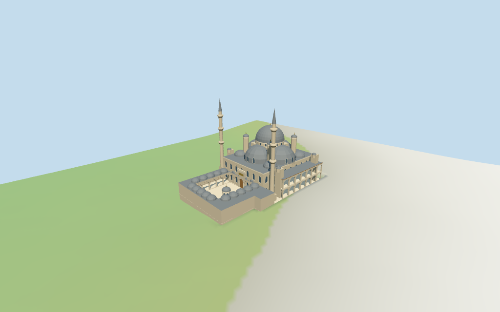

# New Mosque

Individual medium-fi Yeni Camii:central windowed drum/lead dome with four cascading semi-domes,small corner caps and stepped capped buttress turrets,two three-balcony minarets,open domed pointed courtyard,raised prayer-hall portal,octagonal domed grille-front fountain and two-storey exterior side galleries. Exact mapped whole/court/fountain;internal and vertical partitions are picture-proportioned estimates. Five shared material graphs,six merged roles,four browser levels. Fine carving/calligraphy,precise step/site joins,current finish and unseen interiors remain unverified.

## Evidence and reconstruction

Published dimensions and reconstructed details are separated in spec.json. Primary references:

- [Reference](https://commons.wikimedia.org/wiki/File:New_Mosque_View_from_SW_side_in_2024_5412.jpg)
- [Reference](https://commons.wikimedia.org/wiki/File:New_Mosque_courtyard_general_view_in_2009_2674.jpg)
- [Reference](https://commons.wikimedia.org/wiki/File:New_Mosque_SW_side_in_2003_0708.jpg)

Five existing shared256² limestone,raw limestone,standing-seam metal,plain wood and bronze graphs;six material groups including local opaque glazing. Standing-seam abstracts lead roofing. Linear tints,metric UVs and faceted architecture;zero embedded images,unique facade bitmaps,baked lighting or copied inscriptions.

## Model and axes

35,083 triangles; 105,249 vertices; 6 material groups; 4,213,760 bytes. Native bounds: -38.868, -2.593, -27.504 to 38.961, 52.610, 27.392. Source hash: `sha256:2a059f8ba9921e23f1295cb36b6c336aca9c43987f2844268a9bd8be00c63d65`.

{"x":"southeast prayer hall;negative northwest courtyard","y":"up","z":"southwest exterior side gallery"}

Standard viewer DEM datum 4.202828064356562m. Floor 0.609548865798593m is median of 137 outside-perimeter samples every2m at1m offset plus0.25m. Whole-site raw DEM range -2.214149109303987..4.536271635757758m. Raised1.2m plinth is a picture-led visualization assumption,not a measured court level. Visible-model terrain cutout follows mapped outer boundary;preview101² grid is locally seated beneath that boundary. Raw161² DEM retained separately. Exact exterior street,step,threshold and ground joins remain unverified.

## Reproduce

Run `node packages/worldgen/scripts/generate-additional-landmarks.mjs --ids=new_mosque` (or add `--check`). The generator preserves manually edited masters by checking their baseline hashes. Import through the standard authored-model workflow with optimization disabled; then capture all QA cameras, including shared-surface views.

## Pending work

- Retained relation/7574356 /Q911720 identifies Yeni Camii in Istanbul. Current whole52776565707604 (3*2^44+7574356) retains11 outer vertices and4-point courtyard hole;courtyard fountain35185556626907 retains11 points. Original anchor[28.972061282,41.01697895] and heading−0.854377682537rad unchanged,no horizontal rescale. Native+X southeast prayer hall,−X northwest courtyard,+Z southwest external gallery. Current map supplies no dome,minaret or internal hall controls;their centers and exterior partitions are explicit picture-proportioned estimates within the whole footprint. Separate royal pavilion/tomb,bazaar,streets and city remain host content.
- No retained height,width or length facts and no current height/min_height tags on the selected mosque/fountain. All vertical values are working picture proportions,not surveyed heights:1.2m raised plinth,8.2m court gallery/10.4m small caps,7m/13m exterior gallery floors/roof,16.2m main hall shoulder,24.5–27m central drum,8.7m central dome rise/37.2m including finial,16.2–25.2m four semi-domes,smaller19.4m corner caps and30m capped buttress turrets,two52m minarets with three balcony tiers at24/33/41m. Minaret bases/dome/arcades/fountain profiles and bay counts are estimates. Allow several meters of vertical uncertainty. Precise stairs,carving,inscriptions,unseen interiors and current finish unverified.
- Standard viewer DEM datum 4.202828064356562m. Floor 0.609548865798593m is median of 137 outside-perimeter samples every2m at1m offset plus0.25m. Whole-site raw DEM range -2.214149109303987..4.536271635757758m. Raised1.2m plinth is a picture-led visualization assumption,not a measured court level. Visible-model terrain cutout follows mapped outer boundary;preview101² grid is locally seated beneath that boundary. Raw161² DEM retained separately. Exact exterior street,step,threshold and ground joins remain unverified.
- Medium-fi exterior from three actually inspected2003/2009/2024 roof/courtyard/exterior pictures and standard viewer PMTiles/DEM. Internal dome/minaret/hall positions and all heights are picture estimates;whole,court and fountain retain current map controls. Four cascading semi-domes,two three-balcony towers,domed court/pointed arcade,domed octagonal grille fountain and two-storey side gallery are reconstructed. Fine muqarnas,calligraphy,grilles and carving abstracted or omitted. Opaque shallow glazing closes fields;no full interior/free-traversal claim. Separate royal pavilion,mausoleum,bazaar,streets,city and vegetation excluded. Precise stairs/approach/threshold/ground joins,current finish and physical-device timing remain unverified.

This bundle follows the medium-fi standard. Medium-fi appearance and geographic fit are reviewed separately. Hash-bound visual acceptance is recorded separately after capture inspection.

## Additional geographic data

©OpenStreetMap contributors;Protomaps;Mapzen/USGS terrain tiles.
