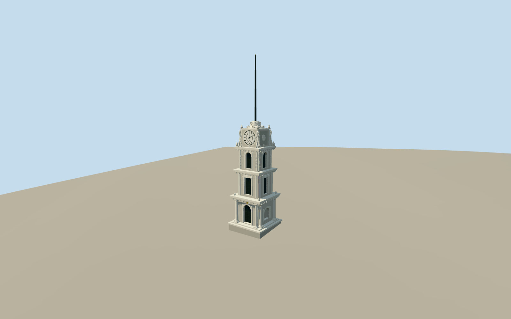

# Nusretiye Clock Tower

Restored square stone clock tower with exposed lower plinth, paired columns, deep arched entrance, rectangular and round-headed upper openings, stepped cornices, two white Ottoman-style dials, floral scroll crown and integral black flagmast. Surrounding mosque, museums, sculptures and square excluded.

Authoring state: **review-in-qa.json**. Current completion evidence is in [qa.json](qa.json) and the [local 100 ledger](../../../../qualla-structures/batches/PROGRESS.md).

- [Nusretiye Clock Tower](https://qualla.com/nusretiye-clock-tower/)

Restored2024 exterior: newly exposed lower plinth and repaired two land/sea clocks from primary caretaker record. Fixed batch four-clock wording is not used for geometry. Older2012 original controls silhouette only.

Masonry height15.2m and23.7m integral flagmast height are photo-derived estimates against generalized map14m/7.4m footprint; no surveyed scale claim. Fine floral relief and Ottoman-style hour marks are original approximations, not facsimiles. Hidden elevations/openings remain conservative symmetric interpretations.

Neighboring mosque, museums, modern sphere sculpture, chain security perimeter, surrounding square pavement and interiors excluded. Cloth flag omitted; integral flagmast retained. No photographic pixels redistributed. Independent native terrain unchanged; own plinth contact reviewed as a bounded preview. Coarse urban/coastal terrain and compatibility with other host terrain remain limitations; footprint replacement disabled.

Build: `node packages/worldgen/scripts/generate-authored-places.mjs --ids=nusretiye_clock_tower`. Add `--check` to verify exact regeneration. 56852 triangles; 4 materials; no embedded photographs.
