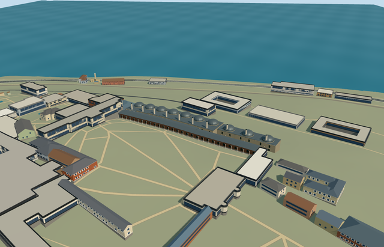

# palace_kitchens_topkapi_palace — Palace Kitchens, Topkapi Palace

Reviewed 2026-10-21. **Complete as an individual medium-fi visualization. Topkapi remains incomplete: 6/18 required members ready.**

## Built and inspected

The named U-shaped range retains its long open service court: stone cooking halls, ten representative lead domes and open-topped circular chimneys, recessed lower openings, pointed upper shared screens, northern connector and west courtyard range with pale columns/open pointed arcade beneath a lead hip roof. Three ordinary exterior photographs and the existing standard PMTiles informed one continuous author/build/inspect/fix pass.

Corrected the smaller LOD budgets, stone pattern scale, brick arch surrounds, matte screen material slots and a real foundation seam. The exposed foundation now shares the floor's sampled boundary edges. All 48 final source/shared/medium-fi/native frames were inspected.

## Shared materials and browser levels

Seven existing 256px graphs: stone_drywall, brick, stone_limestone_raw, stone_marble, metal_standing_seam, metal_rosette_screen and metal_painted. Eight surface roles; eight textured draws or one skyline draw. Metric quad UVs retain material scale. No new graph, private atlas or embedded images. Shared graphs are each requested once; position/normal streams remain separate with equal CPU/GPU memory accounting.

| Level | Triangles | Bytes | Draws |
| --- | ---: | ---: | ---: |
| skyline | 912 | 84,588 | 1 |
| district | 2,740 | 258,220 | 8 |
| street | 15,324 | 1,380,360 | 8 |
| closeup | 26,176 | 2,376,996 | 8 |

Initial skyline plus district: **342,808 bytes**. Physical laptop/phone/tablet and dense-city timings remain pending.

## Native placement

OSM way32396096/native35184404484928; palace institution Q170495. Internal +X follows the range southwest and +Z faces northwest toward the Second Courtyard. Original provider reference internal[0,0]; floors follow sampled ground under the occupied ranges, with locally level roof bays and enclosing foundations.

The native scene preserves the service court, all 258 independent resident buildings of 259, all 572 wider independent records of 573, original 161×161/6m terrain, roads and water. Four overlapping map cases at levels13/14/15 pass. Failed loading retains all259 originals; each LOD unload restores ground/water and releases model geometry. Ground-mask rounding is bounded by the source frame's0.1mm coordinate precision.

## Limits and checks

Heights, ten cooking roof bays, 28 near arcade bays, fine profiles and inaccessible roof/interior inventory are picture-led approximations. No furnished kitchens or copied decoration. Flat fixtures expose terrain-dependent foundations; the original native scene supplies the placement review. Historical thresholds and accessible routes are unverified.

Six GLBs: zero Khronos errors/warnings;502 actual mesh/contact probes. Selected source/import/placement/strict medium-fi/scene/simulation/lint checks pass. Sim30: `9b641a0c0931b4475baa444ea6730c892d60144de80e1323778dab91721d04f1`.

Exact input/source/runtime pins and image hashes: [qa.json](qa.json). Editable footprint/grade/architectural controls: [map-frame.json](map-frame.json).

Rebuild: `generate-additional-landmarks.mjs --ids=palace_kitchens_topkapi_palace`, `import-structure-models.mjs --ids=palace_kitchens_topkapi_palace`, then `generate-landmark-lods.mjs --ids=palace_kitchens_topkapi_palace --force` in their existing script directories.

## Viewed references

- [Palace_kitchens_Topkapi_2007_022.jpg](https://commons.wikimedia.org/wiki/File:Palace_kitchens_Topkapi_2007_022.jpg) — Gryffindor, July2007, public domain; viewed only.
- [Palace_kitchens_Topkapi_2007_017.jpg](https://commons.wikimedia.org/wiki/File:Palace_kitchens_Topkapi_2007_017.jpg) — Gryffindor, July2007, public domain; viewed only.
- [Palace_kitchens_Topkapi_2007b.jpg](https://commons.wikimedia.org/wiki/File:Palace_kitchens_Topkapi_2007b.jpg) — Gryffindor, July2007, public domain; viewed only.
