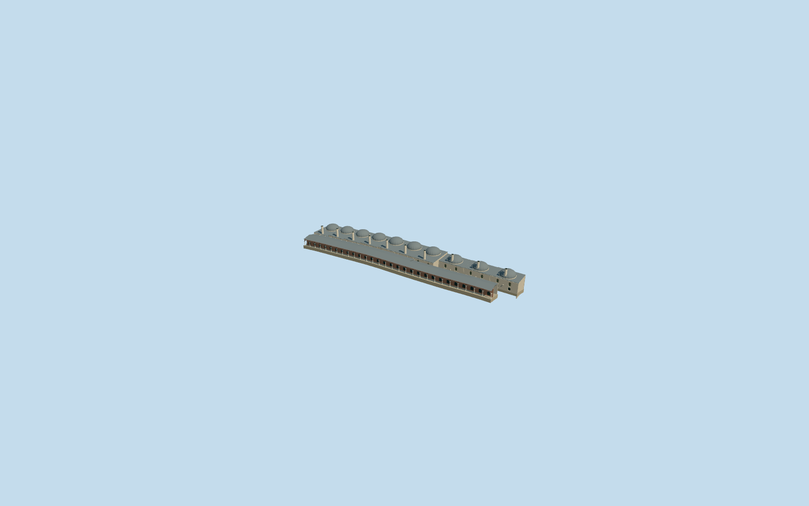

# Palace Kitchens, Topkapi Palace

Specific Palace Kitchens range on OSM way32396096: long stone kitchen hall, ten approximate cooking roof bays with lead domes and tall pale open-topped chimneys, recessed arched upper screens and lower doors, northern connecting range and west courtyard range with brick rear wall and a genuinely open pale-column arcade. Preserve the long unroofed service court and all separate palace members. Original medium-fi interpretation; no furnished kitchens, copied inscriptions, people, trees, pots or museum cases.

## Evidence and reconstruction

Published dimensions and reconstructed details are separated in spec.json. Primary references:

- [Reference](https://commons.wikimedia.org/wiki/File:Palace_kitchens_Topkapi_2007_022.jpg)
- [Reference](https://commons.wikimedia.org/wiki/File:Palace_kitchens_Topkapi_2007_017.jpg)
- [Reference](https://commons.wikimedia.org/wiki/File:Palace_kitchens_Topkapi_2007b.jpg)

Specific Palace Kitchens range on OSM way32396096: long stone kitchen hall, ten approximate cooking roof bays with lead domes and tall pale open-topped chimneys, recessed arched upper screens and lower doors, northern connecting range and west courtyard range with brick rear wall and a genuinely open pale-column arcade. Preserve the long unroofed service court and all separate palace members. Original medium-fi interpretation; no furnished kitchens, copied inscriptions, people, trees, pots or museum cases.

## Model and axes

26,176 triangles; 69,792 vertices; 8 material groups; 2,831,484 bytes. Native bounds: -54.185, -10.461, -84.151 to 54.185, 15.438, 84.151. Source hash: `sha256:ad2bc7e06bef640a001ef60d029936252d91f74f94e4032c6dae671aa5bdbd92`.

{"x":"east","y":"up","z":"south"}

The geographic proposal uses exact-QID OpenStreetMap evidence. Map-derived orientation and estimated architectural details require real-site visual review; preview eligibility is distinct from geographic/fidelity approval. Map attribution: © OpenStreetMap contributors, ODbL-1.0.

## Reproduce

Run `node packages/worldgen/scripts/generate-additional-landmarks.mjs --ids=palace_kitchens_topkapi_palace` (or add `--check`). The generator preserves manually edited masters by checking their baseline hashes. Import through the standard authored-model workflow with optimization disabled; then capture all QA cameras, including shared-surface views.

## Pending work

- Specific Palace Kitchens range on OSM way32396096: long stone kitchen hall, ten approximate cooking roof bays with lead domes and tall pale open-topped chimneys, recessed arched upper screens and lower doors, northern connecting range and west courtyard range with brick rear wall and a genuinely open pale-column arcade. Preserve the long unroofed service court and all separate palace members. Original medium-fi interpretation; no furnished kitchens, copied inscriptions, people, trees, pots or museum cases.
- Named Palace Kitchens OSM way32396096/native35184404484928, member of Topkapi Q170495. The single notched U-shaped parent includes the main eastern hall, northern connecting range and western court frontage. The narrow central service court is unoccupied and remains native terrain. Internal+X runs southwest along the range; internal+Z faces northwest toward the Second Courtyard. World heading0/native+X east,+Z south. Three ordinary exterior pictures inspected; the courtyard-facing colonnade is distinct from the actual kitchens behind it.
- No qualified native height. Picture-led working kitchen eave7.4m, shallow cooking domes about3.8m above their low drums and chimney rims14.4m above local kitchen grade. Western arcade shafts about3.6m/pointed crowns5m, broad lead hip roof6.0-7.7m. Ten major cooking domes/chimneys and28 near arcade bays are a footprint-led visual rhythm, not a verified room or structural inventory. Fine decoration, exact historic roof plan, inaccessible interiors and dimensions remain approximate.
- Use the existing standard PMTiles/Mapzen grid without flattening. Native provider reference internal[0,0]. Occupied floor follows sampled original ground under each narrow range, with level roof bays at local sampled grade and enclosing foundations below original ground. The long central service court stays outside the ground cutout. No palace precinct slab or neighbouring replacement. Native fit remains draft until rendered inspection; standard terrain does not certify historical thresholds or accessible routes.

This bundle follows the medium-fi standard. Medium-fi appearance and geographic fit are reviewed separately. Hash-bound visual acceptance is recorded separately after capture inspection.
