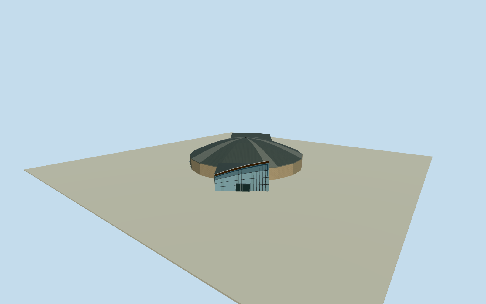

# Panorama 1453 History Museum

Panorama 1453 History Museum, with a sloped glazed entrance and broad timber canopy set against the round exhibition hall.

Authoring state: **review-in-qa.json**. Current completion evidence is in [qa.json](qa.json) and the [completion ledger](../../../../qualla-structures/batches/qualla-003.PROGRESS.md).

- [Panorama 1453 History Museum](https://qualla.com/panorama-1453-history-museum/)

The September 2024 reconstruction covers the public glass entrance and connected exhibition hall. Exterior sculpture, cannon displays, signage lettering and interiors are outside its scope.

The cleared photo constrains the glazing, timber soffit, bracing and entrance canopy. The lower hall follows the mapped perimeter, with its unphotographed external roof surface and rear wall simplified.

Municipal sources give a 38 metre diameter for the interior panorama. The exterior crown is an approximate roof profile.

Build: `node content/worldgen/source/places/sx/sxk/panorama_1453_history_museum/models/generate-panorama-1453-history-museum.mjs`. Add `--check` to verify exact regeneration. 1082 triangles; 5 materials; no embedded photographs.
