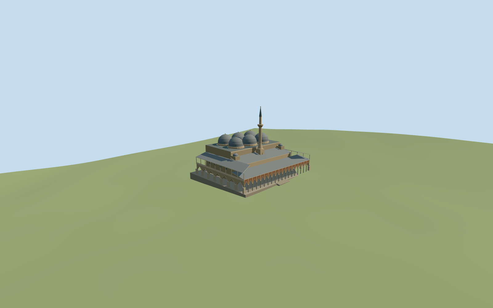

# Piyale Pasha Mosque

Piyale Pasha Mosque with six matching lead domes, double galleries, a 39.5-meter north minaret and nearby octagonal türbe.

Authoring state: **review-in-qa.json**. Current completion evidence is in [qa.json](qa.json) and the [local 100 ledger](../../../../qualla-structures/batches/PROGRESS.md).

- [Piyale Pasha Mosque](https://qualla.com/piyale-pasha-mosque/)

The model represents the standing mosque galleries, prayer hall and extant türbe. Former medrese and dervish lodge wings are outside the represented period.

The long span and reference sections produce estimated external dimensions. Portico paving, tomb eaves and sill heights follow approximate terrain grades.

Mortar details, timber joinery, finial ornament and individual stone panels are generalized. Interior tilework and furniture are outside the model scope.

Build: `node content/worldgen/source/places/sx/sxk/piyale_pasha_mosque/models/generate-piyale-pasha-mosque.mjs`. Add `--check` to verify exact regeneration. 21348 triangles; 6 materials; no embedded photographs.
