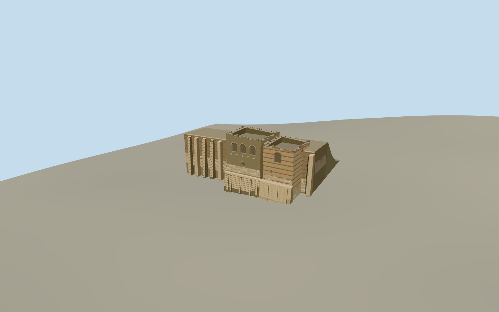

# Prison of Anemas

The paired masonry towers of Anemas on the Blachernae retaining wall above the Golden Horn, with their stepped footing, different masonry and surviving arches.

Authoring state: **review-in-qa.json**. Current completion evidence is in [qa.json](qa.json) and the [completion ledger](../../../../qualla-structures/batches/qualla-003.PROGRESS.md).

- [Prison of Anemas](https://qualla.com/prison-of-anemas/)

The model represents the standing paired towers and the adjacent Blachernae retaining range, with approximated climbing masonry and chamber roofs.

The geometry combines the original surveyed plan, mapped wall, historical exterior plates and available site terrain. Fine stone profiles, tower crown breaks, exact restoration fabric and the vertical registration of the terrace remain approximate.

The original height field is preserved. Temporary restoration equipment, the neighbouring mosque, and unrelated lengths of the city walls are outside the modeled site.

Build: `node content/worldgen/source/places/sx/sxk/prison_of_anemas/models/generate-prison-of-anemas.mjs`. Add `--check` to verify exact regeneration. 13104 triangles; 5 materials; no embedded photographs.
