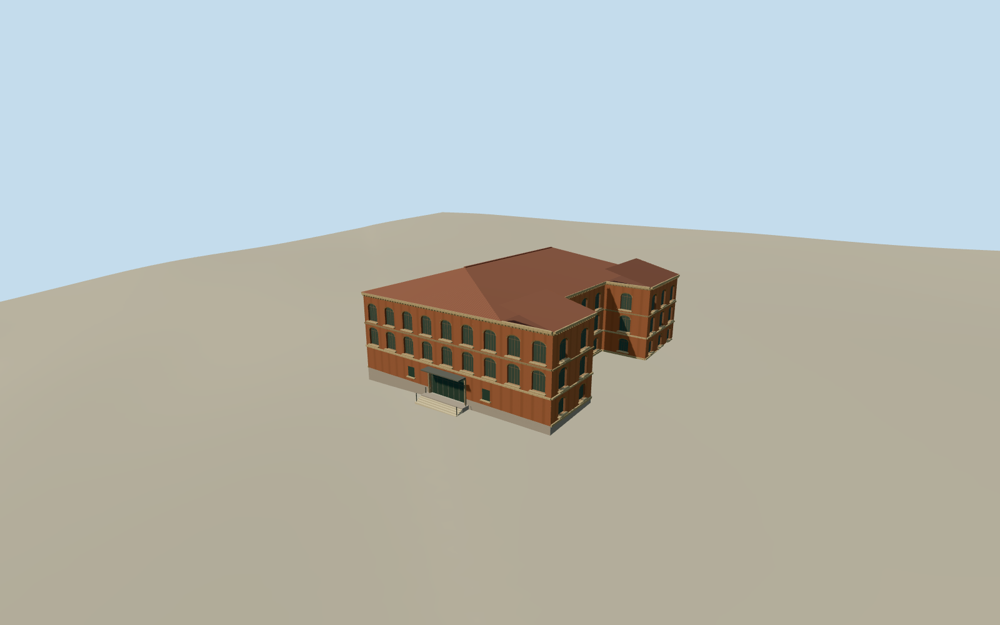

# Rezan Has Museum

The Rezan Has Museum’s wing of the former Cibali Tobacco Factory, with arched brick industrial bays, tiled roofs and the contemporary museum entrance beside the Golden Horn.

Authoring state: **review-in-qa.json**. Current completion evidence is in [qa.json](qa.json) and the [completion ledger](../../../../qualla-structures/batches/qualla-003.PROGRESS.md).

- [Rezan Has Museum](https://qualla.com/rezan-has-museum/)

This is the street-visible C Block host wing of the former Cibali Tobacco Factory. The separate university wings and the enclosed subsurface cistern remain beyond its exterior scope.

The unnamed footprint is attributed to C Block by the university building directory, museum’s tram-side entrance description and the Qualla location inside the native polygon. The OSM museum point farther northwest serves as an identity reference. The exact doorway position is estimated.

The restored masonry and arched industrial openings follow the university’s account. Storey heights and counts, the exact bay rhythm, roof hips, connector glazing, lintels and color differences are reconstructions.

The unchanged Terrarium field sets the street-side approach and local slope. The stair, masonry base and side contacts are approximate.

Build: `node content/worldgen/source/places/sx/sxk/rezan_has_museum/models/generate-rezan-has-museum.mjs`. Add `--check` to verify exact regeneration. 16074 triangles; 6 materials; no embedded photographs.
