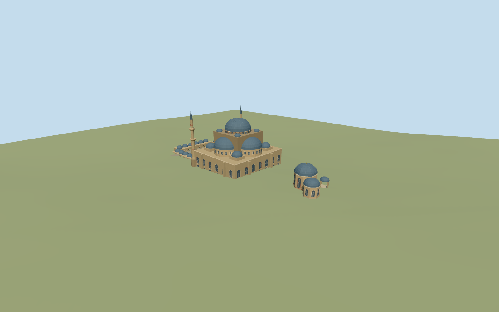

# Şehzade Mosque

Sinan’s Şehzade Mosque with lead-covered central dome, four half-domes, two double-balconied minarets, arcaded court and nearby mausolea.

Authoring state: **review-in-qa.json**. Current completion evidence is in [qa.json](qa.json) and the [completion ledger](../../../../qualla-structures/batches/qualla-003.PROGRESS.md).

- [Şehzade Mosque](https://qualla.com/sehzade-mosque/)

The measured dome span (municipal 18.42 m, structural report rounds to 19 m), 37 m dome crown and 41.1 m twin minarets follow the Turkish measured building study. Other catalogs give different minaret figures. Slope and floor reference are approximate.

The main shell is adapted to the mapped perimeter. Arcades, exact dome shoulders, lead seam rhythms, minaret terracotta ornaments and carved stone opening details are estimates from visual and written evidence.

Three mausolea are modeled near the independently indexed Şehzade Mehmed monument. Exact adjacent outlines and footing heights are documented estimates. Remaining tombs, madrasa, hospice and caravanserai stay outside the reconstruction.

Build: `node content/worldgen/source/places/sx/sxk/sehzade_mosque/models/generate-sehzade-mosque.mjs`. Add `--check` to verify exact regeneration. 27121 triangles; 6 materials; no embedded photographs.
