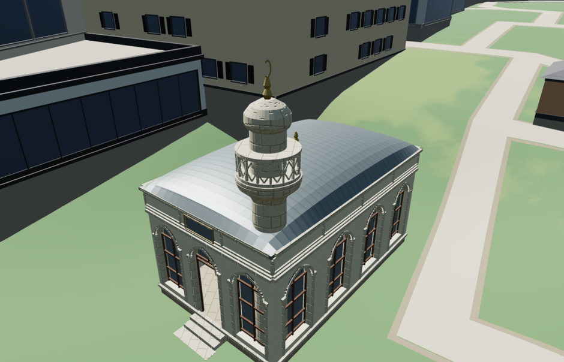

# Sofa Mosque

The pavilion mosque has a shallow metal roof, recessed pointed windows and a small ringed minaret. Two stone treads and a foot landing lead to the recessed door.

The footprint follows OSM way 261824325. The bounded forecourt grade is 35.16 m. The lowest stone meets the rendered grass surface about 9 mm above it at the sampled points.

The fixture retains 78 transportation records, native water and 7 neighboring landmark models. A failed download restores the mapped building. Unload restores ground and land cover and releases the model geometry.

| Detail level | Triangles | Download bytes | Draws |
| --- | ---: | ---: | ---: |
| skyline | 576 | 56,368 | 1 |
| district | 3,416 | 327,164 | 7 |
| street | 8,404 | 797,452 | 7 |
| closeup | 11,740 | 1,105,588 | 7 |

Skyline and district total 383,532 bytes. Six GLBs and 85 placement probes passed. The review covers 57 current renders.

The court elevation and stair proportions use the retained map, terrain and ordinary reference photos. Simplified surrounding geometry crosses some wide fixture views. The model covers the exterior.

[Mapped site frame](map-frame.json) · [Terrain fit](site-fit.json) · [QA evidence](qa.json)
