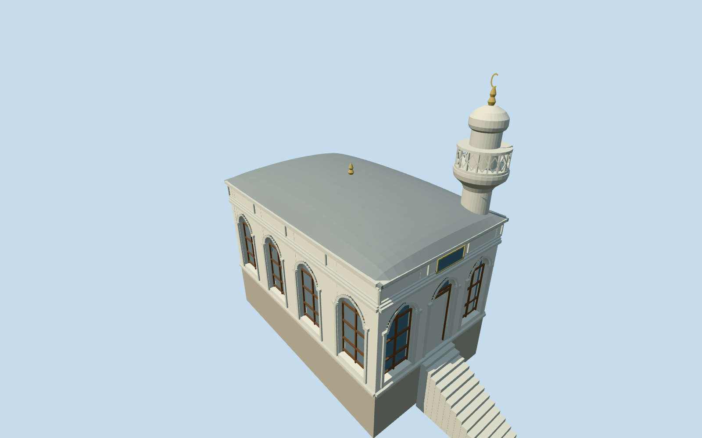

# Sofa Mosque, Topkapi Palace

Sofa Mosque: small pale rectangular prayer hall with four tall pointed windows along its garden side, three front bays and a real central entry, fine brown window mullions, shallow lead cushion roof, paneled upper frieze/cornice and a short attached cylindrical stone minaret with moulded balcony support, a genuinely pierced lozenge guard, blunt rounded cap and finial. Plain interior; no copied inscriptions/art, chandelier, furnishings or independent neighbouring palace range.

## Evidence and reconstruction

Published dimensions and reconstructed details are separated in spec.json. Primary references:

- [Reference](https://commons.wikimedia.org/wiki/File:Sofa_Camii_Topkapi_Istanbul_2007_015.jpg)
- [Reference](https://commons.wikimedia.org/wiki/File:Istanbul_Topkapi_Mus_dec_2016_0966.jpg)
- [Reference](https://commons.wikimedia.org/wiki/File:Sofa_Camii_Topkapi_Istanbul_2007.jpg)

Sofa Mosque: small pale rectangular prayer hall with four tall pointed windows along its garden side, three front bays and a real central entry, fine brown window mullions, shallow lead cushion roof, paneled upper frieze/cornice and a short attached cylindrical stone minaret with moulded balcony support, a genuinely pierced lozenge guard, blunt rounded cap and finial. Plain interior; no copied inscriptions/art, chandelier, furnishings or independent neighbouring palace range.

## Model and axes

11,872 triangles; 33,024 vertices; 7 material groups; 1,335,684 bytes. Native bounds: -6.646, -1.888, -5.970 to 8.259, 11.223, 5.970. Source hash: `sha256:70ab2db23d9cb088f2659eacdec516d092265d2b5bce4365db426dcb5723c823`.

{"x":"east","y":"up","z":"south"}

The geographic proposal uses exact-QID OpenStreetMap evidence. Map-derived orientation and estimated architectural details require real-site visual review; preview eligibility is distinct from geographic/fidelity approval. Map attribution: © OpenStreetMap contributors, ODbL-1.0.

## Reproduce

Run `node packages/worldgen/scripts/generate-additional-landmarks.mjs --ids=sofa_mosque_topkapi_palace` (or add `--check`). The generator preserves manually edited masters by checking their baseline hashes. Import through the standard authored-model workflow with optimization disabled; then capture all QA cameras, including shared-surface views.

## Pending work

- Sofa Mosque: small pale rectangular prayer hall with four tall pointed windows along its garden side, three front bays and a real central entry, fine brown window mullions, shallow lead cushion roof, paneled upper frieze/cornice and a short attached cylindrical stone minaret with moulded balcony support, a genuinely pierced lozenge guard, blunt rounded cap and finial. Plain interior; no copied inscriptions/art, chandelier, furnishings or independent neighbouring palace range.
- Independent Q127418589, OSM way261824325 v24/native35184633913157, corroborated by the Sofa Mosque Commons category. Exact four-corner parent retained. Internal+X southeast follows the long hall toward its entrance; internal+Z southwest faces the photographed four-window garden wall. Minaret is at the far entrance corner, inside the parent footprint.
- Picture-led floor0.6834893142276027m relative to uncovered provider,5.1m wall/cornice,1.1m cushion-roof rise and10.4m minaret/finial. Window/header, hidden rear elevation, minaret position/profile/guard inventory and plain room layout are reconstructed rather than surveyed. Entry14treads follow the sampled original garden grade and do not claim exact historical thresholds.
- Original standard Protomaps20261020/Mapzen extract and161x161/6m terrain retained. Provider internal[0,7] is outside all573 native building records. Upper floor0.12m above highest boundary, protective basement down to lowest boundary; only occupied hall ground is cut and sealed by floor. Original stair/garden ground remains. No bespoke terrain or precinct flattening; exact historical thresholds/accessibility unverified.

This bundle follows the medium-fi standard. Medium-fi appearance and geographic fit are reviewed separately. Hash-bound visual acceptance is recorded separately after capture inspection.
