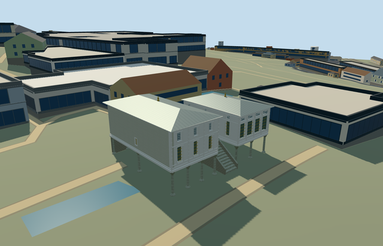

# sofa_pavilion_topkapi_palace - Sofa Pavilion, Topkapi Palace

Reviewed 2026-10-21. **Complete as a medium-fi exterior with approximate native terrain fit. Topkapi remains incomplete: 14/18 ready. Hasoda terrain fit remains pending.**

## Built and inspected

Two independently shaped raised timber wings: northwest glazed hall with oval clerestory tracery and southeast taller ornamental room with paired window levels, pilasters, raised panels and a sparse plastered end wall. Both retain separate shallow lead hips, broad pale soffits and small finials. Eighteen stone supports meet the upper floors, both undercrofts remain open, and a thirteen-tread central stone stair/solid parapets reaches a genuinely open round-arched connector and real room doors. Two ordinary exterior pictures and existing PMTiles guided this continuous authoring pass. Current source, shared, medium-fi and native views inspected.

## Shared textures and browser LODs

Eight existing256px shared graphs across nine roles: painted lap wood, plain wood, lime plaster, limestone, ashlar, standing-seam metal, painted metal and bronze. Plain wood serves trim/floor; linear vertex tints distinguish pale timber and warmer accents. Metric wall/roof/floor quad UVs. No new graph, private atlas or embedded images. Eight close-up draws, one skyline draw; POSITION and NORMAL have separate streams and CPU/GPU byte accounting agrees. Native fixture requests each graph once and releases all model geometry on unload.

| Level | Triangles | Bytes | Draws |
| --- | ---: | ---: | ---: |
| skyline | 771 | 74,572 | 1 |
| district | 3,143 | 309,604 | 8 |
| street | 11,683 | 1,101,464 | 8 |
| closeup | 17,767 | 1,695,336 | 8 |

Initial geometry: **384,176 bytes**. Four authored representations preserve the paired-wing silhouette and central stair. All are within triangle/draw/download budgets. Skyline and district total384176bytes; shared graph caching is used. Flat synthetic fixtures do not establish native ground fit. Physical ordinary-laptop, phone/tablet and dense-city timing measurements remain pending.

## Native placement

Named Sofa Pavilion, site Q170495/way194486642/native35184566575474, exact twelve-corner parent canopy, heading0 in east/up/south coordinates and signed northeast stair-facing. Two actual overlapping standard PMTiles cases at levels14/15 pass; no overlapping level13 feature present. Only its parent native building is suppressed after model loading; all258 independent resident records of259 and all572 wider records of573 remain unchanged. Original161x161/6m terrain, roads and3400906.0006393427square metres water retained. No ground cutout: original terrain remains under both open undercrofts, stair, center and provider. Provider internal[-13,0] is outside all573 original buildings. Each column foot samples the original grid and embeds0.08m; native fit and facing accepted as approximate. Failed loading preserves259 records; each unload restores terrain/water and zero live geometries. All fourteen prior palace assets retain input/source/runtime hashes, including inactive Hasoda.

## Fidelity and limitations

Pictured paired raised-room composition and mapped wing/notch plan guide the exterior. Floor3.3100118364189455m relative to provider, room/eave heights, shallow roof pitches, eighteen-support inventory, window/frame ornament and hidden rear/retaining arrangement are explicit picture-led reconstruction controls. Original coarse6m terrain retained. Historic upper-terrace levels, thresholds and accessibility are unverified. No bespoke terrain, precinct flattening, copied inscriptions/art, furnished rooms or independent neighbouring buildings. Hasoda remains an inactive terrain-fit draft; this does not approve the whole Topkapi collection.

## Targeted checks

Six GLBs: zero Khronos errors/warnings;400 mesh/contact probes;48 current inspected views;two overlapping map cases at levels14/15. Selected source/import/placement/strict medium-fi/scene/sim30/lint checks pass. Sim30 sha256:b45ffc57faa1bcc930f395fd86cca2e1b918a3a6d9389b11fcb6cf3a99d7c00b. Current pins and review reports: [qa.json](qa.json). Editable controls: [map-frame.json](map-frame.json).

## Viewed references

- https://commons.wikimedia.org/wiki/File:Sofa_Kiosk_DSCF2644.jpg - R Prazeres; 2016-05-30; CC-BY-SA-4.0. Viewed only; no copied pixels.

- https://commons.wikimedia.org/wiki/File:Istanbul_Topkap%C4%B1_Palace_Sofa_Kiosk_IMG_8183_1920.jpg - Alexxx1979; 2013-11-23; CC-BY-SA-4.0. Viewed only; no copied pixels.

- https://www.openstreetmap.org/way/194486642 - v17, independently named Sofa Pavilion; no separate Wikidata tag. Site Q170495 retained with this way. OpenStreetMap contributors, ODbL1.0.
