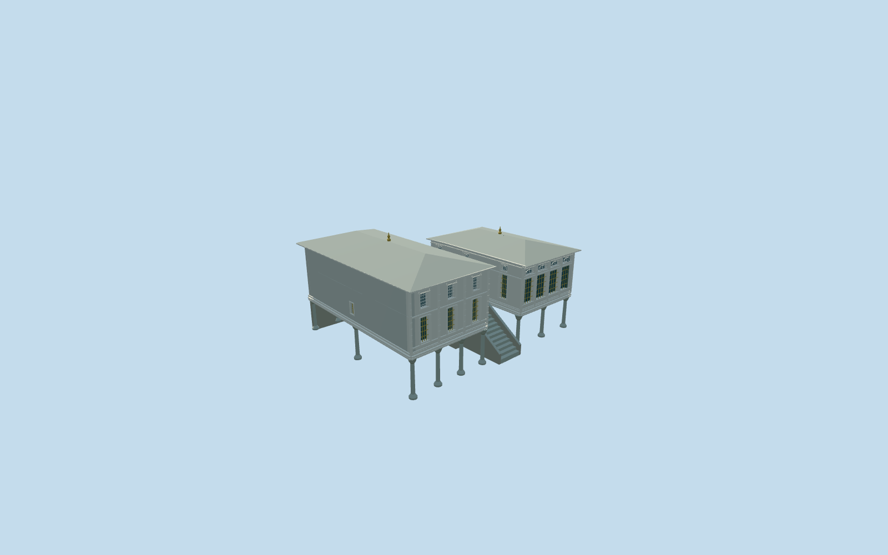

# Sofa Pavilion, Topkapi Palace

Sofa/Terrace Pavilion: two elevated pale painted-timber wings on slender stone columns, different glazed-hall and ornamental-room window rhythms, two separate shallow lead hips with small finials, broad white soffits, raised panel/cornice work and central stone stair/round-arched entrance connector. Open undercrofts retain native ground. Do not include the independent Baghdad/Yerevan/Sofa Mosque, surrounding retaining precinct, copied interior art or furnishings.

## Evidence and reconstruction

Published dimensions and reconstructed details are separated in spec.json. Primary references:

- [Reference](https://commons.wikimedia.org/wiki/File:Sofa_Kiosk_DSCF2644.jpg)
- [Reference](https://commons.wikimedia.org/wiki/File:Istanbul_Topkap%C4%B1_Palace_Sofa_Kiosk_IMG_8183_1920.jpg)

Sofa/Terrace Pavilion: two elevated pale painted-timber wings on slender stone columns, different glazed-hall and ornamental-room window rhythms, two separate shallow lead hips with small finials, broad white soffits, raised panel/cornice work and central stone stair/round-arched entrance connector. Open undercrofts retain native ground. Do not include the independent Baghdad/Yerevan/Sofa Mosque, surrounding retaining precinct, copied interior art or furnishings.

## Model and axes

17,767 triangles; 51,373 vertices; 8 material groups; 2,067,460 bytes. Native bounds: -12.279, -0.600, -12.954 to 12.279, 10.560, 12.954. Source hash: `sha256:70863bb5e6364b8b4890b0e4d0915d29bd940a55ba09825100640e1c5a3bb335`.

{"x":"east","y":"up","z":"south"}

The geographic proposal uses exact-QID OpenStreetMap evidence. Map-derived orientation and estimated architectural details require real-site visual review; preview eligibility is distinct from geographic/fidelity approval. Map attribution: © OpenStreetMap contributors, ODbL-1.0.

## Reproduce

Run `node packages/worldgen/scripts/generate-additional-landmarks.mjs --ids=sofa_pavilion_topkapi_palace` (or add `--check`). The generator preserves manually edited masters by checking their baseline hashes. Import through the standard authored-model workflow with optimization disabled; then capture all QA cameras, including shared-surface views.

## Pending work

- Sofa/Terrace Pavilion: two elevated pale painted-timber wings on slender stone columns, different glazed-hall and ornamental-room window rhythms, two separate shallow lead hips with small finials, broad white soffits, raised panel/cornice work and central stone stair/round-arched entrance connector. Open undercrofts retain native ground. Do not include the independent Baghdad/Yerevan/Sofa Mosque, surrounding retaining precinct, copied interior art or furnishings.
- Named Topkapi Q170495 member OSM way194486642 v17 / native35184566575474, explicitly Sofa Köşkü/Sofa Pavilion. No separate Wikidata tag was present in the standard map identity preflight, so retain the site QID with this independent way. Exact twelve-corner canopy retained. Internal+X southeast orders the glazed hall then taller ornamental room; internal-Z northeast faces the photographed central garden stair.
- Picture-led elevated walking floor3.3100118364189455m relative to uncovered provider,3.15m above the highest native canopy boundary. Glazed hall eaves4.55m above floor; ornamental wing5.35m; shallow lead hips1.05/1.15m. Two-room partition follows exact mapped wings/connector. Roof pitches,18support positions, window/frame ornament inventory, back wall/floor arrangement and room heights are reconstruction controls, not surveyed dimensions.
- Existing standard Protomaps20261020/Mapzen extract and original161x161/6m grid retained. Provider internal[-13,0] is outside all573 native buildings. Each shaft base samples retained ground and embeds .08m; central stair foot follows that ground. Keep ground beneath both open undercrofts and their original notched courts. No terrain/water cutouts, flattening, bespoke terrain or independent surrounding-terrace reconstruction. Historical thresholds/accessibility remain unverified.

This bundle follows the medium-fi standard. Medium-fi appearance and geographic fit are reviewed separately. Hash-bound visual acceptance is recorded separately after capture inspection.
