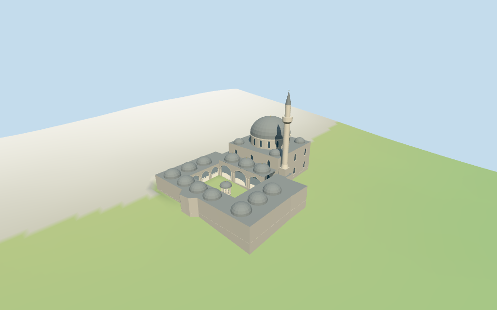

# Sokollu Mehmed Pasha I Mosque

Individual Sokollu Mehmed Pasha I Mosque at Kadirga: irregular mapped envelope and open medrese court,pale stone arcades,rows of small grey domes,three-domed porch,tall hall with windowed central dome,one slender pale minaret with balcony and grey cone,small domed fountain canopy and selected corner turrets. Detached structures,neighbor buildings,furnished interiors,historic tile/calligraphy art and street furniture are excluded.

## Evidence and reconstruction

Published dimensions and reconstructed details are separated in spec.json. Primary references:

- [Reference](https://commons.wikimedia.org/wiki/File:Sokollu_Mehmet_Pasha_Camii_exterior.jpg)
- [Reference](https://commons.wikimedia.org/wiki/File:Sokollu_Mehmet_Pasha_mosque_5722.jpg)

Six existing shared256² limestone,raw limestone,standing-seam metal,plain wood,ceramic tile and bronze graphs;seven merged roles including local opaque glazing. Metric UVs,linear tints,no embedded images,unique atlas,copied historic artwork or baked light.

## Model and axes

10,649 triangles; 31,947 vertices; 7 material groups; 1,282,152 bytes. Native bounds: -27.354, -3.492, -22.709 to 27.414, 36.239, 22.709. Source hash: `sha256:b974615ba9d4284f74775da74126f7fdc0bfca776527766d73e6de216b067d07`.

{"x":"retained long axis;main hall atpositive X","y":"up","z":"cross axis"}

Standard Protomaps20261014 /Mapzen-USGS viewer extractN0476;datum 23.286754970166193 m. 416 building-ring samples span -3.084618103491099 to 2.796820877134717 m. Floor 0.2386633355291785 m is the median of 148 outer/court-edge samples plus0.25 m. Footings follow sampled grade;two exact notched masks preserve the mapped court hole. Fountain foundation uses the maximum standard DEM sample around its local base,not the range floor. Exact stairs,thresholds and retaining levels are unverified.

## Reproduce

Run `node packages/worldgen/scripts/generate-additional-landmarks.mjs --ids=sokollu_mehmed_pasha_i_mosque` (or add `--check`). The generator preserves manually edited masters by checking their baseline hashes. Import through the standard authored-model workflow with optimization disabled; then capture all QA cameras, including shared-surface views.

## Pending work

- Retained Q1572472 /relation4567928 mosque identity,anchor,undirected axis,20-vertex outer envelope and eight-vertex courtyard remain unchanged. Current named mosque point and main25-vertex ring with a six-vertex hole share id52776562701176;tile seam points are retained. Positive X is assigned to the main hall and negative X to the medrese courtyard. Facing,internal partitions,dome/tower/fountain positions and bay counts are picture/map-guided estimates. Only the main mosque envelope is selected;neighbor buildings remain host content.
- No retained dimensional facts or current main-building height tags exist. Heights above the local floor are estimates: medrese ranges5.8 m,porch7.2 m,hall11.8 m,drum15.8 m,main dome22.6 m plus0.9 m finial,minaret36 m including tip. Small roof domes,gallery openings,corner turrets and the fountain canopy are estimated. Current restoration condition is not established.
- Standard Protomaps20261014 /Mapzen-USGS viewer extractN0476;datum 23.286754970166193 m. 416 building-ring samples span -3.084618103491099 to 2.796820877134717 m. Floor 0.2386633355291785 m is the median of 148 outer/court-edge samples plus0.25 m. Footings follow sampled grade;two exact notched masks preserve the mapped court hole. Fountain foundation uses the maximum standard DEM sample around its local base,not the range floor. Exact stairs,thresholds and retaining levels are unverified.
- Two inspected2008 pictures guide the exterior vocabulary. All internal divisions and vertical dimensions remain estimates. Historic tiles,calligraphy,fountain carving,interiors,engineering,exact grade joins and current condition are unverified. Physical-device/full-city timing remains pending.

This bundle follows the medium-fi standard. Medium-fi appearance and geographic fit are reviewed separately. Hash-bound visual acceptance is recorded separately after capture inspection.

## Additional geographic data

©OpenStreetMap contributors;Protomaps;Mapzen/USGS terrain.
