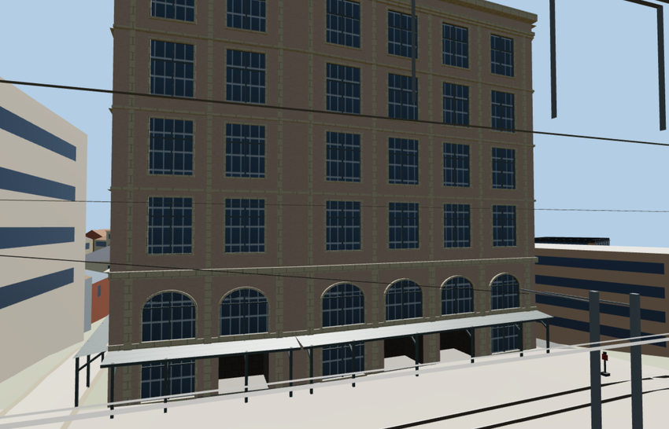

# Tünel funicular

The terminal models follow the mapped Beyoğlu and Karaköy footprints and their photographed entrance orientations. The mapped F2 line and passing loop guide the buried brick lining and rails. The lower terminal’s rear and roof, the tunnel section, and the running grades are approximate.

The two small approach grades join the entrances to their immediate streets. The maximum difference between the sill and the rendered approach was 9 cm across 16 samples per detail level. All four levels retained 1,377 neighboring building features, the 439 road records, and the native water. The terrain remains continuous above the buried route. Model failure restores both terminal footprints and model eviction restores the pre-load ground.

The detailed source rebuilds byte for byte. Its browser levels use 332, 2,756, 15,944, 30,624 triangles and share seven material graphs. The first two files total 292,896 bytes. Six GLBs passed Khronos validation with zero embedded images.

[Placement evidence](placement-report.json) · [Approach controls](site-fit.json) · [Visual review](qa.json)
