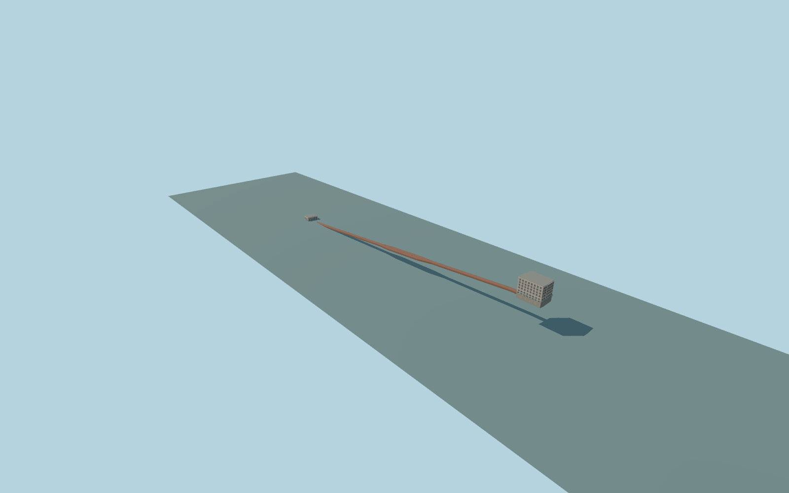

# Tünel funicular system

ConnectedTünelfunicular system visualization:both mapped terminal-host exteriors andthecurrent undergroundmainline/passingloop envelope. Upper26m Metrohan house:classical pale/pink multistorey corner mass,arched lowerbays/pilasters,rectangular upperwindows,deepcornices andwraparound canopy. LowerKarakoy host:light two-level entrance mass,large recessed rectangular doorway,upper archedpanes andsteppedcornice. Preserve everyintervening independentbuilding andoriginal terrain outsideactualclosedterminalfloors. No copiedsigns,photobanners,logos,flags,anniversarydecorations,people,vehicles,train/interior operationalclaims orfutureworks.

Rebuild: `node packages/worldgen/scripts/generate-tunel.mjs`;append `--check` for exact source bytes. Select import/LOD/placement with `--ids=tunel`. Detailed source and four browser tiers are separate ignored GLB outputs.

The Karaköy photograph establishes the public front. Its 9 m host volume, hidden roof and rear elevations are approximate.

The mapped F2 route and passing loop determine the horizontal alignment. Casing section, rail bed and hidden construction are exterior-review approximations.

The two fitted approach grades use standard elevation data. The precise step, street and rail levels are unsurveyed.

Original geometry:repository license. Map:© OpenStreetMap contributors,ODbL-1.0;Protomaps. Standard terrain:terrain-grid.json. Ordinary pictures stay local and are not redistributed or used as textures. Current acceptance:qa.json.
