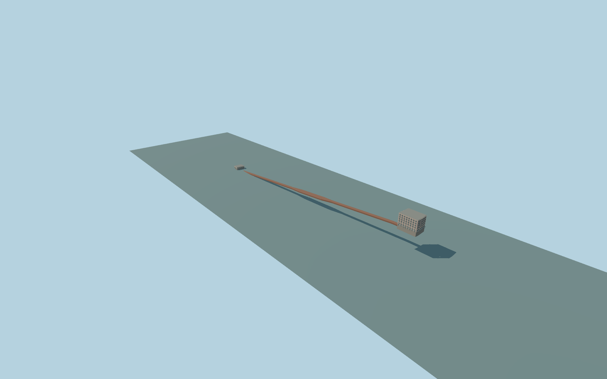

# Tünel funicular system

ConnectedTünelfunicular system visualization:both mapped terminal-host exteriors andthecurrent undergroundmainline/passingloop envelope. Upper26m Metrohan house:classical pale/pink multistorey corner mass,arched lowerbays/pilasters,rectangular upperwindows,deepcornices andwraparound canopy. LowerKarakoy host:light two-level entrance mass,large recessed rectangular doorway,upper archedpanes andsteppedcornice. Preserve everyintervening independentbuilding andoriginal terrain outsideactualclosedterminalfloors. No copiedsigns,photobanners,logos,flags,anniversarydecorations,people,vehicles,train/interior operationalclaims orfutureworks.

Rebuild: `node packages/worldgen/scripts/generate-tunel.mjs`;append `--check` for exact source bytes. Select import/LOD/placement with `--ids=tunel`. Detailed source and four browser tiers are separate ignored GLB outputs.

ConnectedTünelfunicular system visualization:both mapped terminal-host exteriors andthecurrent undergroundmainline/passingloop envelope. Upper26m Metrohan house:classical pale/pink multistorey corner mass,arched lowerbays/pilasters,rectangular upperwindows,deepcornices andwraparound canopy. LowerKarakoy host:light two-level entrance mass,large recessed rectangular doorway,upper archedpanes andsteppedcornice. Preserve everyintervening independentbuilding andoriginal terrain outsideactualclosedterminalfloors. No copiedsigns,photobanners,logos,flags,anniversarydecorations,people,vehicles,train/interior operationalclaims orfutureworks.

Upper host uses native26m relative architectural height. Lower host9m is a two-level entrance interpretation; full hidden upper/rear extent is unverified. One standard lower outside sample 15.8102388m defines commonY=0; upper source grade 53.33291019999999m uses the unchanged upper outside field. Floors are grade+.65m; unsurveyed thresholds. Explicit illustrative underground envelope. Native horizontal mainline/passing-loop retained without length rescaling; rail bed follows the lower of a terminal-to-terminal linear grade and the unchanged global terrain minus 6.2m. This is not a surveyed tunnel section, alignment depth or operational interior.

The lower photograph only establishes the entrance portion, not the full host roof/height. Rear window inventory is regularized; exact terminal associations/orientation, hidden rooms, tunnel depth, section and junction geometry are approximate. The original subterranean-identity rejection remains a readiness blocker until the complete new scope is accepted. No operational or navigable underground interior. Physical laptop/phone timing and numerical LOD errors remain unmeasured.

Seven existing shared256px graphs:plaster_lime,stone_limestone,stone_granite,metal_standing_seam,metal_painted,window_grid andbrick; seven merged semantic groups. MetricUVs,linear colors; opaque walls/roof/casing and dedicated window panes. No private or embedded images; no lettering/photobanners. Skyline/district retain both complete terminal silhouettes and entry-canopy family; underground geometry is omitted while occluded. Street/closeup add mapped mainline and passing-loop casings/railbeds without deleting the city above; source master additionally retains denser arch facets, window trims and sleepers.

Original geometry:repository license. Map:© OpenStreetMap contributors,ODbL-1.0;Protomaps. Standard terrain:terrain-grid.json. Ordinary pictures stay local and are not redistributed or used as textures. Current acceptance:qa.json.
