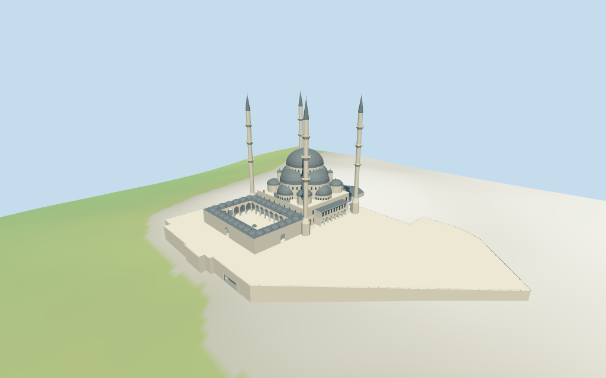

# kocatepe_mosque — Kocatepe Mosque

Reviewed2026-10-17 for the stated medium-fi exterior and approximate map fit. Architectural heights,small details,current finish and exact ground joins remain limited.

## Exterior and shared materials

Inspected all11 portable views including the final1024×640 summary. The main windowed dome, four descending large/small half-domes and corner caps, four slender three-balcony minarets, open pointed courtyard arcades and roof domes, small courtyard basin, WSW two-storey loggia, raised timber doors/steps, eastern hexagonal ancillary mass and mapped raised platform are present. The terrain view shows the open lower road portal. Fine calligraphy,stone/lattice details,basement shops and unseen interiors are omitted;architectural partitions and current finishes remain estimates.

Inspected all11 shared/geographic-flat views. Six existing256² limestone,continuous limestone,standing-seam metal,plain wood,cast bronze and concrete graphs serve seven merged roles including local opaque glazing. Metric UVs,linear tints,zero embedded images or unique atlases. Each graph read once;eviction leaves zero live model geometries. The north-up model agrees with the nine selected raw controls and retained orientation. Flat geographic ground hides the below-zero tunnel;the source-terrain and medium-fi terrain views show it. This fixture does not approve exact urban street thresholds.

## Browser levels

| Level | Triangles | Bytes | Draws |
| --- | ---: | ---: | ---: |
| skyline | 954 | 98920 | 1 |
| district | 3869 | 354548 | 7 |
| street | 15593 | 1428760 | 7 |
| closeup | 40855 | 3979312 | 7 |

**453,468 bytes initial skyline plus district**,plus shared textures. Six shared graphs,seven roles,zero embedded images.

Inspected all27 medium-fi frames: Economy/High,noon/late light,three distances,silhouette,six details,four matched levels and four transitions;also the matched skyline at full size. Skyline954 retains the central dome/four descending caps,four slender three-balcony minarets and open court/side colonnade. District3869 adds curved roof domes and window rhythm;street15593 adds selected recesses and trim;close40855 refines curves and columns. Initial skyline plus district453468bytes plus shared textures;one/seven draws. Detailed close views show intentional changes in roof curves,small caps and column/rail detail between levels. Synthetic Mediterranean context is a fixture;physical laptop/phone timings remain pending.

## Placement and scope

Retained exact OSM relation6276462 / Q853935 is the current standard viewer whole52776564409710 with its open courtyard. Current platform35184794287588 has a5m height tag; hall/dome parts and four circular minaret parts provide separate controls. The small eastern hexagonal annex is retained as a mapped ancillary mass with unverified function. All nine current controls and raw properties remain unchanged. PositiveX follows the main prayer hall toward SSE,negativeX the NNW courtyard,and positiveZ the WSW public side loggia. Original anchor/heading retained;no horizontal rescale. Current map tags omit QID on the tile geometry,so relation ID continuity and retained exact identity remain distinct from tile properties. Standard viewer DEM datum907.8431686498072m. Platform/court plane2.483275388141692m is the median of256 outside-perimeter samples every3m at1m offset plus the mapped5m platform height. Raw platform samples range-8.47059724090093..4.2058253506558m. The foundation follows raw boundary heights;the preview seats terrain under the mapped platform. Two tagged Bankacı tunnel centre-lines retain raw geometry;7m carriageway widths and4.8m clearance are visualization estimates. The tunnel floor follows the retained DEM,with open side portals and no replacement of host roads. This approximates a raised terrace on a coarse hillside DEM;exact road thresholds,stairs,retaining heights and street joins remain unverified. Independently reunited all nine building controls /139 raw points and both tagged Bankacı tunnel roads from current normal viewer tiles,retaining exact properties and fragment geometry. The lower platform has a5m mapped height;main architectural heights and7m carriageway widths/4.8m clearance are estimates. All7164 renderer footprint checks pass:the nine controls covered and1185 exterior host buildings preserved across six files. Reproduced2471 raw platform samples,256 outside-perimeter samples,floor as median plus5m and1146 seated preview points. Raw161² DEM remains source input. Tunnel floor and ceiling follow matching triangulated samples;exact road/terrace/step joins remain unverified.

Individual medium-fi Kocatepe Mosque and mapped raised platform: windowed main dome/four cascading semi-domes/corner caps, four three-balcony minarets, open pointed courtyard with low basin,side loggia/raised doors and stairs,mapped eastern annex and open Bankacı tunnel passage. Nine raw current map controls and two tagged tunnel centre-lines retained. Main vertical partitions,curved roofs,arcade/bay counts,unmapped small details,annex function and precise ground joins remain estimates. Six existing shared graphs,seven merged roles,four browser levels. Current finish,temporary courtyard cover,fine artwork,basement shops and unseen interiors remain limited. The retained identity has no linked height/width/length facts. The lower platform5m tag is retained separately from all estimated architectural heights. Picture-proportioned exterior: hall walls15m; main dome drum31.5–37m with11.5m cap and1.5m finial; four cascading large/small semi-domes,corner caps/buttress turrets; four minarets with three balconies and estimated88.9m tips. Courtyard arcades/roof domes,side loggia,door/step positions,low courtyard basin/caged cap,eastern annex,parapets and fine profiles are estimates. The courtyard picture shows temporary overhead construction framing;it is omitted and present cover/finish remain unverified. Inscriptions,fine stonework,lattice,interiors,basement shops and exact engineering are not reconstructed. Four useful exterior/courtyard pictures guide this original simplified reconstruction. The courtyard picture contains temporary overhead construction framing,omitted here;present courtyard cover is not independently established. No bespoke surveys,redistributed pictures,copied artwork,engineering reconstruction or furnished interior.

## Verification

49 current views inspected;589 FrontSide rays;7164 renderer footprint checks;six Khronos validations with zero errors/warnings/images. Source,runtime,input,LOD,frame,report,shared-graph and placement hashes match. Targeted source reproduction,scene validate,sim30 and recipe-only Biome pass. The existing great_mosque_of_aleppo–great_mosque_of_xi_an full source checkpoint was reused;the next routine batch checkpoint is not due after a single model.

Source:sha256:bfdd0fb26e34381316125f00f78af577fff2dd406592ad6eef2c6b35c24c1465

Runtime:sha256:5f094a55ff513b58bef38f852022f86faddbfa83e8154db2def4d7cccdef0eab

Input:sha256:9f3b97b5500fc0f8a15db27171102cade91914f2933dedf10ec4150796d3f0eb

Commands: targeted generate/import/LOD --ids=kocatepe_mosque;generate --check;portable reflections/antialias/fitted shadows;shared reflections/adaptive clipping/bounded placement;medium-fi reflections;scene validate/sim30;recipe-only Biome. Bulk captures stay local and ignored.

## Inspected picture references

[A.Savin, Wikipedia — 2021-10-29](https://commons.wikimedia.org/wiki/File:Ankara_asv2021-10_img41_Kocatepe_Mosque.jpg). Free Art License for photograph;viewed only. Inspected960×960 overall exterior. Four very slender pale minarets have three projecting balconies and dark pointed caps; a broad grey main dome crowns descending windowed half-domes and smaller corner caps. Pale coursed walls,stepped buttress bases,raised platform,side two-storey loggia and broad approaches define the massing.

[brewbooks — 2007-05-21](https://commons.wikimedia.org/wiki/File:Kocatepe_Camii,_Ankara_01.jpg). CC-BY-SA-2.0 for photograph;viewed only. Inspected960×720 WSW exterior. Central projecting side loggia has an open pointed lower arcade and an upper band of dark rectangular windows under a shallow grey roof. Flanking raised pointed door portals and broad stairs,arched upper windows,parapet rhythm,capped corner turrets and the cascading windowed dome drums are visible. The Commons courtyard category does not make this an inside-court picture.

[Dosseman — 2018-05-17 metadata;uploader notes some views are older scans](https://commons.wikimedia.org/wiki/File:Ankara_Kocatepe_Mosque_Exterior_in_2018_12.jpg). CC-BY-SA-4.0 for photograph;viewed only. Inspected full960×651 entry-flank view. Raised pointed timber door in a broad stone recess,lower rectangular and upper pointed windows,tapered minaret pedestal,broad split stairs and side loggia. Fine inscriptions and stone patterns are not copied;picture date/current finish are qualified.

[Dosseman — 2018-05-17 metadata;historical/construction state](https://commons.wikimedia.org/wiki/File:Ankara_Kocatepe_Mosque_Courtyard_in_2018_13.jpg). CC-BY-SA-4.0 for photograph;viewed only. Inspected960×618 inner courtyard. Tall pointed arcade on pale columns,two tiers of opaque rectangular openings and a raised central pointed entry;low circular basin with hemispherical lattice cover. Temporary overhead framing and construction materials are visible and omitted. Original generic geometric cap/rails approximate the basin;no copied artwork or claim about present roof cover.
