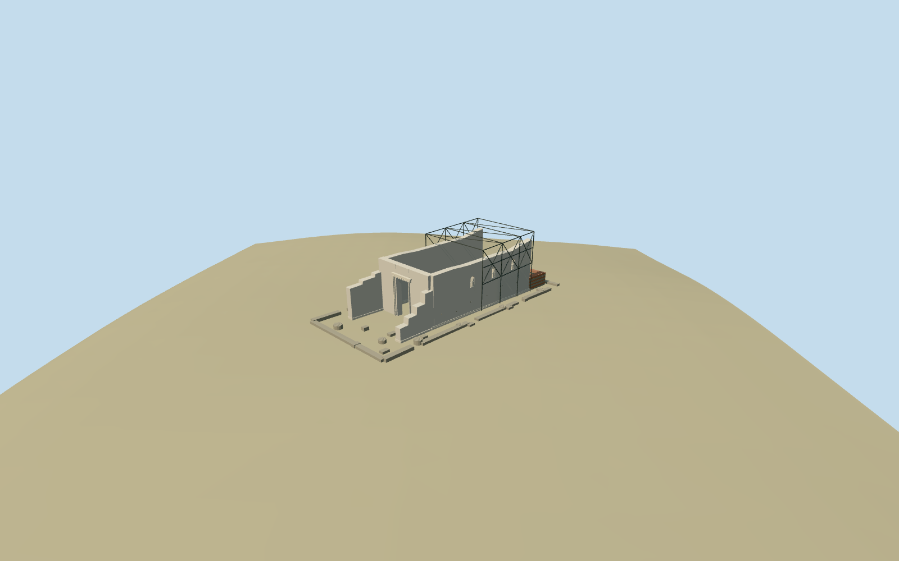

# Temple of Augustus in Ankara

Surviving open temple ruins inside the mapped Ankara archaeological site: two tall broken limestone cella walls, southwest open vestibule, tall genuine rectangular portal with layered jambs/lintel, three small arched window openings in the southeast wall, low rear stone/brick-banded remnants, scattered foundations and broken drums, plus an open modern steel conservation frame. No ancient roof, pediment or complete colonnade is restored. Internal dimensions and remnant/frame inventory are picture-led approximations; the neighboring mosque is independent native context.

## Evidence and reconstruction

Published dimensions and reconstructed details are separated in spec.json. Primary references:

- [Reference](https://commons.wikimedia.org/wiki/File:Ankara_Temple_of_Augustus_and_Rome_exterior_from_S_in_2019_02.jpg)
- [Reference](https://commons.wikimedia.org/wiki/File:Augustus_Tap%C4%B1na%C4%9F%C4%B1_(2).jpg)
- [Reference](https://commons.wikimedia.org/wiki/File:Ankara_vorhalle_augustus-roma-tempel.jpg)
- [Reference](https://commons.wikimedia.org/wiki/File:AugustusAnkara2.jpg)

A deterministic site recipe and reusable Khmer geometry helpers build the specific surviving open cella, portal and rear remnants with photo-led steel supports inside the mapped archaeological site. Four shared256-square stone/brick/painted-metal graphs, metric UVs, linear tints and four authored browser levels; no embedded images or copied narrative atlas.

## Model and axes

2,148 triangles; 6,444 vertices; 5 material groups; 261,216 bytes. Native bounds: -25.856, -2.617, -26.158 to 25.771, 13.155, 26.215. Source hash: `sha256:4ac4f58b41fa967c88f45aaa754e00ce8c3c4c4dc91f462f5a99807c15bc602d`.

{"x":"east","y":"up","z":"south"}

The geographic proposal uses exact-QID OpenStreetMap evidence. Map-derived orientation and estimated architectural details require real-site visual review; preview eligibility is distinct from geographic/fidelity approval. Map attribution: © OpenStreetMap contributors, ODbL-1.0.

## Reproduce

Run `node packages/worldgen/scripts/generate-additional-landmarks.mjs --ids=N0531` (or add `--check`). The generator preserves manually edited masters by checking their baseline hashes. Import through the standard authored-model workflow with optimization disabled; then capture all QA cameras, including shared-surface views.

## Pending work

- Surviving open temple ruins inside the mapped Ankara archaeological site: two tall broken limestone cella walls, southwest open vestibule, tall genuine rectangular portal with layered jambs/lintel, three small arched window openings in the southeast wall, low rear stone/brick-banded remnants, scattered foundations and broken drums, plus an open modern steel conservation frame. No ancient roof, pediment or complete colonnade is restored. Internal dimensions and remnant/frame inventory are picture-led approximations; the neighboring mosque is independent native context.
- Exact-QID Q1640233/way469691342 fixes the approximately59.656x27.054m archaeological-site envelope and named standard PMTiles point35184841780174 corroborates identity. This is an archaeological polygon, not a native building shell. Root heading0, internal architectural angle-0.802151033991rad gives northeast/southwest long axis; the photographed entrance is assigned southwest. Cella, vestibule, rear remnants and bracing are picture-led subdivisions within that envelope, not independently mapped wall surveys. Preserve the separate northwest mosque/native building35184527286414 and all other native buildings; no building replacement mask.
- Picture-led broken wall crest about10.4-11.5m above anchor datum, southwest portal threshold about1.0m with8.0m clear opening, and open modern support frame about13.1m above datum. Rear brick-banded remnants roughly3m above local grade; low foundations/drums generally0.4-1.0m. Heights, exact wall subdivisions, window/frame locations and damage are approximate; no complete ancient reconstruction or exact conservation engineering inventory.
- Retain pinned standard Protomaps2026-10-14/Mapzen13-14 original6m urban terrain, water and every independent building. Long masonry bottoms and low foundations follow sampled native grade and are buried0.55m; tall wall crests and portal lintel are level/broken picture-led profiles, not a huge maximum-grade podium. Individual drums/blocks have locally sampled buried feet. Keep cella/vestibule native ground open; no flattened archaeological precinct or ground/water/building cutout. Standard coarse urban terrain falls about4m along the site and does not resolve exact excavated floors or thresholds.
- Cella, vestibule, rear remnants, broken drums and steel support subdivisions, heights and individual damage are picture-led approximations within the mapped archaeological site. Standard urban DEM does not resolve excavation floors or thresholds. The modern neighboring mosque stays independent native context. No intact ancient roof/colonnade, engineering survey, copied readable inscription or sculpture is claimed.

This bundle follows the medium-fi standard. Medium-fi appearance and geographic fit are reviewed separately. Hash-bound visual acceptance is recorded separately after capture inspection.

## Additional geographic data

©OpenStreetMap contributors; Protomaps; Mapzen/USGS terrain.
