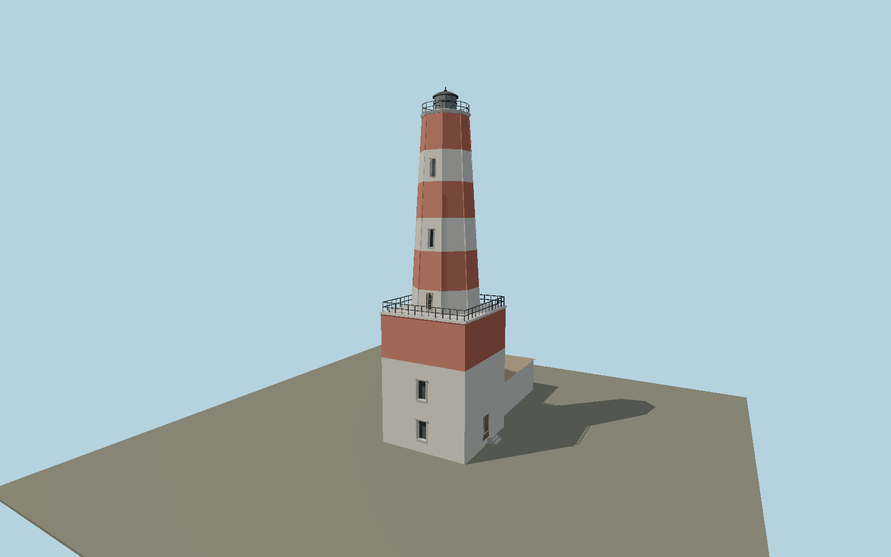

# Shabla Lighthouse — shabla_lighthouse

Tall red and white tapering octagon with real recessed narrow openings, crisp corner ribs and a small dark lantern. Broad square striped masonry base with stacked southern windows and attached low hipped keeper house to the north.

## Identity and evidence

Exact catalog identity **Q21014964**. Source facts: `{"heightMeters":32,"basis":"Municipal32m height, embedded tower coordinate and inspected official/July2026 photographs. The mapped attached service house lies south of the municipal tower control. The exact-QID node18.3m south is retained for identity only. Tower cross-section and floor allocation are photo proportions.","serviceHouseCentroid":[28.606992875,43.54025185],"originalMasterHash":"sha256:e02f0e8ca895b64325a5b42b40c3a7aaa3877c4a5dd491d51a89258f0d336df0"}`. The source specification keeps published dimensions separate from reconstructed details.

- https://shabla.bg/directory/shablenski-far/
- https://shabla.bg/wp-content/uploads/2024/02/shabla-lightghouse-slide-1.jpg
- https://www.openstreetmap.org/node/9031362149
- https://www.openstreetmap.org/way/262498736

Original geometry and shared procedural materials. Official photographs are research references only; no reference imagery or third-party mesh is embedded or redistributed.

## Authored geometry and materials

8,410 triangles, 15,924 vertices, 9 surface groups; 679,276 source bytes. SHA-256: `sha256:16851288e86d80f1cf4e453aeccd8fca419c612c7d53768bfc036b13b188dfa4`. Actual bounds: -7.534, 0.000, -15.935 to 5.200, 32.000, 4.390 m.

Shared canonical material graphs with metric UV repeats in extras.molenSurface; portable glTF PBR factors and vertex colors remain. Dark recesses/lantern panels retain local fallback materials. Shared references: `matgraph:molen.worldgen.material.plaster_lime` (2 × 2 m), `matgraph:molen.worldgen.material.stone_ashlar` (2.4 × 1.5 m), `matgraph:molen.worldgen.material.stone_limestone` (2.4 × 1.6 m), `matgraph:molen.worldgen.material.tile_ceramic` (2.4 × 2.4 m), `matgraph:molen.worldgen.material.metal_painted` (2 × 2 m), `matgraph:molen.worldgen.material.stone_granite` (2 × 2 m), `matgraph:molen.worldgen.material.wood_plain` (2 × 0.25 m), `matgraph:molen.worldgen.material.concrete_plain` (2 × 2 m). Model-native axes: {"up":"+Y","front":"+Z","origin":"Tower ground-contact center at municipal coordinate. +Y up; +Z points roughly north (2.71 degrees true), the stacked tower openings face north, the attached keeper house extends south (-Z), and +X door/steps face inland/west. Municipal tower coordinates and mapped house axis choose the sign; the exact-QID OSM node is an identity control with an approximately18.3m southward position discrepancy."}.

## Placement proposal

+Y up; +Z points roughly north (2.71 degrees true), the stacked tower openings face north, the attached keeper house extends south (-Z), and +X door/steps face inland/west. Municipal tower coordinates and mapped house axis choose the sign; the exact-QID OSM node is an identity control with an approximately18.3m southward position discrepancy. Municipal embedded tower coordinates are the position control, not an engineering survey. The exact-QID OSM node lies about18.3m south, and its identity alone does not validate its point position. North-up aerial and the inspected July2026 west-side photograph establish house/tower quadrant; photo metadata azimuth312 disagrees with the GPS-to-tower direction and is not used as a bearing. House centering follows the mapped rectangle; its scale, 8.5m square tower base, taper, windows, floor allocation, rail spacing and fittings remain photo proportions. Towerheight32m is distinct from focalheight36m; Y0 uses host terrain contact, not surveyed sea level. Detached station buildings, hedges, shore and interiors are not part of this asset. Paint age and individual masonry are generalized. Proposed anchor 28.606973081938126, 43.540340797833935 (longitude, latitude), heading 3.0942136535897933 radians. Elevation policy: **terrain-contact**. This is a reviewable proposal, not a completed site-fit certification. Ground models require terrain contact; offshore models also require water-datum and base-height checks.

## Limitations and review

- The modeled exterior follows the cited published facts and inspected photographs. Unpublished dimensions and local fittings are explicitly photo-proportioned; no claim of engineering survey accuracy is made.
- Portable PBR and shared metric surfaces are provided. Surface weathering, material color under local lighting and fine facade relief require close render review before maximum-detail acceptance.
- Paint wear and individual repairs are represented by shared masonry; the official image has no precise capture date. Tower plan is photograph-scaled against32m height; neighboring detached station houses remain separate map features.

Near/far fixtures are in `spec.qaCameras`. Float32 finite geometry, triangle degeneracy and winding are checked by the generator. Current rendering, shared-material, maximum-fidelity and geographic review results are recorded in `qa.json` and the readiness ledger; source generation alone does not approve a model.

Regenerate with `node packages/worldgen/scripts/generate-lighthouse-models.mjs --ids=shabla_lighthouse`; add `--check` for reproducibility. Editable component recipes are in `packages/worldgen/scripts/lighthouse-atlantic-models.mjs`. The generator protects artist-edited master hashes and preserves import/capture/shared-capture/QA documents.
