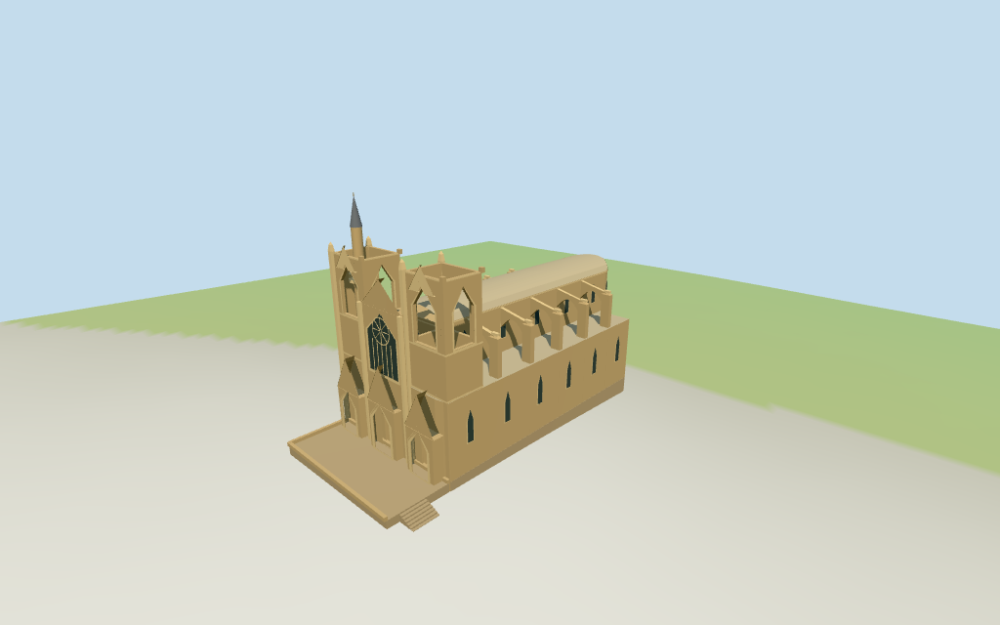

# Lala Mustafa Pasha Mosque

Individual current Lala Mustafa Pasha mosque exterior with three Gothic west portal hoods, central pointed rose panel, open upper western tower shells, northern minaret, low vaulted nave/aisles/rounded apse, flying buttresses, closed doors and approximate raised terrace/side steps.

## Evidence and reconstruction

Published dimensions and reconstructed details are separated in spec.json. Primary references:

- [Reference](https://www.venturecyprus.com/plan-your-adventure/famagusta-salamis-eman-tours)
- [Reference](https://www.mykibris.com/haber/ziyaretcilerini-hayran-birakan-eser-lala-mustafa-pasa-cami-11402)

Five existing shared 256-square sandstone/slate/raw-stone/bronze/wood graphs use metric UVs and linear tints. Sandstone spans wall/trim/roof roles; glazing uses vertex colors. No embedded images.

## Model and axes

5,446 triangles; 16,338 vertices; 8 material groups; 658,232 bytes. Native bounds: -43.325, -1.621, -15.670 to 30.788, 47.420, 20.100. Source hash: `sha256:58f20a61a060dda35e3a613d8cb231d9fe1d940d50833157b4ce6e88d1665e91`.

{"x":"east toward rounded apse","y":"up","z":"south toward terrace steps"}

Individual exterior from two useful pictures and standard viewer PMTiles/DEM. NativeY0 follows10.911700m standardDEM; estimated2.8m floor, terrace and steps approximate ground contact. Retained old site ele21m disagrees with coarse DEM and is not a surveyed floor control. Exact courtyard/threshold joins and navigable interiors unverified.

## Reproduce

Run `node packages/worldgen/scripts/generate-additional-landmarks.mjs --ids=N0333` (or add `--check`). The generator preserves manually edited masters by checking their baseline hashes. Import through the standard authored-model workflow with optimization disabled; then capture all QA cameras, including shared-surface views.

## Pending work

- No current map heights or component footprints. Full parent61x30m envelope sets scale.44.6m minaret,36.1m façade peaks,34.2/34.4m upper tower stubs,24m clerestory/26.4m low vault,14.5m aisles and22.2m outer piers are picture-led estimates; exact heights and damage profiles unverified.
- Individual exterior from two useful pictures and standard viewer PMTiles/DEM. NativeY0 follows10.911700m standardDEM; estimated2.8m floor, terrace and steps approximate ground contact. Retained old site ele21m disagrees with coarse DEM and is not a surveyed floor control. Exact courtyard/threshold joins and navigable interiors unverified.
- Exact damage outlines, stone tracery, sculpture, lettering, full interiors, surrounding precinct and temporary restoration scaffolding excluded. Doors are closed and surfaces do not certify pedestrian collision. Physical laptop/phone timing remains pending.
- Skyline preserves closed tower/gable/minaret/vault silhouettes and simplified buttress connections; district restores front upper openings and shared textures; street restores additional tower openings, curved flying arches and principal rose/portal trim; closeup refines curve segments, pinnacles, terrace and balcony. LOD detail changes remain visible.

This bundle follows the medium-fi standard. Medium-fi appearance and geographic fit are reviewed separately. Hash-bound visual acceptance is recorded separately after capture inspection.

## Additional geographic data

©OpenStreetMap contributors; Protomaps; Mapzen/USGS terrain tiles.
