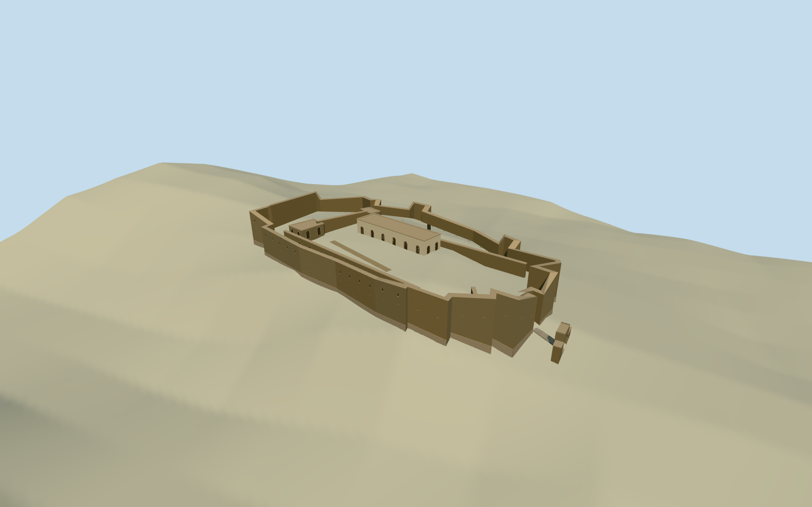

# Citadel of Tripoli

The Citadel of Tripoli on its river ridge, with stepped limestone curtain walls, projecting towers, pointed portals and the courtyard museum wing.

Authoring state: **review-in-qa.json**. Current completion evidence is in [qa.json](qa.json) and the [completion ledger](../../../../qualla-structures/batches/qualla-004.PROGRESS.md).

- [Citadel of Tripoli](https://qualla.com/citadel-of-tripoli/)

Wall heights, minor terrace arrangement, material hues and stone loss vary across the monument and are approximated.

The interior is represented by the entrance passage, open court, aboveground room walls and the exterior of the museum wing.

Build: `node content/worldgen/source/places/sy/sy1/citadel_of_tripoli/models/generate-citadel-of-tripoli.mjs`. Add `--check` to verify exact regeneration. 5992 triangles; 6 materials; no embedded photographs.
