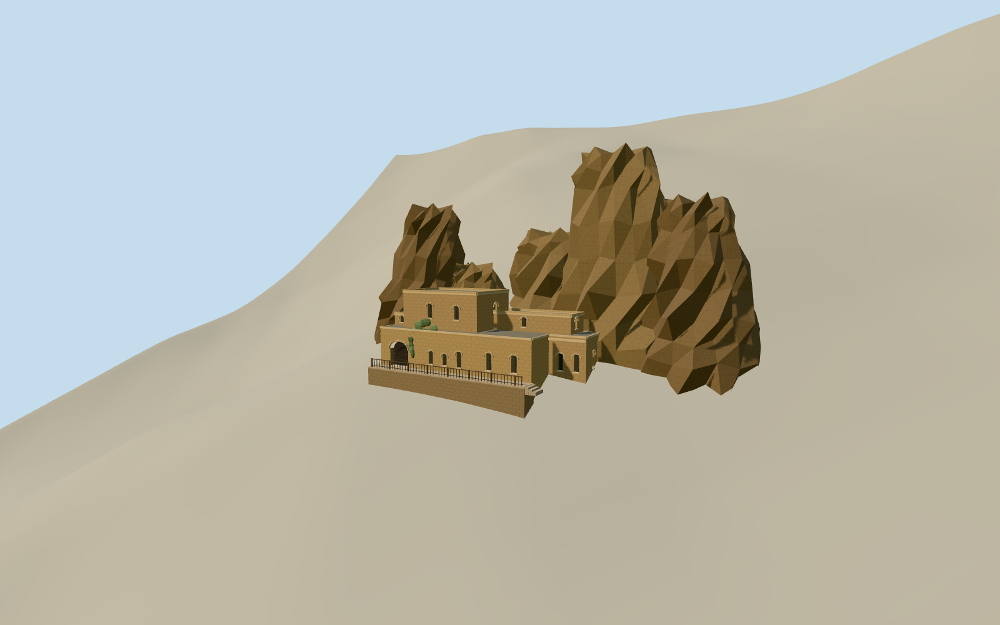

# Gibran Museum

Bsharri’s Gibran Museum, with the golden stepped Mar Sarkis masonry pressed into exposed limestone and set above a narrow valley-facing terrace.

Authoring state: **review-in-qa.json**. Current completion evidence is in [qa.json](qa.json) and the [completion ledger](../../../../qualla-structures/batches/qualla-003.PROGRESS.md).

- [Gibran Museum](https://qualla.com/gibran-museum/)

The exact mapped outline and valley-facing photograph constrain placement. Room heights, hidden roof layout, glazing proportions and the buried walls are estimates.

Local cliff forms and the terrace grade are reconstructed from the photograph, adjacent independent relief and contact margins. The original elevation field is unchanged. The tomb, interiors and paths beyond the immediate terrace are outside the modeled exterior.

Build: `node content/worldgen/source/places/sy/sy1/gibran_museum/models/generate-gibran-museum.mjs`. Add `--check` to verify exact regeneration. 6734 triangles; 6 materials; no embedded photographs.
