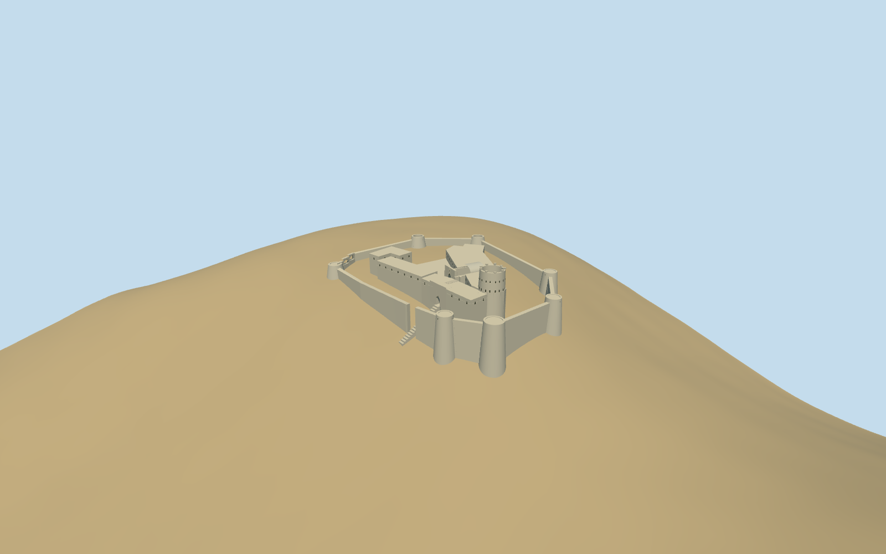

# Margat

Margat basalt fortress: mapped inner ward and open courts, southern round keep, separate pointed chapel portal and cut barrel vault, western dogleg gate, surrounding battered bastions and surviving curtain walls.

## Evidence and reconstruction

Published dimensions and reconstructed details are separated in spec.json. Primary references:

- [Reference](https://www.bme.hu/sites/default/files/csatolmanyok/K%C3%A9p2_4.png)
- [Reference](https://www.burgenwelt.org/syrien/margat/bild1.jpg)
- [Reference](https://cdn.sananews.sy/2025/12/Forteresse-de-Margat-principale.jpg)

Shared basalt, limestone and gravel surfaces; no unique bitmap textures, embedded photographs or borrowed meshes.

## Model and axes

7,669 triangles; 23,007 vertices; 4 material groups; 923,060 bytes. Native bounds: -63.119, -29.958, -101.482 to 88.081, 32.000, 86.337. Source hash: `sha256:348610288e1cf9eb1fe5b28a449729af050567ae9ac608efde9885ff836d6738`.

{"up":"+Y","longitudinal":"+X east","front":"-X western approach; chapel portal is reconstructed facing its western court","origin":"Named PMTiles attraction point; relative height datum from standard viewer elevation"}

PMTiles north-up compound placement; approximate exterior walls and court levels, not a surveyed or traversable castle.

## Reproduce

Run `node packages/worldgen/scripts/generate-additional-landmarks.mjs --ids=N0310` (or add `--check`). The generator preserves manually edited masters by checking their baseline hashes. Import through the standard authored-model workflow with optimization disabled; then capture all QA cameras, including shared-surface views.

## Pending work

- Architectural heights, outer curtains/bastion locations, broken profiles, portal bearing and precise terrain contact are reconstructed from pictures and coarse standard PMTiles, not surveyed.
- Northern settlement, lost fortifications, vegetation, frescoes, room interiors and certified traversable collision are excluded. No claim of complete archaeological or engineering reconstruction.
- Physical laptop and phone frame-rate measurements remain pending.

This bundle follows the medium-fi standard. Medium-fi appearance and geographic fit are reviewed separately. Hash-bound visual acceptance is recorded separately after capture inspection.

## Additional geographic data

© OpenStreetMap contributors; Protomaps; Mapzen/USGS terrain tiles.
