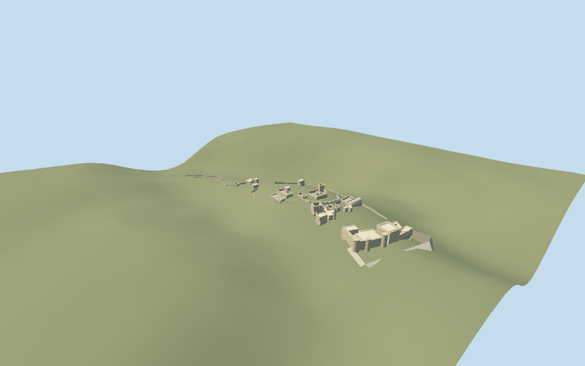

# Citadel of Salah Ed-Din

Syrian citadel exterior on its long rocky ridge: square master tower, pillared hall, round front towers, open eastern moat with isolated needle, low western town walls, raised Byzantine ruins, cisterns, Ayyubid courtyard and baths, mosque and square minaret.

## Evidence and reconstruction

Published dimensions and reconstructed details are separated in spec.json. Primary references:

- [Reference](https://www.openstreetmap.org/relation/5579293)
- [Reference](https://s3.amazonaws.com/media.archnet.org/system/publications/contents/6721/original/DPC3576.pdf?1384801256=)
- [Reference](https://whc.unesco.org/document/168916)
- [Reference](https://whc.unesco.org/document/226794)

No third-party geometry, photograph or bitmap texture is embedded. Shared surface graphs come from the central library; vertex tints carry model colors. Glazing uses PBR materials; transparent surfaces are declared per model.

## Model and axes

16,933 triangles; 36,535 vertices; 7 material groups; 1,522,732 bytes. Native bounds: -354.769, -76.667, -78.309 to 394.196, 40.169, 104.233. Source hash: `sha256:75ce0d2438124fc14db9ebbabbd8b2ffe968260fc8d1d912570686c6cceaf43b`.

{"up":"+Y","longitudinal":"+X toward the eastern moat, 24.466 degrees north of east","front":"Master tower and rock-cut ditch toward +X; lower western ward toward -X","origin":"Signed ridge anchor; Y0 decoded405.8169 m working datum, with independently fitted floors."}

Current Q277531 identity is way373964797 v2 after the old relation5579293 was replaced on2026-10-06. Saved outline agrees within0.000614 m and retained mapped features within0.000698 m; old ways373967435/373967436/374965258 are absent. Stable geometry checks horizontal registration, not current conservation state. Heading0.427014283192 at [36.055056392,35.595076267] directs +X east-northeast bearing65.533884 degrees and +Z south-southeast155.533884 degrees; lower western ward -X, Byzantine core midway +X, palace/mosque farther +X, master tower/eastern moat at eastern tip. Actual AKTC aerial, front/rock-cut needle and palace/minaret images and two conservation plans inspected. Representative post-conservation2008–2010 exterior is historical opt-in only, dated2008-01-01 inclusive to2011-03-01 exclusive; later roof collapse/propping/cliff repairs are outside this state. Numeric ground16641 values on8 m grid with working anchor405.8169 m; palace floor19.9364 m and master16.9806 m, western gates independently fitted. Broad source invented ridge slab removed. Only the bounded eight-vertex moat opens host ground, with complete floor/sidewall envelope and adjacent8 m tapered rock shelves. Original moat inner lip lay outside the real mapped curtain and excluded the needle; corrected lip follows eastern boundary and includes isolated needle.30 m depth/outer lip/Byzantine3 m rise remain interpreted.

## Reproduce

Run `node packages/worldgen/scripts/generate-signature-towers.mjs --ids=citadel_of_salah_ed_din` (or add `--check`). The generator preserves manually edited masters by checking their baseline hashes. Import through the standard authored-model workflow with optimization disabled; then capture all QA cameras, including shared-surface views.

## Pending work

- Original320144-triangle /27212528-byte detailed master reproduces at sha256:eb61f0965485bbac558b40961c24e71d0cf5b17691dbbe1d7f23a08cc50c593e from unchanged salah-citadel-model.mjs#salahStudy.build and map-parts.json.
- Current Q277531 identity is way373964797 v2 after the old relation5579293 was replaced on2026-10-06. Saved outline agrees within0.000614 m and retained mapped features within0.000698 m; old ways373967435/373967436/374965258 are absent. Stable geometry checks horizontal registration, not current conservation state. Heading0.427014283192 at [36.055056392,35.595076267] directs +X east-northeast bearing65.533884 degrees and +Z south-southeast155.533884 degrees; lower western ward -X, Byzantine core midway +X, palace/mosque farther +X, master tower/eastern moat at eastern tip. Actual AKTC aerial, front/rock-cut needle and palace/minaret images and two conservation plans inspected. Representative post-conservation2008–2010 exterior is historical opt-in only, dated2008-01-01 inclusive to2011-03-01 exclusive; later roof collapse/propping/cliff repairs are outside this state. Numeric ground16641 values on8 m grid with working anchor405.8169 m; palace floor19.9364 m and master16.9806 m, western gates independently fitted. Broad source invented ridge slab removed. Only the bounded eight-vertex moat opens host ground, with complete floor/sidewall envelope and adjacent8 m tapered rock shelves. Original moat inner lip lay outside the real mapped curtain and excluded the needle; corrected lip follows eastern boundary and includes isolated needle.30 m depth/outer lip/Byzantine3 m rise remain interpreted.
- Eight-meter diagnostic grid samples a coarse public raster;3.8847 m pixel interval is not verified native resolution or surveyed accuracy. Datum/vintage, canopy/building contamination and historic2008–2010 terrain are unknown. No outlier filter is used.
- Historic documented conservation-era appearance is dated opt-in, valid2008-01-01 inclusive to2011-03-01 exclusive. Conservative interval follows1999–2007 conservation and precedes conflict; exact photo dates/daily changes unknown.2025 propping, cliff repairs and changed entrance roofing are not claimed.
- Closed component floors fit highest occupied ground plus0.25 m; palace compound shares one floor. Byzantine core keeps an interpreted3 m rise above palace. Architecture heights remain original relative interpretations. Bounded foundation skirts extend4 m below sampled terrain; broad original invented whole-ridge slab is removed.
- Moat uses a bounded ground opening and complete floor/sidewall envelope. Inner lip follows mapped eastern castle edge; outer lip,30 m depth and needle proportions are interpreted from primary conservation plans/photos. The coarse terrain cannot establish exact cliffs or road grade; model placement is not surveyed or fully walkable.
- Accepted medium-fi conserved/ruined exterior includes square master tower, pillared hall, three round eastern towers, open rock-cut moat/isolated needle, broken western town curtains/two gate towers/chapel, Byzantine core, cisterns, Ayyubid roofless rooms/courtyard, baths, mosque/square minaret. Exact ruin heads, capitals/vaults/chamber openings/masonry scars and vegetation are interpreted. Nearby modern village, full interior/collision/navigation, modern road furniture and an intact medieval drawbridge are excluded.
- Six common graphs supply weathered/raw/ordinary limestone, gravel, lime plaster and painted metal. Dark recesses stay local. Ordinary masonry remains in preserved detailed recipe but common surfaces provide it in independent browser derivative; no embedded images. Skyline bakes common linear means in one draw.
- Conservation publication images are linked research only; no photographic pixels redistributed.2025–2026 exact conditions are not claimed. Coarse terrain cannot establish exact ancient bedrock/road grades or historic heights. Physical laptop/phone measurements pending.

This bundle follows the medium-fi standard. Medium-fi appearance and geographic fit are reviewed separately. Hash-bound visual acceptance is recorded separately after capture inspection.

## Additional geographic data

Map data © OpenStreetMap contributors, ODbL-1.0. Original authored geometry informed by cited conservation plans; no third-party images or meshes embedded.
