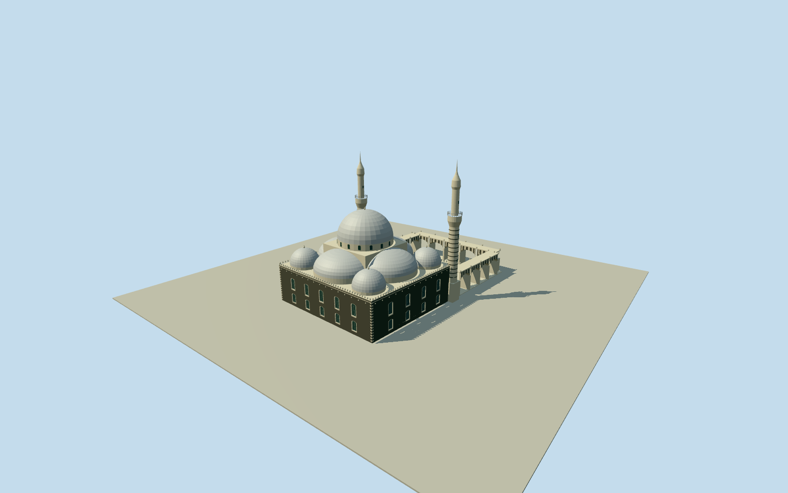

# Khalid ibn al-Walid Mosque

Whole Khalid ibn al-Walid Mosque Q4022343: entire mapped prayer hallway1235112950/four nativecorners and both tagged minaretcornernodes, central silver dome, lower halfdomes and corner domes, basalt exterior with pale limestone window surrounds/quoins, slender twin minarets with galleries/finials, north-facing open ablaq arcade and bounded three-sided courtyard arcades. Native named worship precinctway150212190 is identity/acquisition context, not an invented building footprint. Eastern ancillaryway1235112951 retained in nativecontext but separately identified, not silently substituted for the hall. Exclude surrounding gardens, park monument, roads/landscape, people, signage and private tomb/prayer interior. Hidden roof/courtyard sections and precise current restored finish are original bounded estimates from three clear2006-09 published Qualla originals and mapped surviving hall.

Authoring state: **review-in-qa.json**. Current completion evidence is in [qa.json](qa.json) and the [completion ledger](../../../../qualla-structures/batches/qualla-002.PROGRESS.md).

- [Khalid ibn al-Walid Mosque](https://qualla.com/khalid-ibn-al-walid-mosque/)

Exact named worshipprecinctway150212190/Q4022343 contains mapped whole prayerhallway1235112950. Its two northern cornersnodes11464728728/11464728729 are explicitly tagged minarets; allfour hall corners retained. Hallmetric frame follows its native north edge, +Xeast/+Zsouth externalframe/heading0; northern courtyard extends within the named precinct as a bounded intrinsic architectural estimate. Precinct9control boundary is not extruded as a building, and separate eastern ancillaryLway1235112951 is not mistaken for mainhall. No copyrighted modern plan/pixels copied.

Independent400mfield/16641samples/two original rawTerrariumtiles frozen before any floor/geometry/sectionchoice. FixedSWproviderdatum500.642m/floor+2.5m is a single unsurveyed structural reference, not terrainfitting. Nativehall36.63x32.86m/four exactcorners andtwo tagged northernminarets retained. Body10.8m, central steppedsquare17.4m/drum17.4..19.2m/main pale dome7.8mradius+7.6mrise, fourlower outwardhalfdomes on continuous supporting drums andfour cornerdomes; small domed sideprojection. Minaretgallery23.7..25.2m/narrow uppershaft32.4m/cap37.2m/finial40.3m are bounded originalphotoproportion estimates. Court northlimit-47m/three surrounding lowarcades are bounded intrinsicarchitectural estimates within namedprecinct, not an exactmapped modernplan. Windows/finial/balustradecensus/hiddenroof andcurrentrestoredfinish estimated. No park/landscapebody/artificialterrainplate or privateinterior. Grid/PNG/rawtilesunchanged; exacthostcontact unresolved/replacementfalse.

Whole mapped prayerhall and both tagged northern minarets, pale central dome/four lower halfdomes/four cornerdomes, small side dome and north courtyard open ablaq arcades. Exact four native corners retained at every LOD. Named worship precinct and eastern ancillary footprint remain identity/context controls, not an extruded park boundary or substituted building.

Three exact cleared published Qualla originals with creator PD-user dedications by Zozo2kx, Cloj and Anamnesis personally inspected/nativeSHA1matched. Explicit CC-BY-SA photograph under misleading PD-architecture label excluded without pixels. No supplemental imagery, generated photograph, photo textures or source media/body/metadata repair.

Upper roof/dome sections, heights, window/merlon census, hidden rear, minaret balconies/finials, courtyard arcade limits and small side projection are original bounded photo estimates; later restored finish/fixtures unsurveyed. Private prayer/tomb interior, park monument, gardens and surrounding roads/landscape excluded.

Independent400m field/16641samples/two rawtiles frozen before all structural sections. Fixed500.642m provider datum and+2.5m structural floor are unsurveyed reference estimates. Source ground/height PNG/rawtiles unchanged; exact footing/threshold/courtyard host contact unresolved, geographicpreview/replacementfalse. Flat render ground is a separate diagnosticfixture.

Build: `node packages/worldgen/scripts/generate-authored-places.mjs --ids=khalid_ibn_al_walid_mosque`. Add `--check` to verify exact regeneration. 18348 triangles; 5 materials; no embedded photographs.
